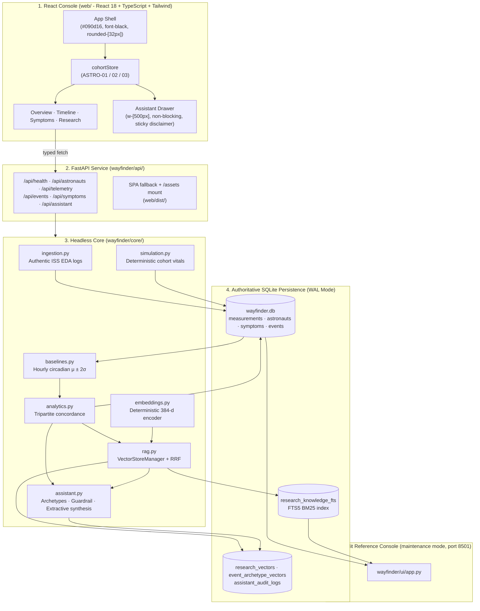

# WAYFINDER V3: Evidence-Grounded Local Health Intelligence

## System Overview

WAYFINDER is an offline-first operational health intelligence and personalized environmental exposure analysis workstation designed for long-duration human spaceflight (e.g., International Space Station expeditions and lunar/Mars transit missions).

Version 3 upgrades the platform from a Streamlit prototype into a decoupled **Evidence-Grounded Local AI** system:

- A **FastAPI** application service (`wayfinder/api/`) exposes cohort-scoped telemetry, events, symptoms, and contextual assistant endpoints.
- An **in-process embedded vector store** (`wayfinder/core/rag.py`) fuses 384-dimensional float32 passage embeddings with SQLite FTS5 BM25 through Reciprocal Rank Fusion (RRF).
- A **React 18 + TypeScript + Vite + Tailwind** console (`web/`) implements the high-end minimalist Perplexity aesthetic with a synchronized 4-lane Plotly WebGL timeline and a non-blocking 500 px evidence drawer.
- A **deterministic epistemic guardrail** (`wayfinder/core/assistant.py`) blocks causal/clinical language and falls back to an extractive synthesizer whenever the optional local Ollama model is offline.

The system correlates authentic NASA Environmental Data Application (EDA) telemetry against personalized astronaut circadian baselines, autonomic vital dynamics, and crew symptom reports to deliver explainable, non-causal clinical decision support without cloud dependencies or real-time internet connectivity.



---

## Quick Start

### Single-command launch (FastAPI + compiled React console)

```powershell
# From the repository root
python -m pip install -r requirements.txt
python -m wayfinder.provision      # one-time: seed the 14-day Expedition 71 dataset
python -m wayfinder.server
```

`wayfinder.provision` tiles the authentic EDA sample across MET Days 120-134,
simulates 5-minute HR / RMSSD / SpO2 / core-temperature streams for all three
crewmembers, injects the Day 127 cabin excursion and crew headache, evaluates
concordance events, and rebuilds the FTS index. It backs up the existing
database to `data/wayfinder.db.bak-<timestamp>` before reseeding; pass
`--keep-existing` to append or `--db <path>` to target another file.

Skipping this step on a partially seeded database leaves `ASTRO-02` and
`ASTRO-03` without simulated vitals, so switching cohorts renders empty KPI
sparklines and empty timeline lanes.

Then open **http://localhost:8000**:

| URL | Purpose |
| :--- | :--- |
| `http://localhost:8000/` | React console · Overview |
| `http://localhost:8000/timeline` | Synchronized 4-lane WebGL timeline |
| `http://localhost:8000/symptoms` | Cohort-bound symptom logging |
| `http://localhost:8000/research` | Hybrid vector research workspace |
| `http://localhost:8000/api/health` | Service health, version, vector chunk count |
| `http://localhost:8000/docs` | OpenAPI / Swagger UI |

The SPA is served from `web/dist/`, which is checked in. If the directory is absent or deleted, `create_app()` serves a diagnostic JSON payload describing how to rebuild it.

### Frontend development (hot reload)

```powershell
# Terminal 1 — API service
python -m wayfinder.server

# Terminal 2 — Vite dev server on :5173 with /api proxied to :8000
cd web
npm install
npm run dev
```

Production rebuild:

```powershell
cd web
npm run tsc      # typecheck only
npm run build    # tsc + vite build → web/dist/
```

### Streamlit reference console (maintenance mode)

```powershell
python -m streamlit run wayfinder/ui/app.py --server.port 8501
```

The V2 console remains fully functional on **http://localhost:8501** for visual regression comparison against the React console.

---

## Subdirectories & System Boundaries

- [wayfinder](./wayfinder/README.md): Primary Python system codebase.
  - [wayfinder/core](./wayfinder/core/README.md): Headless computational core — Pydantic V2 models, SQLite WAL persistence, EDA ingestion, deterministic cohort simulation, circadian baselines, tripartite concordance analytics, deterministic embeddings, hybrid vector retrieval, epistemic guardrail, and extractive synthesis. Must never import Streamlit, Plotly, FastAPI, or React code.
  - [wayfinder/api](./wayfinder/api/README.md): FastAPI application service — lifespan-scoped `StorageManager` and `VectorStoreManager`, cohort-scoped REST routers, persisted assistant audit logs, CORS, and guarded SPA mount.
  - [wayfinder/ui](./wayfinder/ui/README.md): Preserved Streamlit reference console on port 8501.
    - [wayfinder/ui/components](./wayfinder/ui/components/README.md): Provenance badges, calibration indicators, severity markers, and Plotly WebGL 4-lane timeline charts.
    - [wayfinder/ui/views](./wayfinder/ui/views/README.md): Streamlit view controllers for overview, timeline, symptoms, and research.
- `web/`: React 18 + TypeScript + Vite + Tailwind presentation console (Overview, Timeline, Symptoms, Research, Assistant Drawer, Zustand stores, typed API client).
- `data/`: Authentic EDA sample, research corpus, seed embeddings, and the authoritative SQLite database.
- `docs/`: Technical designs, execution plans, and blueprints.

---

## Global Invariants

- **Offline Autonomy:** The platform runs 100% offline. No external vector database, embedding API, or cloud service is used at runtime. The bundled `data/research_embeddings_seed.json` guarantees cold-start retrieval on air-gapped systems.
- **Strict Decoupling:** `wayfinder.core` never imports Streamlit, Plotly, FastAPI, or frontend modules. `wayfinder.api` and `wayfinder.ui` are independent presentation adapters over the same core.
- **Cohort Isolation:** All vitals, circadian baselines, symptom logs, concordance events, and assistant explanations are partitioned strictly by `astronaut_id` (`ASTRO-01`, `ASTRO-02`, `ASTRO-03`). Switching cohorts closes the assistant drawer and purges the active explanation so evidence can never bleed across crewmembers.
- **Epistemic Provenance Integrity:** Every metric and analytical finding carries an explicit data provenance tag:
  - `● AUTHENTIC NASA EDA` (Cyan): Empirical telemetry measured on orbit.
  - `◌ SIMULATED VITALS` (Amber dashed): Mathematically generated circadian and exertion models.
  - `▲ CREW REPORTED` (Violet): Subjective clinical observations logged by crew.
- **Deterministic Epistemic Guardrail:** Every assistant response is scanned for prohibited causal and clinical-intervention stems (`cause*`, `prove*`, `diagnos*`, `prescri*`, `treat*`, `therap*`, `cure*`, `remedy`). A trip fails over to the extractive synthesizer and is persisted with `tripwire_triggered = 1`.
- **Mathematical Safety & Baseline Floors:** Circadian baselines apply physiological variance floors ($\sigma_{\min, \text{HR}}=1.0\,\text{bpm}, \sigma_{\min, \text{RMSSD}}=2.0\,\text{ms}, \sigma_{\min, \text{Temp}}=0.10\,^\circ\text{C}, \sigma_{\min, \text{SpO}_2}=0.50\,\%$) to eliminate division-by-zero. Profiles with $< 3$ distinct calendar days ($|K| < 36$) remain `CALIBRATING` with widened priors.
- **Non-Causal Clinical Decision Support:** All analytical summaries, concordance classifications, assistant answers, and event rationales carry a mandatory non-causal decision-support disclaimer and never assert medical diagnosis.

---

## Global Side Effects

- **Authoritative Persistence:** Reads and writes the local SQLite database at `data/wayfinder.db` in thread-safe WAL mode with foreign key constraints.
- **Vector Persistence:** Idempotently creates `research_vectors`, `event_archetype_vectors`, and `assistant_audit_logs`, then seeds 13 canonical research chunks and 4 event archetypes on first initialization.
- **Telemetry Ingestion:** Reads authentic NASA ISS EDA CSV telemetry from `data/sample_eda_iss_co2_temp.csv`.
- **Offline Search:** Maintains the SQLite FTS5 index `research_knowledge_fts` over `data/research_corpus/`.
- **Network Listeners:** FastAPI/uvicorn binds `0.0.0.0:8000`; the optional Streamlit console binds `8501`.

---

## System Verification

```powershell
# Full suite (209 tests: backend, API, vectors, assistant, React-serving, E2E)
python -m pytest tests/ -q

# Zero-dependency dossier compiler harness (Node 24 native TypeScript)
node web/src/features/dossier/dossierCompiler.test.ts

# Foundation + V2 regression scenarios
python -m pytest tests/test_scenario_day127.py tests/test_scenario_v2.py -v

# V3 retrieval, assistant, and Day 127 1-click evidence scenario
python -m pytest tests/test_vectors.py tests/test_assistant.py tests/test_api.py tests/test_scenario_v3.py -v

# Frontend gates
cd web
npm run tsc
npm run build
```

`tests/test_scenario_v3.py` provisions the 14-day Expedition 71 mission once, verifies the Day 127 Commander Vance $P_{\text{CO}_2}$ excursion and autonomic shift ($Z_{HR} \ge +2.2$, $Z_{RMSSD} \le -2.1$), asserts exactly one `INVESTIGATE` event, exercises `POST /api/assistant/explain` end to end, checks `HRR-CO2-001` citations and the persisted audit row, verifies the causal-text tripwire, and confirms cohort isolation.

---

## Key Capabilities & Version 3 Enhancements

1. **Decoupled Application Service:** `python -m wayfinder.server` starts one process that serves both the REST API and the compiled React SPA. The V2 Streamlit console remains available on port 8501.
2. **Embedded Vector RAG:** 384-dimensional float32 embeddings are stored as SQLite BLOBs and cached on startup in a contiguous `corpus_matrix`, making dense cosine search a NumPy dot product with empty-store protection and thread-safe `reload_corpus()`.
3. **Hybrid Reciprocal Rank Fusion:** Dense cosine and FTS5 BM25 rankings are fused with $RRF(d) = \sum_{m} \mathbb{I}(d \in \text{topK}_m)/(60 + r_m(d))$, normalized to calibrated $[0\%, 100\%]$ relevance and reported with the active retrieval mode (`HYBRID_RRF`, `DENSE_COSINE`, or `LEXICAL_BM25`).
4. **Contextual Knowledge Assistant:** `POST /api/assistant/explain` resolves canonical event archetypes, retrieves grounded NASA passages, synthesizes observed dynamics, scientific context, and study caveats, then persists every interaction to `assistant_audit_logs`.
5. **Resilient Local LLM + Instant Fallback:** Ollama is probed fast (1.5 s) and called with a 15 s timeout; offline, malformed JSON, or a guardrail trip transparently falls back to the deterministic extractive synthesizer without blocking the UI.
6. **React 18 Presentation Console:** Perplexity-inspired dark theme (`#090d16`, `#0f172a`, `rounded-[32px]`, `font-black`), cohort switcher, four views, typed API client, Zustand stores, and a 500 px non-blocking evidence drawer with a sticky disclaimer.
7. **Synchronized 4-Lane WebGL Timeline:** One shared x-axis across cabin atmosphere, cardiovascular/autonomic, thermoregulation/oxygenation, and deviation/concordance lanes; dual secondary Y-axes, stepped $\mu \pm 2\sigma$ ribbons, severity ribbons, symptom markers, gap shading, LTTB decimation, and `Plotly.purge` on unmount.
8. **Preserved V2 Analytics:** Multi-astronaut cohort switching, inverse RMSSD autonomic dynamics, sparse-history calibration guards, pre-severity interval coalescence, and symmetric tripartite concordance continue to run unchanged behind the new API.

---

## Version 5: Perspectives, Clinical Dossier & Deep Space Comms

The V5 package closes the remaining PRD requirements with three client-side capabilities. No new backend service, npm runtime dependency, or external PDF/authentication library is introduced.

### 1. Multi-role perspective switcher (PRD Section 4)

The header pill `[ 🧑‍🚀 Astronaut | 🩺 Flight Surgeon ]` persists to `localStorage` (`wayfinder_active_role`).

- **Astronaut perspective:** cohort selection is locked to `ASTRO-01` (Commander Vance) for medical privacy; the Overview becomes three glanceable cards (cabin environment, personal autonomic status, immediate action plan) plus a one-tap symptom grid; simulation sandboxes, EDA scrubbers, threshold sliders, and risk matrices are hidden. Navigating to Timeline or Research shows an ambient "diagnostic controls minimized" banner.
- **Flight Surgeon perspective:** full diagnostic depth, multi-cohort switching, anomaly injection, event sign-off, and dossier export.
- If a sandbox anomaly is active, both perspectives show the global `[⚠️ SIMULATION OVERRIDE ACTIVE]` banner with a one-tap reset, so synthetic training telemetry can never be mistaken for flight data.

### 2. Structured clinical investigation dossier (PRD FR-12)

Open **Dossier** in the header (self-fetching) or **Export Investigation Dossier** on the surgeon Overview (zero-network, preloaded).

The pure compiler (`web/src/features/dossier/dossierCompiler.ts`) projects astronaut metadata, baseline σ deviations, unit-annotated vital and environmental snapshots, symptom history, concordance events, verified flight-rule checklists, provenance-tagged references, and the mandatory non-causal disclaimer. Causal language in symptom notes is flagged inline (`nonCausalFlag`) and never aborts compilation.

Export modes:

| Action | Behaviour |
| :--- | :--- |
| Copy Markdown | GFM dossier to the clipboard |
| Download .md | `WAYFINDER_Dossier_{reportId}.md` |
| Print / Save PDF | Injects semantic HTML into `#printable-dossier-root`, then native `window.print()` |
| Downlink via Comms | Enqueues a `DOSSIER_TRANSMIT` packet in the ground outbox |

The zero-dependency harness validates 40 assertions across sigma math, units, guardrails, and both templates: `node web/src/features/dossier/dossierCompiler.test.ts`.

### 3. Deep space communications & outbox simulator (PRD FR-11)

The header chip (`AOS · Real-time`, `AOS · 3.5m Delay`, `LOS · Deep Space Silence`) opens the comms controller:

- AOS / LOS segmented link control; LOS freezes the in-flight packet mid-countdown.
- Astrodynamic presets: ISS Orbit (0 s), Lunar Gateway (1.3 s), Mars Opposition (210 s), Mars Conjunction (1,290 s), plus a 0–1,440 s custom slider.
- Time warp: `1x`, `10x`, `60x`, `Instant Delivery`.
- Ground outbox: FIFO queue, countdown bars, status chips, expandable JSON payloads, and delivered-packet flushing.

**Local writes never wait.** Symptom reports and event acknowledgements commit to SQLite through FastAPI first; only on promise success does the UI enqueue a ground packet. During LOS the packet buffers in the outbox, and `SymptomsView` shows the dual confirmation `[✓ Recorded Locally to Station Log · 🛰️ Queued in Ground Outbox]`.

---

## Directory Layout

```
D:\nasaResearch/
├── data/
│   ├── sample_eda_iss_co2_temp.csv      # Authentic 72-hour ISS EDA dataset with CO2 excursion
│   ├── research_embeddings_seed.json    # 13 passage chunks + 4 archetype vectors (384-d float32)
│   ├── wayfinder.db                     # Thread-safe SQLite database (WAL mode, foreign keys)
│   └── research_corpus/                 # Curated NASA spaceflight research publications
├── docs/
│   ├── designs/
│   │   ├── wayfinder_v1.md              # Version 1 Technical Design Document
│   │   ├── wayfinder_v2.md              # Version 2 Technical Design Document
│   │   ├── wayfinder_v3.md              # Version 3 Approved Technical Design Document
│   │   └── SITEMAP.md                   # Documentation sitemap
│   └── tickets/
│       ├── v1_execution_plan.md
│       ├── v2_execution_plan.md
│       └── v3_execution_plan.md         # 27 tickets across 6 epics
├── tests/
│   ├── conftest.py
│   ├── test_storage.py                  # Persistence, migrations & cohort isolation
│   ├── test_ingestion.py                # EDA ingestion & STP conversion
│   ├── test_simulation.py               # Deterministic multi-day vitals / HRV
│   ├── test_baselines.py                # Hourly circadian bins & Z-scores
│   ├── test_analytics.py                # Concordance & interval coalescence
│   ├── test_rag.py                      # Offline FTS5 BM25 retrieval
│   ├── test_vectors.py                  # Vector storage, matrix cache, latency
│   ├── test_assistant.py                # Archetypes, guardrail, Ollama fallback
│   ├── test_api.py                      # FastAPI routes, SPA serving, audit logs
│   ├── test_components.py               # Streamlit badges, charts, LTTB
│   ├── test_models.py                   # Pydantic models & serialization
│   ├── test_scenario_day127.py          # Day 127 single-astronaut harness
│   ├── test_scenario_v2.py              # 14-day Expedition 71 harness
│   └── test_scenario_v3.py              # V3 1-click evidence + guardrail E2E
├── web/                                 # React 18 + TypeScript + Vite + Tailwind console
│   ├── dist/                            # Compiled production SPA served by FastAPI
│   ├── index.html
│   ├── package.json
│   ├── tailwind.config.js
│   ├── vite.config.ts                   # Dev proxy /api → http://localhost:8000
│   └── src/
│       ├── App.tsx                      # Shell, role switcher, comms chip, cohort lock
│       ├── features/
│       │   ├── comms/                   # CommsStatusChip, CommsModal (AOS/LOS + outbox)
│       │   ├── dossier/                 # Types, pure compiler, templates, DossierModal, test
│       │   └── shared/                  # RoleGate · SurgeonOnly · AstronautOnly
│       ├── stores/                      # cohortStore, assistantStore, timelineStore, roleStore, commsStore
│       ├── components/
│       │   ├── OverviewView.tsx         # KPIs, concordance banner, Explain trigger
│       │   ├── TimelineView.tsx         # 4-lane WebGL timeline, ribbons, purge
│       │   ├── SymptomsView.tsx         # Structured symptom form + history
│       │   ├── ResearchView.tsx         # Hybrid search workspace
│       │   ├── AssistantDrawer.tsx      # 500 px non-blocking drawer
│       │   └── EvidenceCard.tsx         # Scientific evidence card
│       ├── lib/format.ts
│       ├── services/api.ts              # Typed API client
│       ├── stores/                      # cohortStore, assistantStore, timelineStore
│       └── types/api.ts
├── wayfinder/
│   ├── __init__.py
│   ├── server.py                        # CLI entry point → uvicorn :8000
│   ├── api/                             # FastAPI application service
│   │   ├── deps.py
│   │   ├── server.py                    # create_app(), CORS, lifespan, SPA fallback
│   │   └── routes/                      # health, astronauts, telemetry, events, symptoms, assistant
│   ├── core/                            # Headless Python core (no UI imports)
│   │   ├── models.py                    # Pydantic V2 schemas & enums
│   │   ├── storage.py                   # SQLite WAL + idempotent migrations & seeding
│   │   ├── ingestion.py                 # ISS EDA parser & quality classifier
│   │   ├── simulation.py                # Multi-day vitals simulator
│   │   ├── baselines.py                 # Hourly circadian baseline engine
│   │   ├── analytics.py                 # Tripartite concordance & coalescence
│   │   ├── embeddings.py                # Deterministic 384-d text encoder
│   │   ├── rag.py                       # VectorStoreManager, dense + RRF retrieval
│   │   └── assistant.py                 # Archetypes, guardrail, extractive synthesis
│   └── ui/                              # Streamlit reference console (maintenance mode)
│       ├── app.py
│       ├── components/
│       └── views/
├── GLOSSARY.md
├── PRD.md
└── requirements.txt
```

---

## Expedition 71 (Day 120–134) Mission Walkthrough

1. Launch the V3 console: `python -m wayfinder.server`, then open **http://localhost:8000**.
2. Select **`ASTRO-01` (CDR M. Vance)** in the cohort switcher.
3. Open **Timeline** to inspect the four synchronized lanes around Day 127 02:15 UTC:
   - *Lane 1 — Cabin atmosphere:* $P_{\text{CO}_2}$ excursion in Node 2 with communication-gap shading.
   - *Lane 2 — Cardiovascular/autonomic:* elevated HR and suppressed RMSSD outside their stepped $\mu \pm 2\sigma$ ribbons.
   - *Lane 3 — Thermoregulation/oxygenation:* core temperature and $\text{SpO}_2$ with envelopes.
   - *Lane 4 — Deviation/concordance:* z-scores, severity ribbons, and the crew symptom diamond.
4. Return to **Overview** and press **Explain with Evidence** on the `INVESTIGATE` concordance banner:
   - The 500 px drawer slides in without blocking the chart.
   - Cited Scientific Evidence Cards reference `HRR-CO2-001` and the wider NASA corpus.
   - The sticky footer shows the mandatory non-causal disclaimer; observed dynamics, scientific context, and study caveats are separated.
5. Switch to **`ASTRO-02` (FE-1 Dr. S. Patel)**:
   - The drawer closes and purges immediately, the timeline reloads Dr. Patel's endurance baseline (resting HR 52 bpm, RMSSD 75 ms, phase shift −1.0 h), and no `INVESTIGATE` events appear — demonstrating cohort isolation.
6. Open **Research** and search, for example, `cabin CO2 headache physiological susceptibility` to exercise hybrid vector + BM25 retrieval directly.
