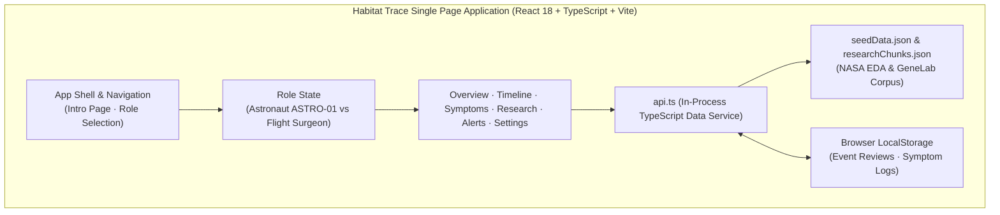

# Habitat Trace: Evidence-Grounded Spaceflight Health Intelligence

## System Overview

Habitat Trace is an offline-first operational health intelligence and personalized environmental exposure analysis workstation designed for long-duration human spaceflight (e.g., International Space Station expeditions and lunar/Mars transit missions).

The system is built as a **100% Pure TypeScript + React 18 + Vite** application:
- **Zero Python Dependencies:** Runs entirely in modern browsers or static hosting environments (Vercel, Netlify, Cloudflare Pages, GitHub Pages) without needing a separate backend server.
- **Client-Side Telemetry & Research Engine:** Centralized typed data service (`src/services/api.ts`) correlates authentic NASA Environmental Data Application (EDA) telemetry against personalized astronaut circadian baselines, autonomic vital dynamics, and crew symptom reports.
- **Epistemic Guardrails & Decision Support:** Implements deterministic extractive literature synthesis, NASA flight rules checklists, and non-causal decision support disclaimers.
- **Astronaut vs. Flight Surgeon Gating:** Tailored field mission interface for individual astronauts and full 6-view clinical expedition oversight for flight surgeons.
- **High-Performance Telemetry Visualization:** Synchronized multi-lane Plotly WebGL timelines, 3D biometric card canvases, and one-click clinical health report PDF exports.

---

## Quickstart

### Prerequisites
- Node.js 18+
- npm or yarn

### Installation & Development
```bash
# Install dependencies
npm install

# Start local development server
npm run dev
```

Visit [http://localhost:5173](http://localhost:5173) in your browser.

### Production Build
```bash
# Typecheck and build static production bundle
npm run build

# Preview production build locally
npm run preview
```

---

## Hosting on Vercel

The application is pre-configured for seamless single-click deployment on Vercel:
1. Push repository to GitHub.
2. Import project on [Vercel](https://vercel.com).
3. Framework Preset: **Vite** (detected automatically via `vercel.json`).
4. Build Command: `npm run build`
5. Output Directory: `dist`
6. Deploy!

No environment variables or serverless Python runtimes are required.

---

## System Architecture



---

## Operational Features

1. **Role-Based Experience:**
   - **Field Mission (Astronaut):** Focused biometrics, circadian status, personalized vitals, and rapid symptom logging locked to individual crew profile.
   - **Medical Ops (Flight Surgeon):** Full expedition cohort monitoring, cross-correlation timelines, flight rule checklists, and anomaly triage.
2. **Deterministic Concordance:**
   - Detects exposure correlation between environmental excursions (e.g., cabin PCO2 spike) and physiological vitals (e.g., HR acceleration, RMSSD depression).
3. **NASA Flight Rules Integration:**
   - Direct procedural checklists for `FR-ECLSS-001` (CO2 hypercapnia), `FR-CDRA-002` (CDRA desiccant regeneration), and `FR-EVA-003` (autonomic strain).
4. **Epistemic Decision Support:**
   - Strict non-causal guardrails ensuring telemetry correlation is never presented as definitive medical causation without ground flight surgeon review.
