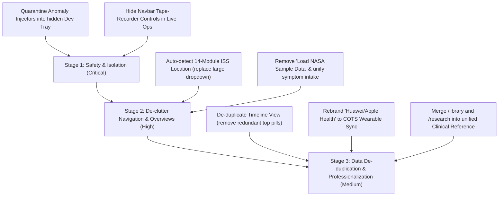

# HabiTrack UI/UX & Clinical Workflow Risk Audit
**Target Audience:** Development & Design Team  
**Evaluation Perspective:** Crewmembers in Orbit (Astronauts with microgravity cognitive load) & Mission Flight Surgeons (Ground Control console operations)  
**Date:** November 2026

---

## Executive Summary

The HabiTrack application provides deep clinical and environmental intelligence. However, several elements introduce **clinical safety risks**, **cognitive friction**, and **operational confusion** because prototype test harnesses and consumer demo features are currently mingled with mission-critical flight interfaces.

This document categorizes and ranks all complex UI/UX elements, data presentations, and features from **Highest Risk (Critical)** to **Lowest Risk (Low)**, complete with root cause analyses, operational impact, and recommended developer fixes.

---

## Risk Hierarchy Matrix

| Rank | Severity | Element / Concept | Primary File(s) | Impact Area |
| :---: | :---: | :--- | :--- | :--- |
| **1** | **CRITICAL** | Simulation Anomaly Injectors Exposed in Production Settings | `src/features/settings/SettingsView.tsx` | Patient Safety / Misdiagnosis |
| **2** | **CRITICAL** | Pinned Navbar Simulation Tape-Recorder Controls | `src/components/NavbarMissionControl.tsx` | Operational Clutter / Immersion |
| **3** | **HIGH** | 14-Module ISS Spatial Selector Forcing Manual Navigation | `src/features/topology/SpacecraftModuleSelector.tsx` | High Cognitive Friction in Zero-G |
| **4** | **HIGH** | Fragmented Symptom Intake & "Load NASA Sample Data" Button | `src/components/SymptomsView.tsx` | Clinical Data Integrity |
| **5** | **MEDIUM-HIGH** | Triple-Duplicated Telemetry Readouts on Timeline View | `src/components/TimelineView.tsx` | Visual Exhaustion / Plot Overload |
| **6** | **MEDIUM** | "Huawei Health" vs "Apple Health" Brand Inconsistency | `src/components/HuaweiHealthPanel.tsx`, `HealthImportModal.tsx` | Clinical Credibility / Provenance |
| **7** | **MEDIUM-LOW** | Redundant Reference Systems (`/library` vs `/research`) | `src/features/library/LibraryView.tsx`, `ResearchView.tsx` | Feature Bloat / Navigation Confusion |
| **8** | **LOW** | Overcrowded Global Header with 10+ Badges and Controls | `src/App.tsx` | Responsive Breakpoints / Glanceability |

---

## Detailed Risk Breakdown (Highest to Lowest)

### 1. [CRITICAL RISK] Simulation Anomaly Injectors Exposed in Production Settings
* **Location:** [src/features/settings/SettingsView.tsx](file:///d:/HabiTrack/src/features/settings/SettingsView.tsx#L98-L126)
* **What it does:** Allows users to click buttons like *"Inject CO₂ Pocket Spike (4,350 PPM)"*, *"Inject Thermal Loop Excursion"*, and manual `+/-` controls that artificially alter resting heart rate and SpO₂ baselines.
* **Why it's hazardous:**
  * In an operational setting, live biomedical telemetry and synthetic simulation injections are mingled without strict visual or cryptographic isolation boundaries.
  * A flight surgeon or astronaut reviewing alerts could confuse an unacknowledged manual injector state with an actual life-support or cardiac emergency.
* **Recommended Team Fix:**
  * Quarantine all anomaly injection and mock biometric tuning controls into a hidden **Developer / Demo Tray** (e.g., triggered only via `Ctrl+Shift+D` or an explicit `?demo=true` query parameter).
  * In normal flight mode, the Settings page should only display read-only crew biomedical thresholds and local user preferences (metric/imperial units, sound alerts).

---

### 2. [CRITICAL RISK] Pinned Navbar Simulation Tape-Recorder Controls
* **Location:** [src/components/NavbarMissionControl.tsx](file:///d:/HabiTrack/src/components/NavbarMissionControl.tsx#L32-L80) & [src/App.tsx#L447](file:///d:/HabiTrack/src/App.tsx#L447)
* **What it does:** Pinned permanently beneath the header on every view, displaying Play, Pause, Reset, 1×, 2×, 5×, 10× playback speed selectors, custom speed modals, and a Day 1 to Day 180 scrub slider.
* **Why it's hazardous:**
  * Consumes 45–60px of vertical viewport real estate on every single screen.
  * Breaks operational realism: an astronaut on orbit or a flight surgeon monitoring an active shift would never fast-forward their telemetry at 10× or scrub backward across 180 days from the main navbar.
* **Recommended Team Fix:**
  * Hide `NavbarMissionControl` entirely when operating in standard live telemetry mode.
  * If time-travel playback is needed for training debriefs, place it inside an explicit "Post-Flight Mission Replay / Debrief" view rather than pinning it globally to the active cockpit header.

---

### 3. [HIGH RISK] 14-Module ISS Spatial Selector Forcing Manual Navigation
* **Location:** [src/features/topology/SpacecraftModuleSelector.tsx](file:///d:/HabiTrack/src/features/topology/SpacecraftModuleSelector.tsx) & [src/components/OverviewView.tsx#L585](file:///d:/HabiTrack/src/components/OverviewView.tsx#L585)
* **What it does:** Renders a 14-module dropdown segmented by USOS (US) and ROS (Russian) segments, accompanied by directional compartment sub-pills (*Aft, Forward, Overhead, Deck, Port, Starboard*), placed directly above Cabin Environmental Telemetry.
* **Why it's hazardous:**
  * High cognitive burden in zero-g. An astronaut experiencing headache, eye irritation, or nausea should not have to manually locate their module and select directional air diffuser pockets before checking environmental carbon dioxide levels.
  * The station telemetry system should automatically bind environmental sensor feeds to the astronaut’s detected module (derived from crew scheduling or wearable RFID beacon).
* **Recommended Team Fix:**
  * Replace the large selector widget with a compact **Location Chip**:  
    `📍 Node 2 (Harmony) · Auto-detected` with a small `[Change]` link.
  * Reserve manual multi-module cross-inspection exclusively for Flight Surgeons in the environmental diagnostics view.

---

### 4. [HIGH RISK] Fragmented Symptom Intake & "Load NASA Sample Data" Demo Button
* **Location:** [src/components/SymptomsView.tsx](file:///d:/HabiTrack/src/components/SymptomsView.tsx#L58-L155)
* **What it does:** Presents three competing mechanisms for handling symptoms:
  1. A manual 5-field web form (Symptom Code, Severity 1–5 slider, Cabin Location text, Notes).
  2. A diary table with search filters, severity filters, status toggles, JSON export, and a button titled *"Load NASA Sample Data"*.
  3. The conversational Mastra AI Assistant drawer (`AssistantDrawer.tsx`).
* **Why it's hazardous:**
  * Having a button that loads synthetic sample data inside an operational medical diary creates a severe risk of polluting authentic medical records with fake entries.
  * Redundant input methods confuse the crew: astronauts in microgravity do not want to fill out desktop web forms when an AI voice/chat assistant already triages symptoms.
* **Recommended Team Fix:**
  * Remove the *"Load NASA Sample Data"* button from the production UI.
  * Unify symptom entry: route crew symptom reporting through the AI Assistant or a single 1-tap fast logger, while keeping the diary view strictly read-only/auditable for the Flight Surgeon.

---

### 5. [MEDIUM-HIGH RISK] Triple-Duplicated Telemetry Readouts on Timeline View
* **Location:** [src/components/TimelineView.tsx#L828-L902](file:///d:/HabiTrack/src/components/TimelineView.tsx#L828-L902)
* **What it does:** Displays telemetry across three stacked zones:
  1. Top readout pills: Station Telemetry (*CO₂, Temp, Humidity, Radiation*) and Physiological Telemetry (*HR, HRV, SpO₂, Core Temp*).
  2. Middle Plotly chart: Up to 8 interactive time-series traces with crosshairs and spike lines.
  3. Bottom cards: `<PhysiologicalCards />` rendering the identical four vital metrics with baseline deltas.
* **Why it's problematic:**
  * Information redundancy causes visual exhaustion. Showing the exact same numbers three times within one vertical scroll clutters the interface and distracts from anomalous trend detection.
  * The multi-lane Plotly graph is intimidating without progressive disclosure.
* **Recommended Team Fix:**
  * Remove the top static pills.
  * Default the Plotly timeline to the 2 primary excursion streams relevant to the active context (e.g., CO₂ and Heart Rate), letting users toggle additional streams as needed.
  * Let `<PhysiologicalCards />` at the bottom serve as the sole detailed baseline card summary.

---

### 6. [MEDIUM RISK] "Huawei Health" vs "Apple Health" Brand Inconsistency
* **Location:** [src/components/HuaweiHealthPanel.tsx](file:///d:/HabiTrack/src/components/HuaweiHealthPanel.tsx), [src/components/HealthImportModal.tsx](file:///d:/HabiTrack/src/components/HealthImportModal.tsx), and [src/services/huaweiImportService.ts](file:///d:/HabiTrack/src/services/huaweiImportService.ts)
* **What it does:** Displays a panel titled *"Huawei Health Sync"* that actually parses Apple Health `export.zip` files using worker threads and consumer smartwatch badges.
* **Why it's problematic:**
  * In a clinical NASA flight software deployment, referencing commercial consumer phone brands (Huawei vs Apple) damages institutional trust and clinical credibility.
  * Confuses users about what file format or device is expected.
* **Recommended Team Fix:**
  * Rename the feature generically to **"Commercial Wearable Sync (COTS Telemetry)"** or **"Personal Biosensor Import"**.
  * Auto-detect the uploaded ZIP format (Apple Health XML vs Huawei HiHealth CSV) transparently in the background.

---

### 7. [MEDIUM-LOW RISK] Redundant Reference Systems (`/library` vs `/research`)
* **Location:** [src/features/library/LibraryView.tsx](file:///d:/HabiTrack/src/features/library/LibraryView.tsx) and [src/components/ResearchView.tsx](file:///d:/HabiTrack/src/components/ResearchView.tsx)
* **What it does:** Provides two separate navigation items:
  * `/library`: Curated NASA medical flight guides plus a *"NASA Live Search"* tab querying public NASA images and YouTube-style outreach videos.
  * `/research`: Flight Surgeon scientific literature search across the embedded NASA HRR/OSDR corpus.
* **Why it's problematic:**
  * Having two separate navigation links for reference materials splits documentation across arbitrary tabs.
  * The public video/image search in `/library` is consumer public-outreach filler that does not belong in an operational clinical avionics console.
* **Recommended Team Fix:**
  * Remove the public outreach media search tab.
  * Merge curated clinical procedures and research literature RAG into a unified **"Clinical Reference & Flight Rules"** repository.

---

### 8. [LOW RISK] Overcrowded Global Header with 10+ Badges and Controls
* **Location:** [src/App.tsx#L250-L444](file:///d:/HabiTrack/src/App.tsx#L250-L444)
* **What it does:** Packs 11 disparate items into a single top bar:
  1. Logo & App Title
  2. Active View Breadcrumb
  3. Mission Path Switcher (Astronaut vs Flight Surgeon)
  4. Calibration Status Badge
  5. Extractive / Ollama AI Status Badge
  6. Dual UTC / MMT Cockpit Clock
  7. Comms Radio Status Chip
  8. Health Report Generation Button
  9. Locked Astronaut Crewmember Chips
  10. Cohort & Health Refresh Button
* **Why it's problematic:**
  * On laptop screens, tablet viewports, or high-density cockpit displays, the header wraps into multiple disjointed lines or truncates text labels.
* **Recommended Team Fix:**
  * Consolidate secondary status badges (*Calibration*, *Ollama/Extractive Mode*, *Comms*) into a single compact **"System Health" popover / dropdown**.
  * Keep only the essential controls visible in the main bar: Brand, Crew Selector, Role Switcher, and UTC Clock.

---

## Action Plan for the Team

