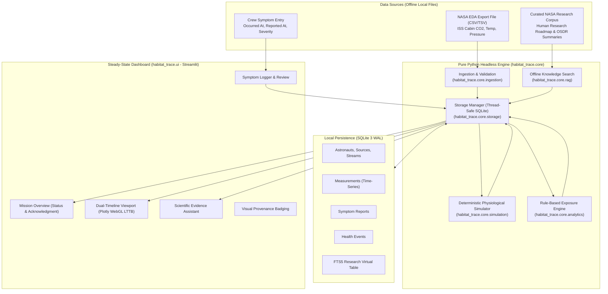

# Technical Design Document: HABITAT TRACE Version 1

* **Feature Name:** HABITAT TRACE Version 1 — Offline Astronaut Health Intelligence & Environmental Exposure Analysis System
* **Author:** MinnThikeTunn
* **Date:** 2026-11-14
* **Status:** Approved (Review Complete)
* **Predecessor Context:** [concepts_brief.md](file:///D:/nasaResearch/concepts_brief.md)
* **Requirements Baseline:** [PRD.md](file:///D:/nasaResearch/PRD.md)

---

## 1. Overview & Problem Statement

### 1.1 The Problem

During human spaceflight missions, astronauts operate in isolated, extreme microgravity environments characterized by persistent radiation exposure, elevated ambient carbon dioxide concentrations, acoustic stress, fluid shifts, and sleep disruption. Deep-space exploration missions (Lunar Gateway, Artemis, and Mars transit) introduce severe communication latency (ranging from several minutes to over twenty minutes each way) or complete radio blackouts. Under these conditions, real-time tele-medical support from ground-based Flight Surgeons is impossible.

Currently, mission health data operates in operational silos:
1. Spacecraft environmental telemetry from the International Space Station (ISS) Environmental Data Application (EDA)—tracking cabin carbon dioxide ($P_{\text{CO}_2}$), atmospheric pressure, and ambient temperature—is managed separately from astronaut symptom reports and clinical logs.
2. Physiological changes are difficult to evaluate without reference to an astronaut's baseline and immediate environmental context. A transient elevation in heart rate or headache report is difficult to interpret without knowing whether cabin COâ‚‚ spiked or life support scrubbing cycled simultaneously.
3. Clinical knowledge references and spaceflight health studies—such as the NASA Human Research Roadmap (HRR) risk reports, the NASA-STD-3001 (NASA Spaceflight Human-System Standard) Volume 2 guidelines, radiation analytics from the NASA RadLab portal, and space biology publications in the NASA Open Science Data Repository (OSDR)—reside in external repositories that cannot be browsed offline without internet connectivity.
4. When astronauts experience acute symptoms, reporting delays occur because symptoms are experienced during operational tasks and logged hours later during debriefs, obscuring the correlation between symptom onset and environmental spikes.

Without an offline-capable, integrated health intelligence system, crew members and flight surgeons face fragmented data streams, leading to delayed anomaly detection, increased cognitive burden during mission operations, and the risk of uncontextualized medical decision-making.

### 1.2 Overview

HABITAT TRACE Version 1 is an offline-capable decision-support system that unifies spacecraft environmental telemetry, deterministically generated physiological vital-sign streams, and structured crew symptom reporting into a synchronized exposure timeline. 

The system runs entirely on local mission hardware without internet connectivity. It ingests authentic historical NASA Environmental Data Application (EDA) datasets (such as ISS cabin COâ‚‚ and temperature records), pairs them with transparently labeled, deterministic synthetic vitals, and aligns them with crew-submitted symptom logs. A local knowledge retrieval engine indexes curated NASA Human Research Roadmap (HRR) and space biology literature directly in an embedded SQLite database using Full-Text Search (FTS5) to provide immediate scientific citations during anomaly investigation.

HABITAT TRACE provides decision support and contextual evidence. It does not provide autonomous clinical diagnoses, does not prescribe medical treatments, and explicitly disclaims causality from temporal correlations.

### 1.3 Goals

* **Offline Independence [PRD: FR-11]:** Operate locally on mission workstations without internet access, external services, or remote cloud API calls.
* **Authentic Environmental Grounding [PRD: FR-02, FR-04]:** Ingest and normalize authentic NASA EDA time-series datasets (cabin COâ‚‚, cabin pressure, temperature) from file exports, preserving units, timestamps, and data-quality states.
* **Transparent Vitals Simulation [PRD: FR-01, FR-07]:** Generate physiologically plausible, deterministic astronaut vital-sign streams (Heart Rate, SpOâ‚‚, Core Temperature) time-synchronized to NASA EDA data, with mandatory visual provenance badging (`AUTHENTIC_NASA_EDA` vs. `SYNTHETIC_SIMULATION`).
* **Temporal Exposure Alignment [PRD: FR-05, FR-06]:** Align symptom reports (differentiating occurrence time from report submission time) with nearby environmental telemetry and physiological measurements to highlight exposure windows.
* **Rule-Based Event Detection [PRD: FR-08, FR-09]:** Detect noteworthy co-occurrences (e.g., cabin COâ‚‚ exceeding 4.5 mmHg with coincident symptom reports) through deterministic, explainable rules.
* **Offline Scientific Knowledge Retrieval [PRD: FR-10]:** Provide sub-millisecond local retrieval of curated NASA Human Research Roadmap and OSDR evidence summaries using SQLite FTS5 BM25 search, with optional synthesis via a local Ollama instance (`localhost:11434`) and fallback to verbatim cited excerpts.
* **Decoupled Architecture & Headless Testability [PRD: Section 9, Section 12]:** Enforce strict separation between pure Python domain models/analytics (`habitat_trace/core`) and the steady-state Streamlit dashboard (`habitat_trace/ui`), ensuring the analytical engine is fully testable via automated test suites without launching a web server.
* **Architecture Staging for Future Platform Tiers [PRD: Section 17]:** Establish clean architectural boundaries and database schema provisions for personal baseline estimation (Version 2), predictive trend models (Version 4), and disruption-tolerant ground uplink synchronization (Version 5).

### 1.4 Non-Goals

* **Autonomous Medical Diagnosis:** HABITAT TRACE will not diagnose clinical conditions, predict medical emergencies, or calculate clinical risk scores.
* **Autonomous Prescription or Medical Direction:** The system will not recommend or prescribe pharmaceuticals, surgical procedures, or operational countermeasures.
* **Causal Attribution:** The system will not assert that an environmental spike caused a symptom; it strictly reports temporal co-occurrence and exposure windows.
* **High-Frequency Real-Time Telemetry Streaming:** Streamlit will not operate as a continuous 60 Hz sensor monitor. The dashboard operates on historical time slices and discrete mission replay steps.
* **Treating Research Assays as Real-Time Vitals:** Biological assay data (e.g., transcriptomics or proteomics from OSDR) will not be presented as streaming physiological signals.
* **Heavy Cloud or Vector DB Infrastructure:** Vector stores requiring C++ compilation (ChromaDB, FAISS) or GPU-heavy local neural models are excluded from Version 1 to guarantee zero-configuration offline execution.
* **Multi-User Role-Based Access Control:** Version 1 operates as a single-workstation console with an astronaut profile dropdown; multi-user network authentication is deferred to Version 5.

---

## 2. Technical Plan

### 2.1 System Architecture & Data Flow

HABITAT TRACE Version 1 enforces a strict layered architecture with a completely headless analytical core. Under this architecture, the business logic, data models, persistence, and correlation algorithms have no dependencies on Streamlit or web presentation frameworks. All persistence operations are strictly encapsulated through the `StorageManager` in `habitat_trace/core/storage.py`.



### 2.2 Core Component Specifications

#### 2.2.1 Data Models (`habitat_trace/core/models.py`) [PRD: FR-01, FR-02]
All domain entities are strictly typed using Pydantic V2 models with immutable validation rules:

* **`ProvenanceCategory` (Enum):**
  - `AUTHENTIC_NASA_EDA`: Authentic telemetry from NASA Environmental Data Application (displayed as `[AUTHENTIC NASA EDA]`).
  - `SYNTHETIC_SIMULATION`: Deterministic physiological vitals (displayed as `[SIMULATED VITALS]`).
  - `CREW_REPORTED`: Self-reported astronaut logs (displayed as `[CREW REPORTED]`).
* **`QualityStatus` (Enum):** `VALID`, `SUSPECT`, `IMPUTED`, `STALE`, `GAP`.
* **`MetricCategory` (Enum):** `ENVIRONMENTAL`, `PHYSIOLOGICAL`.
* **`SeverityLevel` (Enum):** `INFO`, `OBSERVE`, `INVESTIGATE`.
* **`UncertaintyLevel` (Enum):** `LOW`, `MODERATE`, `HIGH`.
* **`ReviewStatus` (Enum):** `PENDING`, `ACKNOWLEDGED`, `RESOLVED`.
* **`Astronaut`:** Identifier, callsign, mission identifier, role, baseline calibration timestamp, baseline parameters (JSON string).
* **`DataSource`:** Source identifier, source name, provenance category, dataset identifier, sampling frequency.
* **`TelemetryStream`:** Stream identifier, source reference, metric name (e.g., `cabin_co2`, `heart_rate`), metric category, engineering unit (`mmHg`, `bpm`, `degC`, `percent`), nominal minimum, nominal maximum.
* **`Measurement`:** Record ID, stream reference, astronaut reference (nullable for cabin-wide metrics), ISO 8601 timestamp, numeric value, quality status, synthetic boolean flag.
* **`SymptomReport`:** Report ID, astronaut reference, symptom code (`HEADACHE`, `FATIGUE`, `DIZZINESS`, `CONGESTION`), severity (integer 1 to 5), occurrence timestamp, reporting timestamp, cabin module location, notes, synthetic boolean flag.
* **`HealthEvent`:** Event ID, astronaut reference, event type, severity level, start timestamp, end timestamp, list of contributing stream identifiers, associated symptom report ID (nullable), explainable rationale string, uncertainty level, review status, review notes.
* **`ResearchDocument`:** Document ID, title, section heading, content snippet, DOI or authoritative URL citation, source repository designation (`NASA_OSDR`, `HUMAN_RESEARCH_ROADMAP`).

#### 2.2.2 Storage & Persistence (`habitat_trace/core/storage.py`) [PRD: FR-01, FR-02, FR-11]
Encapsulates an embedded SQLite 3 database (`habitat_trace.db`).
* **Thread Safety & Concurrency:** The `StorageManager` implements thread-safe connection pooling via a context-manager factory. Connections are created with `check_same_thread=False`, `timeout=10.0`, and Write-Ahead Logging (`PRAGMA journal_mode = WAL;`). Foreign keys are strictly enforced (`PRAGMA foreign_keys = ON;`).
* **Authoritative Relational DDL Schema:**

```sql
-- 1. Astronaut Mission Profile
CREATE TABLE IF NOT EXISTS astronauts (
    astronaut_id TEXT PRIMARY KEY,
    callsign TEXT NOT NULL,
    mission_id TEXT NOT NULL,
    crew_role TEXT NOT NULL,
    baseline_calibrated_at TIMESTAMP,
    baseline_parameters TEXT -- JSON payload storing V2 resting parameters
);

-- 2. Data Sources & Provenance Metadata
CREATE TABLE IF NOT EXISTS data_sources (
    source_id TEXT PRIMARY KEY,
    source_name TEXT NOT NULL,
    provenance_category TEXT NOT NULL CHECK(provenance_category IN ('AUTHENTIC_NASA_EDA', 'SYNTHETIC_SIMULATION', 'CREW_REPORTED')),
    dataset_identifier TEXT,
    sampling_frequency_hz REAL
);

-- 3. Telemetry Stream Registry
CREATE TABLE IF NOT EXISTS telemetry_streams (
    stream_id TEXT PRIMARY KEY,
    source_id TEXT NOT NULL REFERENCES data_sources(source_id),
    metric_name TEXT NOT NULL,
    metric_category TEXT NOT NULL CHECK(metric_category IN ('ENVIRONMENTAL', 'PHYSIOLOGICAL')),
    unit TEXT NOT NULL,
    nominal_min REAL,
    nominal_max REAL
);

-- 4. Unified Time-Series Measurements Table
CREATE TABLE IF NOT EXISTS measurements (
    id INTEGER PRIMARY KEY AUTOINCREMENT,
    stream_id TEXT NOT NULL REFERENCES telemetry_streams(stream_id),
    astronaut_id TEXT REFERENCES astronauts(astronaut_id),
    timestamp TIMESTAMP NOT NULL,
    value REAL NOT NULL,
    quality_status TEXT NOT NULL DEFAULT 'VALID' CHECK(quality_status IN ('VALID', 'SUSPECT', 'IMPUTED', 'STALE', 'GAP')),
    is_synthetic BOOLEAN NOT NULL DEFAULT 0
);
CREATE INDEX IF NOT EXISTS idx_measurements_stream_time ON measurements(stream_id, timestamp);
CREATE INDEX IF NOT EXISTS idx_measurements_astro_time ON measurements(astronaut_id, timestamp);

-- 5. Structured Crew Symptom Reports
CREATE TABLE IF NOT EXISTS symptom_reports (
    report_id TEXT PRIMARY KEY,
    astronaut_id TEXT NOT NULL REFERENCES astronauts(astronaut_id),
    symptom_code TEXT NOT NULL,
    severity INTEGER NOT NULL CHECK(severity BETWEEN 1 AND 5),
    occurred_at TIMESTAMP NOT NULL,
    reported_at TIMESTAMP NOT NULL,
    cabin_module TEXT,
    notes TEXT,
    is_synthetic BOOLEAN NOT NULL DEFAULT 0
);
CREATE INDEX IF NOT EXISTS idx_symptoms_occurred ON symptom_reports(astronaut_id, occurred_at);

-- 6. Detected Exposure & Timeline Association Events
CREATE TABLE IF NOT EXISTS health_events (
    event_id TEXT PRIMARY KEY,
    astronaut_id TEXT NOT NULL REFERENCES astronauts(astronaut_id),
    event_type TEXT NOT NULL,
    severity_level TEXT NOT NULL CHECK(severity_level IN ('INFO', 'OBSERVE', 'INVESTIGATE')),
    start_time TIMESTAMP NOT NULL,
    end_time TIMESTAMP NOT NULL,
    contributing_stream_ids TEXT NOT NULL,
    symptom_report_id TEXT REFERENCES symptom_reports(report_id),
    rationale TEXT NOT NULL,
    uncertainty_level TEXT NOT NULL CHECK(uncertainty_level IN ('LOW', 'MODERATE', 'HIGH')),
    review_status TEXT NOT NULL DEFAULT 'PENDING' CHECK(review_status IN ('PENDING', 'ACKNOWLEDGED', 'RESOLVED')),
    review_notes TEXT
);

-- 7. Local NASA Research Knowledge Documents (SQLite FTS5 Table)
CREATE VIRTUAL TABLE IF NOT EXISTS research_knowledge_fts USING fts5(
    doc_id,
    title,
    section_heading,
    content,
    doi_citation,
    source_repository
);
```

#### 2.2.3 NASA EDA Dataset Ingestion (`habitat_trace/core/ingestion.py`) [PRD: FR-02, FR-03]
Responsible for parsing and validating authentic NASA ISS Environmental Data Application exports:
* **Format Flexibility & Normalization:** Ingests CSV or TSV files. Converts timestamps into UTC ISO 8601 strings.
* **Standard Temperature & Pressure (STP) Conversion:** Converts carbon dioxide from `ppm` to partial pressure $P_{\text{CO}_2}$ in `mmHg` using the standard barometric relationship:
  $$P_{\text{CO}_2} = P_{\text{total}} \times \text{ppm} \times 10^{-6}$$
  Where $P_{\text{total}}$ defaults to ambient cabin pressure if present in the EDA file, or standard ISS nominal atmospheric pressure ($101.325\,\text{kPa} \approx 760.0\,\text{mmHg}$).
* **Data-Quality Classifier:**
  - `SUSPECT`: Values outside physical operational bounds (e.g., $P_{\text{CO}_2} < 0\,\text{mmHg}$, Temperature $< 10^\circ\text{C}$ or $> 40^\circ\text{C}$).
  - `GAP`: Time delta between consecutive rows exceeding $3 \times$ nominal sampling cadence without records; an explicit `GAP` marker row is inserted.
  - `STALE`: Constant value repeated unchanged across $> 10 \times$ sampling period.
  - `IMPUTED`: Linearly interpolated point across small gaps ($\le 2$ missing steps) when explicit smoothing is enabled; marked distinctly from raw values.

#### 2.2.4 Deterministic Physiological Simulation (`habitat_trace/core/simulation.py`) [PRD: FR-01, FR-07]
Generates physiologically plausible astronaut vitals tied to the exact timeline of ingested EDA data. Crucially, to prevent epistemic circularity, vitals are driven by autonomous physiological baselines and diurnal cycles rather than an algebraic derivation of the environmental stream:
* **Physiological Models:**
  - **Heart Rate:** Driven by resting baseline, circadian rhythm, and autonomous physical exertion:
    $$\text{HR}(t) = \text{HR}_{\text{rest}} + \epsilon_{\text{circadian}}(t) + \Delta \text{HR}_{\text{exertion}}(t) + \eta(t)$$
    Where $\text{HR}_{\text{rest}} = 65\,\text{bpm}$, $\epsilon_{\text{circadian}}(t) = 5.0 \cos\left(\frac{2\pi (t - t_{\text{peak}})}{86400}\right)\,\text{bpm}$ with diurnal peak at 14:00 local, and $\eta(t) \sim \mathcal{U}(-1.5, 1.5)\,\text{bpm}$ generated from a seeded pseudorandom generator.
  - **Blood Oxygen Saturation ($\text{SpO}_2$):** Modeled nominally at $98.0\% \pm 0.5\%$, dropping to $94.0\%$ during independent simulated hypoventilation or cabin depressurization events.
  - **Core Body Temperature:** Modeled around $37.0^\circ\text{C}$ with a circadian amplitude of $\pm 0.3^\circ\text{C}$:
    $$T_{\text{core}}(t) = 37.0 + 0.3 \sin\left(\frac{2\pi (t - t_{\text{temp\_peak}})}{86400}\right) + \eta_{\text{temp}}(t)$$
* **Temporal Discretization Policy:** Vitals streams inherit the exact discrete timestamps of the ingested EDA environmental dataset. When an EDA record carries `QualityStatus.GAP`, the simulation engine marks the corresponding vitals record as `QualityStatus.GAP` to avoid generating synthetic telemetry during sensor dropouts.
* **Determinism & Provenance:** The simulation accepts an explicit integer seed. Given identical seeds and timestamps, output is bit-for-bit identical. All records carry `provenance_category = 'SYNTHETIC_SIMULATION'` and `is_synthetic = 1`.

#### 2.2.5 Exposure Correlation & Event Detection (`habitat_trace/core/analytics.py`) [PRD: FR-06, FR-08, FR-09]
Implements rule-based, transparent exposure window alignment without black-box clinical claims:
* **Baseline Operational Fallback:** Before Version 2 personal baseline fitting, Version 1 applies fixed population-level nominal bounds per NASA-STD-3001 Volume 2:
  - Cabin COâ‚‚ nominal: $\le 3.0\,\text{mmHg}$; Elevated threshold: $> 4.0\,\text{mmHg}$; Mission limit: $5.0\,\text{mmHg}$.
  - Heart Rate nominal: $50\text{--}90\,\text{bpm}$.
  - SpOâ‚‚ nominal: $\ge 95\%$.
* **Sliding-Window Temporal Alignment:** For each symptom report at $t_{\text{symptom}}$, the engine scans an exposure window $[t_{\text{symptom}} - 4\text{h}, t_{\text{symptom}} + 4\text{h}]$ across environmental streams.
* **Spatial Alignment Guardrail:** When `cabin_module_location` is specified in the symptom report (e.g., "Columbus"), the engine checks if the environmental stream is module-specific or habitat-wide. If telemetry is from a different module or module data is missing, the event is flagged with `spatial_uncertainty = 'HIGH'`.
* **Quantitative Severity Rules:**
  - `INFO`: Environmental threshold exceeded ($P_{\text{CO}_2} > 4.0\,\text{mmHg}$) without coincident symptom reports or vital excursions.
  - `OBSERVE`: Environmental excursion with mild physiological elevation ($P_{\text{CO}_2} > 4.0\,\text{mmHg}$ and $\text{HR} > 85\,\text{bpm}$) without reported symptoms.
  - `INVESTIGATE`: Environmental threshold exceeded ($P_{\text{CO}_2} > 4.5\,\text{mmHg}$) co-occurring with a crew-reported symptom within the exposure window.
* **Uncertainty Quantification:** Evaluated from missing data percentage in the window: $< 5\%$ gap = `LOW`, $5\text{--}20\%$ gap = `MODERATE`, $> 20\%$ gap or spatial mismatch = `HIGH`.
* **Non-Causal Disclaimer:** Every event includes an immutable statement: *"Temporal overlap indicates co-occurrence only, not clinical causation. HABITAT TRACE does not diagnose pathologies or prescribe countermeasures."*

#### 2.2.6 Offline Scientific Knowledge Retrieval (`habitat_trace/core/rag.py`) [PRD: FR-10]
Provides offline evidence retrieval using SQLite's native FTS5 engine:
* **Corpus Indexing:** Indexes structured markdown files from `data/research_corpus/` into `research_knowledge_fts` with BM25 ranking.
* **BM25 Search:** Executes sub-5ms full-text search against symptom codes or event rationales.
* **Hybrid Synthesis:**
  - *Mode 1 (Local Ollama Daemon):* If reachable on `http://localhost:11434/api/generate`, dispatches a POST request with payload `{"model": "llama3.2:1b", "prompt": "...", "stream": false}` with a 3.0-second timeout.
  - *Mode 2 (Default / Fallback):* Renders the verbatim top-3 cited passages directly in the UI with source repository, section heading, and DOI links.

#### 2.2.7 Presentation Layer (`habitat_trace/ui/`) [PRD: FR-04, FR-05, FR-06, FR-09]
Built with Streamlit and Plotly, operating in steady-state investigation mode:
* **Persistent Global Disclaimer:** Header banner on all screens:  
  `Operational Decision Support Only — Not Approved for Autonomous Clinical Diagnosis or Medical Countermeasure Direction`
* **`app.py`:** Main entry point with astronaut profile selector in the sidebar and tab navigation.
* **`views/overview.py`:** Mission elapsed time, active cabin status, latest metrics, pending health events with interactive acknowledgment button and review notes input.
* **`views/timeline.py`:** Synchronized dual-timeline viewport using Plotly WebGL (`scattergl`) with server-side Largest Triangle Three Buckets (LTTB) decimation (capped at 1,000 points per lane) to prevent browser rendering lag. Overlays threshold lines, symptom markers, and gray hatched gap zones.
* **`views/symptoms.py`:** Batched `st.form` for logging symptoms, recording distinct `occurred_at` and `reported_at` timestamps.
* **`views/research.py`:** Interactive search console for browsing indexed NASA literature.
* **`components/badges.py`:** Standardized badges mapping `ProvenanceCategory` enums to UI labels (`[AUTHENTIC NASA EDA]`, `[SIMULATED VITALS]`, `[CREW REPORTED]`).
* **`components/charts.py`:** WebGL dual-timeline charting functions with synchronized panning and threshold bands.

### 2.3 Architecture Staging for Future Platform Tiers [PRD: Section 17]

To prevent speculative complexity in Version 1, advanced abstractions are documented as architectural guidance rather than dead code:
* **Version 2 (Personal Health Baselines):** Will implement individual resting baseline estimation (median, MAD, IQR) using the `baseline_parameters` column in `astronauts`.
* **Version 4 (Predictive Trend Intelligence):** Will implement short-term trajectory forecasting with confidence envelopes.
* **Version 5 (Ground Synchronization):** Will implement disruption-tolerant delta packaging and ground uplink merging.

### 2.4 Error Handling & Data-Quality Guarantees

#### 2.4.1 Ingestion Fault Tolerance
The ingestion module validates file paths, MIME types, and header rows before opening connections, raising descriptive exceptions (`DataIngestionError`, `SchemaMismatchError`).

#### 2.4.2 Timestamp Normalization & Gap Insertion
Missing timestamps or non-monotonic time-series trigger sorting and gap-filling logic that inserts explicit `GAP` records rather than failing or dropping rows.

#### 2.4.3 Database Concurrency & Locking
SQLite transactions are wrapped in thread-local context managers with timeout configurations (10.0 seconds) and WAL mode to prevent `database is locked` errors during concurrent UI interactions.

#### 2.4.4 Streamlit State Resilience & Decimation
All expensive database reads and transformations are wrapped with `@st.cache_data(ttl=60)`. Telemetry data is decimated via LTTB before serialization to the client browser, preventing memory spikes.

### 2.5 Safety, Privacy & Scientific Integrity

#### 2.5.1 Diagnostic & Causal Guardrails
The analytics engine explicitly labels detected events as `INFO`, `OBSERVE`, or `INVESTIGATE`. No disease nomenclature (e.g., "hypercapnia", "hypoxia") is assigned by the algorithm. All generated event summaries use observational phrasing: *"Elevated CO2 was observed coincident with a reported headache. Correlation does not imply causation."*

#### 2.5.2 Local Data Boundary
No data packets, telemetry, or user inputs ever leave the local host. Network sockets are strictly bound to `127.0.0.1` (or completely disabled).

---

## 3. Alternatives Considered

### 3.1 Scientific Knowledge Retrieval Engine

* **Alternative 1A: Heavy Local Vector Database (ChromaDB / FAISS / LangChain)**
  * *Mechanism:* Chunking NASA research documents into dense vector embeddings using local sentence-transformers, stored in ChromaDB or FAISS for cosine similarity search.
  * *Trade-offs:* Provides semantic similarity search for paraphrase queries, but requires native C++ compilation dependencies (hnswlib, torch), consumes 2–8 GB of memory, introduces potential Windows build friction, and increases container/install size significantly.
  * *Rejected by author:* Exceeds target memory and compute budget on standard crew workstation hardware; violates the principle of zero-dependency resilience.
* **Alternative 1B: Remote Cloud LLM APIs (OpenAI / Anthropic)**
  * *Mechanism:* Sending user queries and environmental summaries to cloud LLM endpoints via HTTP REST APIs.
  * *Trade-offs:* High synthesis fluency and zero local compute required, but completely dependent on an active internet connection.
  * *Rejected by author:* Directly violates PRD Section 7 (FR-11: Offline Operation). In a deep-space communications blackout or 20-minute latency window, cloud API calls fail immediately.
* **Alternative 1C: Embedded SQLite FTS5 (Full-Text Search) with BM25 Ranking and Optional Local Ollama Synthesis (Selected)**
  * *Mechanism:* Curated NASA research summaries are indexed in a native SQLite FTS5 virtual table. Queries execute via BM25 keyword matching in sub-5ms on CPU. If a local Ollama daemon is detected on `localhost:11434`, it synthesizes a 2-sentence summary; otherwise, verbatim cited snippets with DOI links are displayed.
  * *Trade-offs:* Semantic nuance is replaced by keyword and phrase matching, but the system is 100% self-contained in standard Python `sqlite3`, requires zero external packages, uses less than 50 MB of disk space, and carries zero hallucination risk in fallback mode.

### 3.2 Presentation Layer & Runtime Architecture

* **Alternative 2A: Decoupled React + TypeScript + FastAPI Service Architecture**
  * *Mechanism:* Standalone FastAPI backend serving JSON endpoints via REST/WebSocket, consumed by a React Single Page Application (SPA) with client-side caching.
  * *Trade-offs:* Clean client-server boundary, granular DOM re-rendering, and superior long-term extensibility for multi-user mission operations. However, it requires dual build pipelines, node/npm tooling, CORS management, and extensive frontend scaffolding.
  * *Rejected by author for Version 1:* Postponed to Version 5. Introduces dual-runtime operational and build complexity disproportionate to single-workstation prototype requirements.
* **Alternative 2B: Streamlit Steady-State Console with Headless Python Core (Selected)**
  * *Mechanism:* Python-based Streamlit UI consuming an isolated `habitat_trace.core` library. The UI operates strictly in a steady-state investigation paradigm (loading historical slices, batching inputs via `st.form`, and rendering WebGL Plotly charts) without dynamic high-frequency WebSocket streaming.
  * *Trade-offs:* Less granular layout control and full script re-runs on unbatched interactions, but delivers an interactive, operational prototype in a single unified Python codebase. Because `habitat_trace.core` has zero Streamlit imports, the core engine can be ported to FastAPI in Version 5 without rewriting analytics logic.

### 3.3 Physiological Telemetry Sourcing

* **Alternative 3A: Ingestion of NASA OSDR Biological Assay Data as Streaming Telemetry**
  * *Mechanism:* Attempting to plot biological sample data from OSDR (e.g., transcriptomics, cytokine assays, genomic sequencing) as continuous time-series alongside environmental sensors.
  * *Trade-offs:* Uses authentic NASA biological data, but biological samples are discrete, pre- and post-flight or intermittent measurements, not continuous vital-sign feeds.
  * *Rejected by author:* Violates PRD Section 6.2 and Section 11 (Scientific Integrity). Presenting static biological assay data as streaming vital signs produces misleading clinical visualizations.
* **Alternative 3B: Unlabeled Synthetic Vitals Time-Series**
  * *Mechanism:* Generating random or rule-based heart rate and oxygen saturation streams and displaying them identically to authentic sensor telemetry.
  * *Trade-offs:* Visually convincing for demonstrations, but creates an illusion that the prototype possesses real-time flight telemetry, compromising scientific credibility.
  * *Rejected by author:* Violates PRD FR-01 and Section 11. All demonstration data must carry explicit provenance watermarks.
* **Alternative 3C: Autonomous Deterministic Simulation with Mandatory Visual Provenance Badging (Selected)**
  * *Mechanism:* Generates deterministic physiological vitals time-locked to authentic NASA EDA timestamps, driven by autonomous circadian rhythms and resting baselines (independent of cabin COâ‚‚ to prevent epistemic circularity). Every data point and chart lane is explicitly badged as `AUTHENTIC_NASA_EDA` vs. `SYNTHETIC_SIMULATION`.
  * *Trade-offs:* Synthetic vitals are simulated rather than real, but the approach maintains total scientific honesty, enables repeatable testing via fixed random seeds, and realistically demonstrates multimodal exposure correlation.

### 3.4 Ingestion & Asynchronous Task Processing

* **Alternative 4A: Celery Distributed Task Queue with Redis Broker**
  * *Mechanism:* Offloading CSV parsing, simulation, and event detection to background Celery workers backed by a Redis container.
  * *Trade-offs:* Scalable for high-throughput multi-mission ingestion, but requires running background daemons, Redis server configuration, and complex error tracking.
  * *Rejected by author:* Unjustified operational complexity for an offline desktop prototype.
* **Alternative 4B: Synchronous Ingestion with SQLite WAL Mode & Parameterized Batching (Selected)**
  * *Mechanism:* Direct file ingestion in pure Python using Pandas chunking and SQLite batch inserts inside single transactions.
  * *Trade-offs:* Ingestion of large multi-month files blocks the UI thread for a few seconds during initial load, but requires zero background daemons or external services, running reliably on any offline laptop.

---

## 4. Detailed Implementation

### 4.1 File Inventory & Touch Tree

The following list enumerates every file to be created, modified, or managed for the HABITAT TRACE Version 1 implementation within the workspace root (`.` / `D:\nasaResearch\`):

```text
.
├── requirements.txt
├── README.md
├── data/
│   ├── sample_eda_iss_co2_temp.csv
│   └── research_corpus/
│       ├── hrr_elevated_co2.md
│       ├── hrr_sleep_loss.md
│       ├── hrr_radiation_biomarkers.md
│       └── osdr_cardiovascular_microgravity.md
├── habitat_trace/
│   ├── __init__.py
│   ├── core/
│   │   ├── __init__.py
│   │   ├── models.py
│   │   ├── storage.py
│   │   ├── ingestion.py
│   │   ├── simulation.py
│   │   ├── analytics.py
│   │   └── rag.py
│   └── ui/
│       ├── __init__.py
│       ├── app.py
│       ├── components/
│       │   ├── __init__.py
│       │   ├── badges.py
│       │   └── charts.py
│       └── views/
│           ├── __init__.py
│           ├── overview.py
│           ├── timeline.py
│           ├── symptoms.py
│           └── research.py
└── tests/
    ├── __init__.py
    ├── conftest.py
    ├── test_storage.py
    ├── test_ingestion.py
    ├── test_simulation.py
    ├── test_analytics.py
    ├── test_rag.py
    ├── test_components.py
    └── test_scenario_day127.py
```

#### Detailed File Rationales:

1. **`requirements.txt`**
   * *Purpose:* Pins exact runtime dependencies: `streamlit>=1.35.0`, `pandas>=2.2.0`, `plotly>=5.22.0`, `pydantic>=2.7.0`, and `pytest>=8.2.0`. Explicitly omits heavy neural and C++ dependencies (torch, chromadb, langchain) to guarantee zero-compilation installation on offline Windows machines.
2. **`README.md`**
   * *Purpose:* Comprehensive operations and architecture manual. Documents offline installation, database seeding, the Day 127 demonstration scenario, and scientific safety disclaimers.
3. **`data/sample_eda_iss_co2_temp.csv`**
   * *Purpose:* Bundled authentic ISS EDA excerpt covering a 72-hour mission window with cabin carbon dioxide partial pressure (`mmHg`), ambient temperature (`degC`), and atmospheric pressure (`kPa`). Provides authentic ground-truth environmental data.
4. **`data/research_corpus/hrr_elevated_co2.md`**
   * *Purpose:* Curated summary from the NASA Human Research Roadmap regarding physiological and cognitive effects of elevated cabin COâ‚‚, headaches, and compensatory hyperventilation. Used for FTS5 indexing.
5. **`data/research_corpus/hrr_sleep_loss.md`**
   * *Purpose:* Curated summary from NASA HRR detailing microgravity sleep architecture alterations, circadian desynchrony, and fatigue markers.
6. **`data/research_corpus/hrr_radiation_biomarkers.md`**
   * *Purpose:* Curated summary of space radiation dosimeter measurements and biological risk factors from RadLab and OSDR literature.
7. **`data/research_corpus/osdr_cardiovascular_microgravity.md`**
   * *Purpose:* Curated summary of spaceflight cardiovascular deconditioning, fluid redistribution, and resting heart-rate shifts from OSDR spaceflight studies.
8. **`habitat_trace/__init__.py`**
   * *Purpose:* Package root exposing top-level version metadata (`__version__ = "1.0.0"`).
9. **`habitat_trace/core/__init__.py`**
   * *Purpose:* Core package initializer with zero Streamlit imports.
10. **`habitat_trace/core/models.py`**
    * *Purpose:* Pydantic V2 schemas enforcing strict typing, enum validation, and JSON serialization for `Astronaut`, `DataSource`, `TelemetryStream`, `Measurement`, `SymptomReport`, `HealthEvent`, and `ResearchDocument`.
11. **`habitat_trace/core/storage.py`**
    * *Purpose:* SQLite 3 database manager. Executes DDL statements, manages WAL journal mode, creates indices on stream/time pairs, and provides thread-safe context managers for connections (`check_same_thread=False`, `timeout=10.0`). Implements `StorageManager.ensure_initialized()` for default database path `data/habitat_trace.db`, automatic schema migrations, and idempotent metadata seeding.
12. **`habitat_trace/core/ingestion.py`**
    * *Purpose:* Ingests NASA EDA CSV/TSV files, normalizes timestamps into UTC ISO 8601, performs STP conversion for $P_{\text{CO}_2}$, detects telemetry gaps, and marks data quality states (`VALID`, `SUSPECT`, `STALE`, `GAP`, `IMPUTED`).
13. **`habitat_trace/core/simulation.py`**
    * *Purpose:* Generates deterministic, physiologically plausible vital-sign time-series (Heart Rate, SpOâ‚‚, Body Temperature) time-synchronized to authentic NASA EDA timestamps and driven by autonomous circadian rhythms and exertion baselines (independent of ambient COâ‚‚ to eliminate epistemic circularity), stamped with `SYNTHETIC_SIMULATION` provenance tags.
14. **`habitat_trace/core/analytics.py`**
    * *Purpose:* Rule-based exposure alignment engine and time-series decimation utility. Exposes `decimate_time_series(df, max_points=1000)` using LTTB. Evaluates sliding exposure windows ($[-4\text{h}, +4\text{h}]$) surrounding crew symptom reports against environmental thresholds ($P_{\text{CO}_2} > 4.0 / 4.5\,\text{mmHg}$), generating immutable `HealthEvent` records with uncertainty levels and non-causal rationales.
15. **`habitat_trace/core/rag.py`**
    * *Purpose:* SQLite FTS5 indexing engine for the research corpus. Executes BM25 keyword searches against symptom codes and event rationales, rendering verbatim cited passage cards by default, with an optional zero-config experimental hook for local Ollama HTTP synthesis (`llama3.2:1b`, 3.0s timeout).
16. **`habitat_trace/ui/__init__.py`**
    * *Purpose:* UI package initializer.
17. **`habitat_trace/ui/app.py`**
    * *Purpose:* Main Streamlit dashboard entry point. Displays persistent operational disclaimer header banner. Sets up wide page config, astronaut profile selector in the sidebar, tab navigation, and caches the thread-safe `StorageManager` factory instance.
18. **`habitat_trace/ui/components/__init__.py`**
    * *Purpose:* UI components subpackage initializer.
19. **`habitat_trace/ui/components/badges.py`**
    * *Purpose:* Reusable visual provenance badges (`[AUTHENTIC NASA EDA]`, `[SIMULATED VITALS]`, `[CREW REPORTED]`) and quality-status pills.
20. **`habitat_trace/ui/components/charts.py`**
    * *Purpose:* Reusable Plotly WebGL (`scattergl`) synchronized dual-timeline charts, threshold bands, symptom markers, and hatched gray data gap indicators.
21. **`habitat_trace/ui/views/__init__.py`**
    * *Purpose:* Views subpackage initializer.
22. **`habitat_trace/ui/views/overview.py`**
    * *Purpose:* High-level dashboard tab showing mission elapsed time, cabin environmental indicators, pending review events, and interactive event acknowledgment button with clinical review notes input to update `review_status` in SQLite.
23. **`habitat_trace/ui/views/timeline.py`**
    * *Purpose:* Interactive dual-timeline viewport allowing the user to scrub mission elapsed time, calling `decimate_time_series` before chart rendering to inspect environmental excursions alongside vitals and exposure analysis cards.
24. **`habitat_trace/ui/views/symptoms.py`**
    * *Purpose:* Batched `st.form` for logging new astronaut symptoms with separate occurrence and submission timestamps, location selectors, and severity ratings. Triggers synchronous exposure window evaluation on submission.
25. **`habitat_trace/ui/views/research.py`**
    * *Purpose:* Offline scientific literature browser and search console displaying indexed NASA HRR and OSDR summaries with exact citations.
26. **`tests/__init__.py`**
    * *Purpose:* Test suite package initializer.
27. **`tests/conftest.py`**
    * *Purpose:* Shared `pytest` fixtures providing in-memory temporary SQLite databases (`temp_db`), mock EDA DataFrames, and sample symptom reports.
28. **`tests/test_storage.py`**
    * *Purpose:* Verifies database initialization, table creation, foreign key constraints, index creation, and transaction safety across threads.
29. **`tests/test_ingestion.py`**
    * *Purpose:* Verifies EDA CSV parsing, timestamp conversion, STP unit mapping, and data-quality flag assignment (including `GAP` marker insertion).
30. **`tests/test_simulation.py`**
    * *Purpose:* Verifies functional determinism (identical seeds produce identical streams) and autonomous physiological baseline bounds.
31. **`tests/test_analytics.py`**
    * *Purpose:* Verifies LTTB time-series decimation accuracy, rule-based exposure window detection, event creation, spatial uncertainty flags, and non-causal phrasing.
32. **`tests/test_rag.py`**
    * *Purpose:* Verifies SQLite FTS5 table creation, document chunk indexing, BM25 retrieval ranking, and fallback citation formatting.
33. **`tests/test_components.py`**
    * *Purpose:* Verifies visual provenance badge generation, severity and quality indicators, and Plotly WebGL dual-timeline chart creation.
34. **`tests/test_scenario_day127.py`**
    * *Purpose:* End-to-end automated integration test verifying the complete mission Day 127 scenario: authentic EDA file ingestion, vitals generation, delayed headache report insertion, exposure alignment triggering an `INVESTIGATE` health event, and literature retrieval.

---

### 4.2 Sequential Implementation Phases


#### Phase 1: Core Foundation & Data Schemas [PRD: FR-01, FR-02]
* Set up directory structure and `requirements.txt`.
* Implement `habitat_trace/core/models.py` with Pydantic V2 schemas and enums.
* Implement `habitat_trace/core/storage.py` with SQLite 3 DDL, WAL configuration, indices, `StorageManager.ensure_initialized()`, and default metadata seeding (astronaut profiles, sources, streams).
* Implement `tests/conftest.py` with shared test database fixtures.
* Write and execute `tests/test_storage.py` to verify persistence integrity and thread safety.

#### Phase 2: Ingestion & Simulation Engine [PRD: FR-02, FR-03, FR-07]
* Create `data/sample_eda_iss_co2_temp.csv` with authentic ISS EDA time-series data.
* Implement `habitat_trace/core/ingestion.py` with STP unit normalization, timestamp parsing, and data-quality flagging (`VALID`, `SUSPECT`, `STALE`, `GAP`, `IMPUTED`).
* Implement `habitat_trace/core/simulation.py` with deterministic, autonomous circadian-driven vitals generation and provenance tagging (`SYNTHETIC_SIMULATION`).
* Write and execute `tests/test_ingestion.py` and `tests/test_simulation.py`.

#### Phase 3: Analytics & Offline RAG Engine [PRD: FR-06, FR-08, FR-10]
* Implement `habitat_trace/core/analytics.py` with LTTB decimation (`decimate_time_series`), sliding-window exposure correlation, spatial uncertainty checks, and explainable `HealthEvent` generation.
* Create curated markdown research summaries in `data/research_corpus/`.
* Implement `habitat_trace/core/rag.py` with SQLite FTS5 virtual table indexing, BM25 search, and verbatim citation card rendering with optional Ollama hook.
* Write and execute `tests/test_analytics.py` and `tests/test_rag.py`.

#### Phase 4: Streamlit Steady-State Console [PRD: FR-04, FR-05, FR-09]
* Implement `habitat_trace/ui/components/badges.py` and `habitat_trace/ui/components/charts.py` using Plotly WebGL (`scattergl`).
* Implement tab views: `overview.py` (with event acknowledgment and notes input), `timeline.py` (with LTTB decimation integration), `symptoms.py` (with synchronous event triggering), and `research.py`.
* Implement main entry point `habitat_trace/ui/app.py` with persistent disclaimer banner, session state caching of the `StorageManager` factory, and astronaut profile selection.

#### Phase 5: Verification & End-to-End Demonstration Scenario [PRD: FR-11]
* Implement `tests/test_scenario_day127.py` executing the end-to-end mission verification scenario (Day 127: cabin COâ‚‚ excursion to 5.8 mmHg, delayed headache report at MET 127d 02:15, exposure alignment, and scientific literature retrieval).
* Run complete `pytest` test suite across all modules.
* Finalize `README.md` with operational guidance and architecture documentation.
