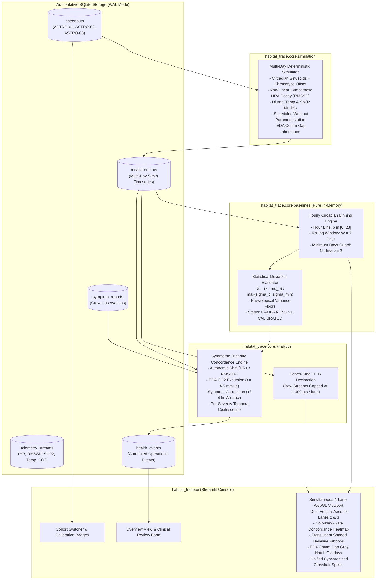
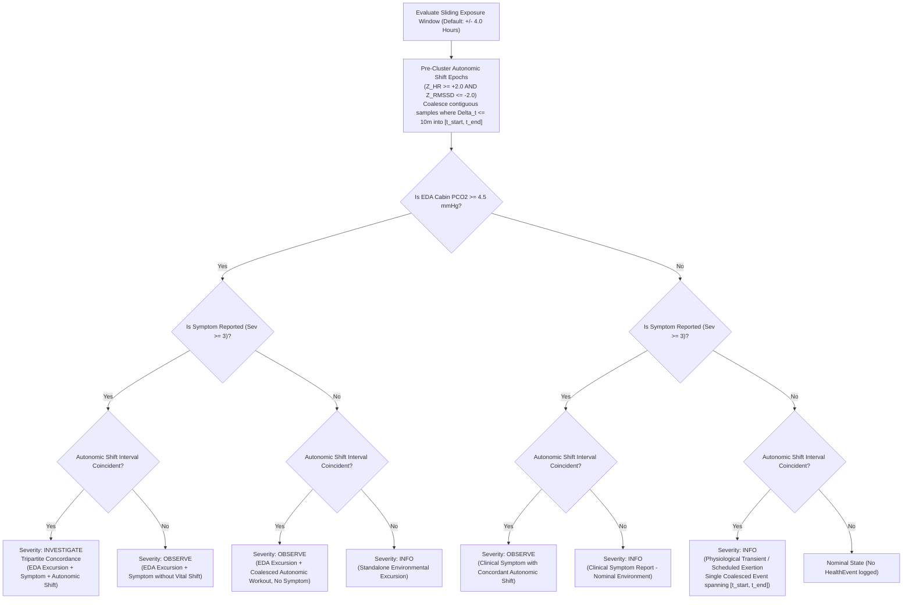

# HABITAT TRACE Version 2: Personalized Health Monitoring & Multi-Signal Baseline Analytics

* **Author:** MinnThikeTunn
* **Date:** 2026-11-14
* **Status:** Approved Technical Design Document (Fully Implementation Ready)
* **Predecessor Context:** [concepts_brief.md](file:///D:/nasaResearch/concepts_brief.md)
* **Parent System:** [HABITAT TRACE Version 1 Approved Design Doc](file:///D:/nasaResearch/docs/designs/habitat_trace_v1.md)
* **Requirements Baseline:** [PRD.md](file:///D:/nasaResearch/PRD.md) (Section 17: Version 2 Scope)
* **Domain Vocabulary:** [GLOSSARY.md](file:///D:/nasaResearch/GLOSSARY.md)

---

## 1. The Problem

Astronauts during long-duration spaceflight (e.g. International Space Station expeditions and lunar/Mars transit missions) experience acute and chronic physiological adaptations. Microgravity induces immediate cephalad fluid shifts, reductions in plasma volume, cardiovascular deconditioning, and autonomic nervous system recalibration. Concurrently, environmental stressors—including acoustic noise, elevated ambient partial pressure of carbon dioxide ($P_{\text{CO}_2}$), confinement, and shifted circadian sleep cycles—place continuous physiological load on the crew.

HABITAT TRACE Version 1 established an offline environmental exposure analysis platform capable of ingesting authentic NASA ISS Environmental Data Application (EDA) telemetry, detecting environmental excursions (such as cabin $P_{\text{CO}_2} \ge 4.5\,\text{mmHg}$), aligning timestamped crew symptom reports, and retrieving cited spaceflight medical literature from a local SQLite FTS5 database.

However, Version 1 operated under major constraints:
1. **Single Static Astronaut Profile:** The system persisted only one hardcoded astronaut profile (`ASTRO-01`, CDR Vance). It possessed no capability to isolate multiple crew members or account for individual baseline differences across roles, ages, and physiological phenotypes.
2. **Population-Static Thresholds:** In Version 1, vitals were evaluated against rigid, universal thresholds. In reality, human physiology in spaceflight is **individualized and circadian-periodic**:
   - An astronaut with an endurance-trained resting heart rate of 52 bpm who rises to 76 bpm has experienced a statistically significant 3-sigma excursion, whereas for a crewmate with a resting rate of 74 bpm, 76 bpm is a nominal resting state.
   - Fixed population cutoffs produce false alarms during normal daytime activity while simultaneously missing dangerous cumulative physiological strain during sleep periods when vitals should be suppressed.
3. **Absence of Autonomic Nervous System Telemetry:** Version 1 tracked only Heart Rate, Blood Oxygen Saturation ($\text{SpO}_2$), and Core Body Temperature. It omitted Heart Rate Variability (HRV via RMSSD, Root Mean Square of Successive Differences)—the recognized non-invasive biomarker for autonomic stress, sympathetic tone escalation, and physical/cognitive fatigue in operational spaceflight environments.
4. **Isolated Signal Interpretation:** Physiological excursions were evaluated independently of environmental telemetry, creating risk of alarm fatigue from routine physical exercise countermeasures (e.g. 90 minutes of daily treadmill or cycle ergometer training) that cause natural cardiovascular elevation.

Without personalized baselines, multi-astronaut profiling, and multi-signal concordance analysis, medical decision support cannot differentiate between normal individual diurnal rhythms, scheduled physical exertion, and true environmental stressor compensation.

---

## 2. Overview

HABITAT TRACE Version 2 upgrades the offline astronaut health intelligence platform into a **Personalized Astronaut Health Monitoring System**.

The system establishes an individual-first clinical monitoring framework that maintains:
- **Multi-Astronaut Cohort Architecture:** Supports simultaneous, strictly isolated profiles for crew members (`ASTRO-01` Commander Vance, `ASTRO-02` Flight Engineer Patel, and `ASTRO-03` Mission Specialist Lindgren), each characterized by unique resting physiological baselines, baseline calibration states, and circadian chronotypes (phase offsets).
- **Expanded Autonomic Vitals Suite:** Ingests and deterministically simulates multi-day (7 to 14 days) continuous physiological telemetry adding Heart Rate Variability via RMSSD (`ms`) with non-linear inverse sympathetic coupling dynamics alongside Heart Rate (`bpm`), Blood Oxygen Saturation ($\text{SpO}_2$ `%`), and Core Body Temperature (`degC`).
- **Rolling Hourly Circadian Baselines:** Introduces a pure-Python, zero-dependency baseline engine (`habitat_trace.core.baselines`) that segments the 24-hour mission clock into discrete hourly circadian bins ($b \in [0, 23]$) across a rolling historical window. This calculates time-of-day expected means $\mu_{s, b}(t)$ and standard deviations $\sigma_{s, b}(t)$ in $O(1)$ time, yielding continuous $Z$-score statistical deviation tracking:
  $$Z_s(t) = \frac{x_s(t) - \mu_{s, b}(t)}{\max(\sigma_{s, b}(t), \sigma_{\min, s})}$$
  where $\sigma_{\min, s}$ is a stream-specific physiological variance floor ($\text{HR} = 1.0\,\text{bpm}, \text{RMSSD} = 2.0\,\text{ms}, \text{Temp} = 0.10\,^\circ\text{C}, \text{SpO}_2 = 0.50\,\%$) preventing runaway division-by-zero during resting states.
- **Tripartite Multi-Signal Concordance Analytics:** Augments exposure event detection to evaluate concordance across three distinct operational layers:
  1. Authentic NASA ISS EDA environmental telemetry ($P_{\text{CO}_2}$, cabin temperature, pressure).
  2. Multi-vital statistical deviations ($Z$-scores outside $[\mu - 2\sigma, \mu + 2\sigma]$).
  3. Crew-reported clinical symptoms (severity 1–5, cabin module location).
  Events escalate to `INVESTIGATE` operational status when tripartite concordance occurs, to `OBSERVE` on partial concordance (including symptom reports during nominal cabin atmosphere), and label non-concordant routine exercise transients as `INFO` with temporal interval coalescence.
- **Simultaneous Multi-Lane Timeline Visualization:** Upgrades the Streamlit Plotly WebGL console to display 4 synchronized, decimated time-series lanes featuring independent dual vertical axes, translucent shaded circadian baseline envelopes $[\mu(t) \pm 2\sigma(t)]$, colorblind-safe concordance heatmaps, telemetry communication gap overlays, and epistemic data provenance badges.

---

## 3. Goals and Non-Goals

### 3.1 In-Scope Goals

1. **Multi-Astronaut Profile Persistence & Cohort Switching:**
   - Migrate SQLite schema to support multi-astronaut profiles with individual resting parameters (`resting_hr`, `resting_rmssd`, `resting_spo2`, `resting_temp`), chronotype circadian offsets, and calibration status (`CALIBRATING` vs. `CALIBRATED`).
   - Implement an interactive sidebar cohort switcher in Streamlit that re-binds timeline traces, KPI summary metrics, and review cards to the selected crew member with zero state contamination and preserved viewport zoom.
2. **Autonomic Telemetry (HRV/RMSSD) & Multi-Day Demonstration Data:**
   - Extend the deterministic physiological simulator to generate 7 to 14 days of synchronized 5-minute interval vitals including RMSSD with physiological non-linear inverse sympathetic coupling (HR rise during exertion correlates with RMSSD decay; sleep brings parasympathetic dominance with elevated RMSSD).
   - Ensure all simulated data inherits communication gaps from authentic NASA EDA logs and strictly carries `is_synthetic = 1` and `provenance_category = SYNTHETIC_SIMULATION`.
3. **Pure-Python Rolling Circadian Baseline Engine:**
   - Create `habitat_trace.core.baselines` using vector math to compute hourly bin statistics $(\mu_{s, b}, \sigma_{s, b})$ over rolling windows without external C-extension or machine learning dependencies.
   - Generate instantaneous $Z$-score deviations for every vital measurement using domain-calibrated physiological floors $\sigma_{\min, s}$.
   - Provide rigorous sparse-history handling: when distinct mission calendar days in a bin are $N_{\text{days}} < 3$ (or $|K| < 36$ samples), flag status as `CALIBRATING`, set uncertainty to `HIGH`, and widen confidence bounds using resting profile prior variance.
4. **Contextual Multi-Signal Concordance Correlation:**
   - Enhance `habitat_trace.core.analytics` to detect concordance between multi-vital shifts ($Z_{HR} \ge +2.0$ and $Z_{RMSSD} \le -2.0$), cabin $P_{\text{CO}_2}$ excursions ($> 4.5\,\text{mmHg}$), and symptom reports.
   - Symmetrically evaluate clinical symptoms during nominal cabin atmosphere, escalating symptom + vital deviations to `OBSERVE`.
   - Implement temporal event coalescence to cluster contiguous exercise intervals into single summarized `INFO` or `OBSERVE` records, preventing event flooding.
   - Preserve epistemic transparency by embedding mandatory non-causal disclaimers in all generated event rationales.
5. **Simultaneous 4-Lane WebGL Visualization:**
   - Render 4 stacked, synchronized Plotly timeline lanes with independent dual vertical axes for Lane 2 (HR / RMSSD) and Lane 3 (Temp / $\text{SpO}_2$) and an accessible colorblind-safe palette for Lane 4.
   - Maintain 60fps rendering using Largest Triangle Three Buckets (LTTB) decimation capped at 1,000 points per lane on high-frequency measurements while preserving hourly baseline ribbon geometries.
6. **Automated End-to-End Verification Harness:**
   - Deliver 100% automated test coverage in `tests/test_baselines.py`, `tests/test_simulation.py`, `tests/test_analytics.py`, and `tests/test_scenario_v2.py` verifying multi-day baseline stability, acute excursion injection response, and cohort isolation across the Day 120–134 Expedition 71 scenario.

### 3.2 Out-of-Scope Non-Goals

1. **No Autonomous Clinical Diagnosis:**
   - HABITAT TRACE will NOT diagnose clinical medical conditions (e.g. tachycardia, hypercapnia toxicity, hypoxia, autonomic neuropathy, or cardiac arrhythmia). It functions strictly as an operational decision-support tool.
2. **No Prescriptive Countermeasure Recommendations:**
   - The system will NOT prescribe medical interventions, adjust life-support scrubber rates, or command environmental hardware. All countermeasure authority remains with the Flight Surgeon and Crew Medical Officer (CMO).
3. **No Heavy Machine Learning Frameworks:**
   - No PyTorch, TensorFlow, Scikit-learn, or XGBoost dependencies. All baseline statistics and Z-scores must execute via standard Python and vectorized NumPy/Pandas to ensure lightweight, zero-compilation offline operation.
4. **No Millisecond-Level High-Frequency Waveform Ingestion:**
   - The platform will NOT ingest raw beat-to-beat ECG waveforms or continuous Photoplethysmography (PPG) signals. Telemetry remains structured aggregate time-series observations at 5-minute sampling intervals.
5. **No Multi-User Distributed Network Synchronization:**
   - Distributed multi-crew networking, cryptographic peer-to-peer sync, and access control lists are deferred to Version 5. Version 2 runs locally on an offline workstation using embedded SQLite.

---

## 4. Technical Plan

### 4.1 System Architecture & Data Flow



---

### 4.2 Data Model Extensions & SQLite Schema Migration

#### Model Enhancements (`habitat_trace.core.models`)
1. **`CalibrationStatus` Enum:**
   ```python
   class CalibrationStatus(str, Enum):
       CALIBRATING = "CALIBRATING"
       CALIBRATED = "CALIBRATED"
   ```
2. **`Astronaut` Model Extensions:**
   ```python
   class Astronaut(BaseModel):
       model_config = ConfigDict(frozen=True)

       astronaut_id: str
       callsign: str
       mission_id: str
       crew_role: str
       baseline_calibrated_at: Optional[str] = None
       baseline_parameters: Optional[str] = None  # Legacy V1 JSON field (superseded by explicit columns)
       # V2 Cohort Extensions:
       resting_hr: float = 65.0
       resting_rmssd: float = 55.0
       resting_spo2: float = 98.0
       resting_temp: float = 37.0
       circadian_phase_shift_hours: float = 0.0  # Operational sleep shift relative to mission UTC
       baseline_window_days: int = 7
       calibration_status: CalibrationStatus = CalibrationStatus.CALIBRATING
   ```
3. **In-Memory Analytical Baseline Structures (`habitat_trace.core.models`):**
   *(Note: `CircadianBinStats` and `BaselineDeviation` are ephemeral in-memory Pydantic representations generated dynamically on-the-fly via vectorized NumPy arrays without redundant SQLite schema sprawl).*
   ```python
   class CircadianBinStats(BaseModel):
       model_config = ConfigDict(frozen=True)

       stream_id: str
       astronaut_id: str
       hour_bin: int  # 0 to 23
       mean: float
       std: float
       sample_count: int
       distinct_days: int
       calibration_status: CalibrationStatus

   class BaselineDeviation(BaseModel):
       model_config = ConfigDict(frozen=True)

       timestamp: str
       stream_id: str
       astronaut_id: str
       value: float
       expected_mean: float
       expected_std: float
       z_score: float
       is_statistical_deviation: bool  # True if |Z| >= 2.0
   ```

#### Storage Migration (`habitat_trace.core.storage`)
The [`StorageManager`](file:///D:/nasaResearch/habitat_trace/core/storage.py#L30) executes migrations inside `ensure_initialized()`:
- Inspects existing table schema via `PRAGMA table_info(astronauts)`.
- If missing, executes non-destructive `ALTER TABLE astronauts ADD COLUMN ...` statements:
  ```python
  existing_cols = {row["name"] for row in conn.execute("PRAGMA table_info(astronauts);").fetchall()}
  cols_to_add = {
      "resting_hr": "REAL DEFAULT 65.0",
      "resting_rmssd": "REAL DEFAULT 55.0",
      "resting_spo2": "REAL DEFAULT 98.0",
      "resting_temp": "REAL DEFAULT 37.0",
      "circadian_phase_shift_hours": "REAL DEFAULT 0.0",
      "baseline_window_days": "INTEGER DEFAULT 7",
      "calibration_status": "TEXT DEFAULT 'CALIBRATING'",
  }
  for col_name, col_def in cols_to_add.items():
      if col_name not in existing_cols:
          conn.execute(f"ALTER TABLE astronauts ADD COLUMN {col_name} {col_def};")
  ```
- Registers `stream_sim_hrv` in the authoritative `telemetry_streams` table:
  ```sql
  INSERT OR IGNORE INTO telemetry_streams (stream_id, source_id, metric_name, metric_category, unit, nominal_min, nominal_max)
  VALUES ('stream_sim_hrv', 'SRC_SIM_VITALS', 'rmssd', 'PHYSIOLOGICAL', 'ms', 15.0, 140.0);
  ```
- Pre-seeds the authoritative multi-astronaut cohort if not present:
  1. `ASTRO-01` (CDR M. Vance, baseline HR 65, RMSSD 55, chronotype shift 0.0h)
  2. `ASTRO-02` (FE-1 Dr. S. Patel, baseline HR 52, RMSSD 75, chronotype shift -1.0h)
  3. `ASTRO-03` (MS-1 K. Lindgren, baseline HR 72, RMSSD 38, chronotype shift +1.5h)

---

### 4.3 Pure-Python Hourly Circadian Baseline Engine (`habitat_trace.core.baselines`)

Spaceflight vitals exhibit strong 24-hour diurnal rhythms. Evaluating an observation against a 24-hour static average produces severe bias (e.g. nocturnal heart rate compared to daytime active means).

#### Mathematical Methodology
1. **Hour-of-Day Segmentation:**  
   Every timestamp $t_i$ is mapped to its integer hour $b_i = \text{hour}(t_i) \in [0, 23]$ in mission UTC.
2. **Rolling Historical Window ($W = 7\text{ days}$):**  
   For any evaluation timestamp $T$ and stream $s$, the baseline distribution for hour $b$ is computed from all valid observations occurring in that hour during the prior $W$ days:
   $$K(s, b, T) = \{x_s(t_k) \mid \text{hour}(t_k) = b, \; T - W \le t_k < T, \; \text{quality\_status} = \text{VALID}\}$$
   $$N_{\text{days}}(s, b, T) = \left|\left\{\text{date}(t_k) \mid x_s(t_k) \in K(s, b, T)\right\}\right|$$
3. **Hourly Bin Estimators:**
   $$\mu_{s, b}(T) = \begin{cases} 
   \frac{1}{|K|} \sum_{x \in K} x & \text{if } |K| > 0 \\ 
   \text{resting\_baseline}_s & \text{if } |K| = 0 
   \end{cases}$$
   $$\sigma_{s, b}(T) = \begin{cases} 
   \sqrt{\frac{1}{\max(|K| - 1, 1)} \sum_{x \in K} (x - \mu_{s, b}(T))^2} & \text{if } |K| > 1 \\ 
   \sigma_{\text{prior}, s} & \text{if } |K| \le 1 
   \end{cases}$$
4. **Domain-Calibrated Physiological Variance Floors:**
   To prevent runaway division-by-zero during resting states or sparse observations, the engine bounds variance by stream-specific physiological floors:
   $$\sigma_{\min, \text{HR}} = 1.0\,\text{bpm}, \quad \sigma_{\min, \text{RMSSD}} = 2.0\,\text{ms}, \quad \sigma_{\min, \text{Temp}} = 0.10\,^\circ\text{C}, \quad \sigma_{\min, \text{SpO}_2} = 0.50\,\%$$
   $$Z_s(t) = \frac{x_s(t) - \mu_{s, b}(t)}{\max(\sigma_{s, b}(t), \sigma_{\min, s})}$$
5. **Sparse-History Calibration Guard:**
   - If $N_{\text{days}}(s, b, T) < 3$ (or $|K| < 36$ samples): Return status `CALIBRATING`, widen visual ribbon to $[\mu \pm 3 \cdot \sigma_{\text{prior}}]$, and set event uncertainty to `HIGH`.
   - If $N_{\text{days}}(s, b, T) \ge 3$ ($|K| \ge 36$): Return status `CALIBRATED`, standard visual ribbon $[\mu \pm 2\sigma_{s, b}]$, and set event uncertainty to `LOW`.

---

### 4.4 Autonomic Telemetry Simulation with Inverse Coupling (`habitat_trace.core.simulation`)

The deterministic simulation engine expands to multi-day horizons (7–14 days) and introduces Heart Rate Variability via RMSSD, Core Temperature, and $\text{SpO}_2$:

1. **Circadian Phase Offset:** Each astronaut profile supplies $\phi$ (chronotype offset in hours).
2. **Scheduled Countermeasure Exertion Function $\Delta_{\text{exertion}}(t)$:**  
   Models mandatory 90-minute daily countermeasure workouts (e.g. Cycle Ergometer with Vibration Isolation and Stabilization System / CEVIS or T2 Treadmill) as a scheduled half-sine wave peaking at $+65\,\text{bpm}$ during scheduled workout intervals:
   $$\Delta_{\text{exertion}}(t) = \begin{cases} 
   65.0 \cdot \sin\left(\frac{\pi (t - t_{\text{start}})}{90\,\text{min}}\right) & \text{if } t \in [t_{\text{start}}, t_{\text{start}} + 90\,\text{min}] \\ 
   0.0 & \text{otherwise} 
   \end{cases}$$
3. **Heart Rate Model ($\text{bpm}$):**
   $$\text{HR}(t) = \text{RestHR} + 10.0 \cdot \sin\left(\frac{2\pi (\text{hour}(t) - \phi - 6)}{24}\right) + \Delta_{\text{exertion}}(t) + \eta_{HR}(t), \quad \eta_{HR} \sim \mathcal{N}(0, 1.0)$$
4. **Non-Linear Inverse Autonomic RMSSD Coupling ($\text{ms}$):**
   Parasympathetic activity elevates RMSSD during rest and sleep, whereas sympathetic surge non-linearly suppresses RMSSD without hard clamp floor saturation:
   $$\text{RMSSD}(t) = \text{RestRMSSD} \cdot \exp\left(-0.012 \cdot \Delta_{\text{exertion}}(t)\right) - 8.0 \cdot \sin\left(\frac{2\pi (\text{hour}(t) - \phi - 6)}{24}\right) + \eta_{RMSSD}(t), \quad \eta_{RMSSD} \sim \mathcal{N}(0, 1.5)$$
   Bounded to physiological bounds $[15.0, 140.0]\,\text{ms}$.
5. **Core Body Temperature Model ($^\circ\text{C}$):**
   $$\text{Temp}(t) = \text{RestTemp} + 0.35 \cdot \sin\left(\frac{2\pi (\text{hour}(t) - \phi - 9)}{24}\right) + 0.008 \cdot \Delta_{\text{exertion}}(t) + \eta_{\text{Temp}}(t), \quad \eta_{\text{Temp}} \sim \mathcal{N}(0, 0.03)$$
6. **Blood Oxygen Saturation Model ($\text{SpO}_2$ $\%$):**
   $$\text{SpO}_2(t) = \min\left(100.0, \; \text{RestSpO}_2 - 0.4 \cdot \cos\left(\frac{2\pi (\text{hour}(t) - \phi)}{24}\right) - 0.015 \cdot \Delta_{\text{exertion}}(t) + \eta_{\text{SpO}_2}(t)\right), \quad \eta_{\text{SpO}_2} \sim \mathcal{N}(0, 0.2)$$
   Constrained to $[90.0, 100.0]\%$.
7. **Authentic Gap Inheritance:** All simulated vitals continue to inherit communication dropouts (`QualityStatus.GAP`) exactly coinciding with missing authentic NASA EDA timestamps.

---

### 4.5 Symmetric Tripartite Exposure Concordance Engine (`habitat_trace.core.analytics`)

To prevent alert fatigue while ensuring severe clinical symptoms are never ignored during nominal cabin environments, `evaluate_exposure_events` is upgraded to a symmetric tripartite evaluation engine:



#### Pre-Severity Temporal Interval Coalescence Rules
1. **Contiguity Window:** Observations exhibiting autonomic shifts ($Z_{HR} \ge +2.0 \text{ AND } Z_{RMSSD} \le -2.0$) separated by $\Delta t \le 10\,\text{min}$ are clustered into a single interval $[t_{\text{start}}, t_{\text{end}}]$.
2. **Minimum Duration:** Only intervals spanning $\ge 3$ consecutive samples ($\ge 15\,\text{min}$) are formed into coalesced events.
3. **Decoupled Severity:** Coalescence executes *before* severity categorization. If an astronaut performs a 90-minute countermeasure workout during an authentic high-$P_{\text{CO}_2}$ excursion ($\ge 4.5\,\text{mmHg}$), the entire workout bout is logged as exactly **1 `OBSERVE` event** spanning $[t_{\text{start}}, t_{\text{end}}]$ with peak metrics, rather than 18 separate events.
4. **Deterministic Identifier:** Coalesced events generate deterministic IDs: `f"EVT-EXERTION-{start_timestamp.replace(':', '').replace('-', '')}"`.

#### Canonical Rendered Operational Rationale Exemplar
```text
[OPERATIONAL HEALTH EVENT: INVESTIGATE]
• Environmental Telemetry: Cabin PCO2 reached 5.82 mmHg (Threshold >= 4.5 mmHg, Node 2) [AUTHENTIC NASA EDA]
• Autonomic Deviation: Heart Rate Z=+2.61 (+18.4 bpm above circadian baseline), RMSSD Z=-2.45 (-22.1 ms below circadian baseline) [SIMULATED VITALS]
• Crew Symptom: HEADACHE (Severity 3/5, Node 2) reported at MET 127d 02:15 UTC [CREW REPORTED]
• Operational Decision Support Notice: Temporal overlap indicates co-occurrence only, not clinical causation. HABITAT TRACE does not diagnose pathologies or prescribe countermeasures.
```

---

### 4.6 Simultaneous 4-Lane WebGL Timeline Viewport (`habitat_trace.ui`)

Plotly WebGL (`go.Figure`) is configured with 4 vertically stacked, synchronized subplots sharing a unified x-axis with synchronized vertical spike lines (`fig.update_layout(hovermode="x unified")`):

1. **Lane 1: Cabin Atmosphere (Authentic NASA EDA)**
   - Cabin $P_{\text{CO}_2}$ ($\text{mmHg}$, solid cyan, threshold dashed red line at $4.5\,\text{mmHg}$).
   - Cabin Temperature ($^\circ\text{C}$, solid blue).
   - Sensor communication dropout spans highlighted with gray diagonal hatched rects (`TELEMETRY GAP`).
2. **Lane 2: Cardiovascular & Autonomic Tone (Independent Dual Y-Axes)**
   - **Primary y-axis (Left):** Heart Rate ($\text{bpm}$, amber dashed line `[◌ MOCK VITALS]`) with shaded translucent baseline ribbon $[\mu_{HR}(t) \pm 2\sigma_{HR}(t)]$ (`opacity=0.18`).
   - **Secondary y-axis (Right):** RMSSD ($\text{ms}$, emerald dashed line `[◌ MOCK VITALS]`) with shaded translucent baseline ribbon $[\mu_{RMSSD}(t) \pm 2\sigma_{RMSSD}(t)]$.
3. **Lane 3: Thermoregulation & Oxygenation (Independent Dual Y-Axes)**
   - **Primary y-axis (Left):** Core Body Temperature ($^\circ\text{C}$, range $[35.5, 39.0]$, coral dashed line with shaded $[\mu \pm 2\sigma]$ ribbon).
   - **Secondary y-axis (Right):** Blood Oxygen Saturation ($\text{SpO}_2$ `%`, range $[88, 101]$, royal blue dashed line with $[\mu \pm 2\sigma]$ ribbon).
4. **Lane 4: Statistical Deviation & Concordance Heatmap (Colorblind-Safe Ramp)**
   - Represents composite deviation magnitude $|Z_{\text{composite}}| = \max(|Z_{HR}|, |Z_{RMSSD}|, |Z_{\text{Temp}}|, |Z_{\text{SpO}_2}|)$:
     - Normal ($|Z| < 2.0$): Slate / Charcoal (`#334155`).
     - Elevated ($2.0 \le |Z| < 3.0$): Cyan / Sky-Blue (`#0ea5e9`, glyph marker `â–²`).
     - Critical Concordance ($|Z| \ge 3.0$ or simultaneous HR+/RMSSD-): High-Luminance Magenta (`#d946ef`, glyph marker `â—†`).
   - Crew symptom report markers rendered as upright violet diamond markers at timestamp `occurred_at`.

#### Decimation Boundary & Zoom Persistence
LTTB decimation (capped at 1,000 points per lane) is active *only* when the loaded viewport duration exceeds 1,000 raw samples ($> 3.47$ mission days). Hourly baseline ribbon coordinates (336 points over 14 days) are passed directly without decimation to preserve paired polygon bounds. Viewport date ranges are persisted in `st.session_state["timeline_range"]` across astronaut cohort switches.

---

## 5. Alternatives Considered

### 5.1 Continuous Non-Linear Harmonic Cosinor Regression
* **Mechanism:** Fitting multi-component periodic trigonometric equations ($f(t) = M + A \cos(\omega t + \phi)$) via continuous non-linear least squares (e.g. `scipy.optimize.curve_fit`) over sliding historical windows.
* **Rejected by author:** Rejected due to excessive compute latency and regression instability during Streamlit UI reruns. Spaceflight physiological curves deviate significantly from clean sinusoidal harmonics during scheduled exercise, causing matrix convergence errors and thread locks on offline laptop hardware. Discrete hourly circadian binning ($b \in [0, 23]$) executes in $O(1)$ lookup time, vectorizes cleanly across NumPy arrays, and handles arbitrary asymmetric diurnal profiles without numerical solvers.

### 5.2 Proprietary Wearable Device / Binary EDF Stream Ingestion
* **Mechanism:** Integrating live BLE device drivers, proprietary binary SDKs, or raw European Data Format (EDF/BDF) parsers for hardware like Bio-Monitor, Hexoskin, or Apple Watch.
* **Rejected by author:** Rejected due to operational fragility and peripheral lock-in for an offline research prototype. The PRD explicitly designates HABITAT TRACE Version 2 as a decision-support demonstration platform. High-fidelity deterministic mock data mathematically parameterized to individual astronaut phenotypes with authentic EDA communication gap inheritance fully exercises the multi-signal correlation pipeline without introducing fragile hardware dependencies.

### 5.3 Single-Signal Anomaly Thresholds
* **Mechanism:** Triggering clinical investigation health events whenever any single physiological metric crosses a static limit (e.g. Heart Rate $> 100\text{ bpm}$ or $|Z| \ge 2.0$).
* **Rejected by author:** Rejected due to overwhelming false alarm fatigue. Astronauts perform mandatory 90-minute daily countermeasure workouts (CEVIS cycle ergometer, T2 treadmill) that routinely drive heart rates above 130 bpm and depress RMSSD. Requiring tripartite concordance (co-occurrence with cabin $P_{\text{CO}_2} \ge 4.5\,\text{mmHg}$ or crew-reported clinical symptoms) isolates true operational exposure risks while appropriately downgrading isolated physical exertion to `INFO`.

### 5.4 Opaque Deep Learning / Machine Learning Anomaly Detection (Isolation Forests, Autoencoders)
* **Mechanism:** Training unsupervised multi-dimensional neural networks (e.g., PyTorch LSTM autoencoders) or Isolation Forests to output multidimensional reconstruction error scores.
* **Rejected by author:** Rejected due to lack of explainability, heavy dependency footprint, and vulnerability to distributional shift in microgravity. Black-box anomaly scores cannot provide the transparent, explainable clinical rationales required by NASA Flight Surgeons. Statistical hourly $Z$-scores maintain complete auditability, link directly to physiological deviation units ($\sigma$), and require zero machine learning compilation.

---

## 6. Detailed Implementation Plan

The implementation is executed across 5 modular, sequentially verifiable phases:


### 6.1 Complete File Inventory & Technical Contracts

| File Path | Status | Change Rationale & Explicit Technical Contract |
| :--- | :--- | :--- |
| `habitat_trace/core/models.py` | **Modified** | Extend `Astronaut` model with individual baseline resting fields (`resting_hr`, `resting_rmssd`, `resting_spo2`, `resting_temp`), chronotype offset (`circadian_phase_shift_hours`), and `CalibrationStatus` enum (`CALIBRATING`, `CALIBRATED`). Define `CircadianBinStats` and `BaselineDeviation` (with `is_statistical_deviation: bool`). |
| `habitat_trace/core/storage.py` | **Modified** | In `ensure_initialized()`: run idempotent SQLite migration adding 7 columns to `astronauts` table; register `stream_sim_hrv` (RMSSD) in `telemetry_streams`; seed cohort profiles (`ASTRO-01`, `ASTRO-02`, `ASTRO-03`). Update `insert_astronaut` to persist all 13 columns. Extend `get_measurements_df(..., astronaut_ids: Optional[List[str]] = None)`. |
| `habitat_trace/core/baselines.py` | **Created** | Pure-Python in-memory baseline engine with explicit signatures:<br/>• `compute_circadian_hourly_bins(measurements_df: pd.DataFrame, astronaut: Astronaut, evaluation_time: Optional[str] = None, window_days: int = 7) -> Dict[Tuple[str, int], CircadianBinStats]`<br/>• `evaluate_measurement_deviations(measurements_df: pd.DataFrame, bin_stats: Dict[Tuple[str, int], CircadianBinStats], astronaut: Astronaut) -> pd.DataFrame` |
| `habitat_trace/core/simulation.py` | **Modified** | Extend to multi-day windows with explicit signature:<br/>• `simulate_cohort_vitals_for_window(start_time: str, end_time: str, cohort_profiles: List[Astronaut], sample_interval_minutes: int = 5, eda_measurements_df: Optional[pd.DataFrame] = None) -> List[Measurement]`<br/>Implements non-linear exponential RMSSD decay, Core Temp, $\text{SpO}_2$, and scheduled 90-minute workouts. |
| `habitat_trace/core/analytics.py` | **Modified** | Upgrade `evaluate_exposure_events(astronaut_id: str, storage_manager: StorageManager, window_hours: float = 4.0) -> List[HealthEvent]` to execute the 5-step analytical pipeline: queries 7-day baseline history, enriches deviations, performs pre-severity interval coalescence ($\Delta t \le 10\,\text{min}$, duration $\ge 15\,\text{min}$), and categorizes into `INVESTIGATE`, `OBSERVE`, and `INFO`. |
| `habitat_trace/ui/components/badges.py` | **Modified** | Add `render_calibration_badge(status: CalibrationStatus) -> str` rendering Amber chip for `CALIBRATING` and Emerald chip for `CALIBRATED`. Update severity and provenance chip formatters. |
| `habitat_trace/ui/components/charts.py` | **Modified** | Implement `create_multi_lane_cohort_figure(env_df: pd.DataFrame, vitals_df: pd.DataFrame, deviations_df: Optional[pd.DataFrame], baseline_envelopes: Dict[str, pd.DataFrame], events: List[HealthEvent], symptoms: List[SymptomReport], active_astronaut: Astronaut) -> go.Figure` using `make_subplots(specs=[[{"secondary_y": False}], [{"secondary_y": True}], [{"secondary_y": True}], [{"secondary_y": False}]])` with unified crosshairs. |
| `habitat_trace/ui/app.py` | **Modified** | Add sidebar cohort selector (`ASTRO-01`, `ASTRO-02`, `ASTRO-03`); add "Load Multi-Day Mission Scenario Data" button calling `st.cache_data.clear()`; bind active astronaut profile and calibration badge to `st.session_state`. |
| `habitat_trace/ui/views/overview.py` | **Modified** | Update Mission Overview view to render active astronaut baseline summary card (resting HR, resting RMSSD, chronotype phase shift, calibration status); render Concordance Status indicator and filter review actions by active astronaut. |
| `habitat_trace/ui/views/timeline.py` | **Modified** | Render simultaneous 4-lane WebGL figure with dynamic selective LTTB downsampling, baseline ribbons, and symptom markers, preserving zoom across profile switches via `st.session_state["timeline_range"]`. |
| `habitat_trace/ui/views/symptoms.py` | **Modified** | Bind symptom reporting intake to the currently active astronaut from sidebar selection. |
| `tests/test_baselines.py` | **Created** | Unit test suite for `habitat_trace.core.baselines`: verifies hourly binning accuracy, rolling 7-day window estimators, physiological floors $\sigma_{\min, s}$, $Z$-score calculations, and $N_{\text{days}} \ge 3$ calibration status transitions. |
| `tests/test_simulation.py` | **Modified** | Extend simulation tests to verify multi-day determinism, non-linear RMSSD decay, Core Temp/$\text{SpO}_2$ models, chronotype phase shift offsets, and authentic EDA gap inheritance. |
| `tests/test_analytics.py` | **Modified** | Add tests for symmetric tripartite concordance correlation, temporal interval coalescence, single-vital exercise transient filtering (`INFO`), and mandatory non-causal explanation formatting. |
| `tests/test_scenario_v2.py` | **Created** | End-to-end integration scenario verifying the Day 120–134 Expedition 71 mission scenario: cohort initialization, multi-day vitals ingestion, baseline stabilization, acute physiological excursion injection, and strict astronaut profile isolation. Includes `provision_14day_mission_environment` fixture helper. |
| `GLOSSARY.md` | **Modified** | Append authoritative definitions for Circadian Hourly Bin, Autonomic Tone (RMSSD), Multi-Signal Concordance, Calibration Status, and Chronotype Phase Offset. |
| `README.md` | **Modified** | Update system architecture diagrams, directory layout, and walkthrough instructions for Version 2 multi-astronaut cohort inspection. |

---

### 6.2 Phase-by-Phase Execution Order

#### Phase 1: Data Model Extensions & Storage Migration
1. Update `habitat_trace/core/models.py` with `CalibrationStatus`, extended `Astronaut`, `CircadianBinStats`, `BaselineDeviation` (with `is_statistical_deviation`), and register `stream_sim_hrv`.
2. In `habitat_trace/core/storage.py:ensure_initialized()`:
   - Check `PRAGMA table_info(astronauts)` and execute `ALTER TABLE astronauts ADD COLUMN ...`.
   - Seed `stream_sim_hrv` into `telemetry_streams`.
   - Pre-seed the 3 cohort profiles (`ASTRO-01`, `ASTRO-02`, `ASTRO-03`).
3. Update `insert_astronaut` to persist all 13 columns; extend `get_measurements_df(..., astronaut_ids)`.
4. Run existing test suite (`pytest tests/test_storage.py`) to verify backwards compatibility and zero data regressions.

#### Phase 2: Circadian Baseline Engine & Autonomic Simulation
1. Create `habitat_trace/core/baselines.py` implementing:
   - `compute_circadian_hourly_bins(measurements_df, astronaut, evaluation_time, window_days=7)`
   - `evaluate_measurement_deviations(measurements_df, bin_stats, astronaut)`
   - Apply stream floors $\sigma_{\min, s}$ and $N_{\text{days}} \ge 3$ day guards.
2. Update `habitat_trace/core/simulation.py` to support multi-day windows, non-linear RMSSD decay, diurnal Temp/$\text{SpO}_2$, and scheduled 90-minute countermeasure workouts.
3. Write `tests/test_baselines.py` and update `tests/test_simulation.py`; verify with `pytest`.

#### Phase 3: Tripartite Concordance Analytics
1. Update `habitat_trace/core/analytics.py` implementing the 5-step pipeline in `evaluate_exposure_events`:
   - Step 1: `astronaut = storage_manager.get_astronaut(astronaut_id)`.
   - Step 2: Query historical measurements across `[window_start - 7 days, window_end]`.
   - Step 3: Compute rolling circadian bins across the 7-day history.
   - Step 4: Evaluate deviations on the target exposure window.
   - Step 5: Inner-join on `timestamp` for autonomic shift detection ($Z_{HR} \ge +2.0 \text{ AND } Z_{RMSSD} \le -2.0$).
2. Implement pre-severity interval coalescence ($\Delta t \le 10\,\text{min}$, duration $\ge 15\,\text{min}$) clustering contiguous workout measurements into a single summarized event record.
3. Apply symmetric severity rules (`INVESTIGATE`, `OBSERVE`, `INFO`) and mandatory non-causal explanation strings.
4. Update `tests/test_analytics.py` to verify tripartite concordance detection, symptom evaluation during nominal $P_{\text{CO}_2}$, and workout transient coalescence.

#### Phase 4: UI Components & Simultaneous 4-Lane Presentation
1. Update `habitat_trace/ui/components/badges.py` with `render_calibration_badge`.
2. Update `habitat_trace/ui/components/charts.py` to implement `create_multi_lane_cohort_figure`:
   - 4-lane WebGL subplots with independent dual y-axes for Lanes 2 & 3.
   - Colorblind-safe Lane 4 ramp (`#334155`, `#0ea5e9`, `#d946ef`).
   - Unified crosshair spikes (`hovermode="x unified"`).
   - Selective LTTB decimation (active only if raw points $> 1,000$).
3. Update `habitat_trace/ui/app.py` with sidebar cohort switcher and multi-day scenario loader (invoking `st.cache_data.clear()`).
4. Update `habitat_trace/ui/views/overview.py`, `habitat_trace/ui/views/timeline.py`, and `habitat_trace/ui/views/symptoms.py` to bind directly to the active cohort profile and preserve viewport zoom state in `st.session_state["timeline_range"]`.

#### Phase 5: Verification Suite & Documentation
1. Create `tests/test_scenario_v2.py` with `provision_14day_mission_environment`:
   - **Step 1 (Cohort Seeding):** Assert `ASTRO-01.resting_hr == 65.0`, `ASTRO-02.resting_hr == 52.0`, `ASTRO-03.resting_hr == 72.0`.
   - **Step 2 (Baseline Calibration Convergence):** Simulate 14 days of telemetry. Assert that on Day 1, $N_{\text{days}} = 1 < 3 \implies \text{CALIBRATING}$; on Day 4, $N_{\text{days}} \ge 3 \implies \text{CALIBRATED}$.
   - **Step 3 (Acute Excursion Injection):** Inject Day 127 02:15 UTC elevated $P_{\text{CO}_2} = 5.8\,\text{mmHg}$, a severe headache symptom (severity 3/5, Node 2), and coincident autonomic shift ($Z_{HR} \ge +2.5, Z_{RMSSD} \le -2.0$).
   - **Step 4 (Concordance Detection):** Run `evaluate_exposure_events("ASTRO-01")`. Assert exactly 1 `INVESTIGATE` health event is logged with the mandatory non-causal disclaimer.
   - **Step 5 (Cohort Profile Isolation):** Run `evaluate_exposure_events("ASTRO-02")` and `evaluate_exposure_events("ASTRO-03")`. Assert each returns **0 `INVESTIGATE` events**, proving strict profile isolation.
2. Update `GLOSSARY.md` and `README.md` reflecting Version 2 capabilities.
3. Run complete automated test suite (`pytest tests/ -v`) to guarantee 100% test pass rate across all unit, component, and integration boundaries.
