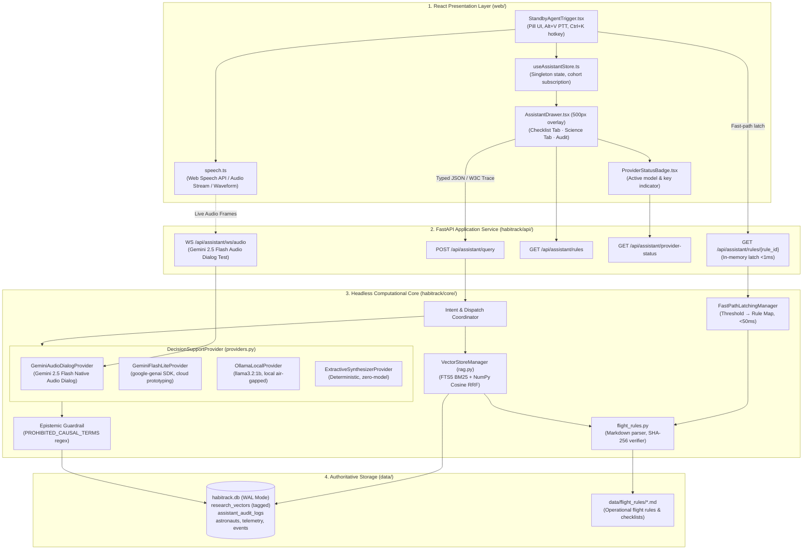

# HABITRACK Standby AI Assistant & Operational Flight Rule RAG

* **Author:** MinnThikeTunn
* **Status:** Approved Technical Design Document
* **Date:** 2026-11-14
* **Predecessor Context:** [concepts_brief.md](file:///D:/nasaResearch/concepts_brief.md)
* **Parent Architecture:** [HABITRACK V3](file:///D:/nasaResearch/README.md)
* **Requirements Baseline:** [PRD.md](file:///D:/nasaResearch/PRD.md), [GLOSSARY.md](file:///D:/nasaResearch/GLOSSARY.md)

---

## Overview

HABITRACK is an offline operational health intelligence and environmental exposure workstation for long-duration human spaceflight. During mission anomalies and environmental excursions (such as rapid cabin carbon dioxide elevations or cardiovascular decompensation), crewmembers and flight surgeons require immediate, procedural guidance grounded in certified operational flight rules and spaceflight research.

This feature introduces a standby assistant accessible across every console view (`Overview`, `Timeline`, `Symptoms`, `Research`). The assistant pairs an unobtrusive floating trigger pill with a slide-out 500 px side drawer. It supports standard keyboard text queries (`Ctrl+K`), client-side push-to-talk (PTT) voice interaction, and a dedicated developer evaluation harness. Grounded by an in-process SQLite hybrid vector RAG pipeline (dense cosine similarity + FTS5 BM25) indexing Markdown flight rules, the assistant delivers operational procedural recommendations and scientific context through a deterministic two-stage architecture: sub-50ms threshold-to-rule latching for certified checklists, backed by single-turn contextual explanation.

The architecture implements a dual-profile model:
1. **Developer Testing Profile:** An opt-in streaming audio dialog harness over WebSocket (`/ws/assistant/audio`) evaluating **Gemini 2.5 Flash Native Audio Dialog** using a user-supplied API key (`GEMINI_API_KEY`).
2. **Production Flight Profile:** Zero-cloud offline operation using keyboard text querying, local STT, local Ollama (`llama3.2:1b`), and deterministic extractive fallback with non-causal epistemic guardrails (`PROHIBITED_CAUSAL_TERMS`) and strict astronaut cohort data isolation.

---

## The Problem

### 1. Latency & Cognitive Overhead During Operational Excursions
When telemetry excursions or multi-signal concordance events fire (such as an acute $P_{\text{CO}_2}$ spike paired with suppressed heart rate variability), crew operators face severe cognitive load. Flight rules and contingency checklists are currently stored in scattered documentation or separated in disconnected research views. Operators must manually formulate keyword queries or search rulebooks during time-critical incidents, losing vital response time.

### 2. Fragmentation of Assistant Presence
In the current console, the assistant drawer is coupled strictly to the Overview and Timeline views for 1-click explanation of pre-existing concordance events. It is unavailable on the Symptoms or Research screens, and provides no omnipresent conversational entry point or standby voice modality for hands-busy crew members working on physical flight tasks.

### 3. Risk of Generative Hallucination & Procedural Liability
Standard generative LLM stochastic sampling risks hallucinating checklist steps, dropping crucial verification conditions, or generating speculative medical diagnoses. In life-critical spaceflight operations, operational checklists require verbatim procedural fidelity and strict source provenance (Flight Rule ID, revision date, exact line reference) that cannot be left to probabilistic token prediction.

### 4. Cloud Lock-in vs. Spaceflight Air-Gapped Autonomy
Prototyping AI features with cloud-only frontier models introduces architectural dependencies on massive context windows, continuous high-bandwidth internet connectivity, and multi-turn tool loops. Deep-space transit operates under communication delays (4–24 minutes each way to Mars) or complete blackout (LOS). An operational assistant must run offline on resource-constrained flight workstations with zero external vector daemons.

---

## Goals

1. **Global Standby Trigger & Drawer Shell:** Render an unobtrusive standby trigger pill visible across all console routes (`Overview`, `Timeline`, `Symptoms`, `Research`) that expands the 500 px side drawer (`AssistantDrawer.tsx`) as a non-blocking slide-out overlay without occluding or forcing canvas reflows on the synchronized 4-lane Plotly WebGL timeline.
2. **Dual-Modality Input (Text & Push-to-Talk Voice):** Support typed keyboard queries (`Enter` to submit, `Ctrl+K` global focus) alongside client-side Push-to-Talk (PTT) voice capture. The browser Web Speech API serves as an online development convenience, while offline operation gracefully falls back to keyboard entry or local STT engines with visual state indicators (`Idle`, `Listening`, `Processing`).
3. **Markdown Flight Rule Ingestion:** Extend the in-process SQLite hybrid vector store (`research_vectors` table + contiguous NumPy cosine matrix + FTS5 BM25) to ingest certified operational flight rules and contingency checklists stored in Markdown format, with zero external vector database daemons (e.g. ChromaDB).
4. **Deterministic Two-Stage Latching Pipeline:** Pre-bind known telemetry thresholds and concordance event signatures to canonical Flight Rule IDs. On event detection, latch and display authenticated emergency checklists in $< 50\text{ms}$ with zero model latency, while asynchronously generating contextual scientific framing in the background.
5. **Verbatim Procedural Checklists:** Deliver certified flight rules and contingency checklists via exact, verbatim pass-through verified with SHA-256 hashes against primary Markdown documentation, restricting the LLM to read-only contextual summarization.
6. **Unified Provider Abstraction & Two-Track Audio Evaluation:** Establish a decoupled provider contract supporting:
   - **Developer Audio Testing Harness:** Streaming live audio dialog evaluated with **Gemini 2.5 Flash Native Audio Dialog** over WebSocket (`/ws/assistant/audio`) with a user-supplied API key;
   - **Cloud Text Prototyping:** Gemini Flash-Lite via the Google GenAI SDK;
   - **Air-Gapped Flight Profile:** Local execution via Ollama (`llama3.2:1b` structured JSON mode) and a deterministic offline Extractive Research Synthesizer with zero model dependencies.
7. **Strict Cohort Isolation & Epistemic Guardrails:** Enforce physical and namespace data isolation between universal flight rules and private astronaut telemetry. Automatically purge active assistant state and in-flight requests on cohort switch. Enforce `PROHIBITED_CAUSAL_TERMS` regex to block clinical diagnoses or medical prescriptions.
8. **Operational Observability:** Persist structured diagnostic records in `assistant_audit_logs`, including W3C trace identifiers, STT acoustic metrics, provider failover counters, and guardrail tripwire offsets.

---

## Non-Goals

1. **Heavy External Vector Daemons:** ChromaDB, Milvus, Qdrant, or Pinecone will not be used in production. The system relies strictly on the in-process SQLite float32 BLOB vector store and FTS5 BM25 hybrid RRF.
2. **Autonomous Multi-Turn Agent Reasoning Loops:** The system will not permit open-ended, autonomous multi-turn tool loops during mission operations. Retrieval is single-pass and deterministic.
3. **Medical Diagnoses or Prescriptions:** The assistant will not diagnose pathological diseases, calculate clinical drug dosages, or prescribe pharmacological therapies. All recommendations remain operational flight procedures and evidence correlations.
4. **Mandatory Cloud Audio Streaming for Core Flight Operations:** Raw microphone audio will not be streamed to cloud LLMs for the operational flight profile. Operational voice transcription defaults to client-side or on-device engines. Cloud multimodal streaming is isolated strictly to the opt-in developer evaluation harness for Gemini 2.5 Flash Native Audio Dialog over WebSocket (`/ws/assistant/audio`).
5. **Modification of Core Analytics Algorithms:** Existing circadian baseline algorithms (`habitrack.core.baselines`), tripartite concordance math (`habitrack.core.analytics`), and ISS EDA ingestion (`habitrack.core.ingestion`) will not be refactored or modified.

---

## Open Questions

* **Question 1 (Flight Rule Schema):** What exact YAML frontmatter metadata should be standardized across Markdown flight rule documents in `data/flight_rules/`?
  - *Resolution:* Standardized to `rule_id`, `title`, `subsystem`, `revision_date`, `severity_trigger`, `condition_threshold`, and `reference_docs` as specified in Section 2.A.
* **Question 2 (Gemini API Key Provisioning):** In offline or test environments where `GEMINI_API_KEY` is unset or invalid, how should the system behave?
  - *Resolution:* The frontend will display a visible provider status badge (`ProviderStatusBadge.tsx`) in the drawer header indicating the active provider (`Gemini 2.5 Flash Audio`, `Gemini Flash-Lite`, `Ollama local`, or `Extractive Synthesizer`). When the key is absent, the backend silently falls back to local Ollama / extractive synthesis without crashing.

---

## Critical User Journeys (CUJs)

### CUJ 1: Global Text Query for Flight Rule Retrieval
* **Given**: An operator is viewing the Symptoms log (`/symptoms`) on the console workstation with active cohort `ASTRO-01`.
* **When**: The operator presses `Ctrl+K` or clicks the standby assistant trigger pill in the bottom corner and types: *"What is the flight rule for cabin CO2 exceeding 4.0 mmHg during sleep cycles?"* and presses Enter.
* **Then**: The 500 px side drawer expands smoothly as a non-blocking overlay. The system runs hybrid vector + BM25 search over the Markdown flight rules, retrieves Rule `FR-ECLSS-CO2-04`, displays the certified operational steps verbatim with source citations, and provides a concise single-turn non-causal explanation.

### CUJ 2: Push-to-Talk Voice Query During Telemetry Scrubbing
* **Given**: An operator is actively panning and zooming the 4-lane WebGL timeline on `/timeline`.
* **When**: The operator holds the Push-to-Talk microphone button on the assistant pill (or presses `Alt+V`) and speaks: *"Check scrubber cycling contingency checklist,"* then releases the button.
* **Then**: The browser Web Speech API (or local STT worker) captures audio, displays an animated audio waveform, and generates a transcription without interrupting timeline interactions. The query is submitted to the backend, returning the verified scrubber checklist with a non-blocking drawer expansion. In air-gapped environments without speech recognition support, the UI immediately guides the operator to typed text query (`Ctrl+K`).

### CUJ 3: Telemetry Excursion Non-Modal Latching
* **Given**: Cabin $P_{\text{CO}_2}$ telemetry exceeds 5.0 mmHg, triggering an `INVESTIGATE` Multi-Signal Concordance Event on Commander Vance (`ASTRO-01`).
* **When**: The telemetry event is emitted by the analytics pipeline.
* **Then**: The standby trigger pill enters an amber pulsing state with an operational badge and pre-latches the emergency rule in memory in $< 50\text{ms}$. To avoid operator distraction or WebGL canvas reflow during critical anomalies, the drawer does **not** auto-open; clicking the pill or pressing `Ctrl+K` smoothly expands the drawer overlay (`z-40`, backdrop-blur), rendering the verified checklist verbatim with SHA-256 validation while the background LLM synthesizes non-causal research context.

### CUJ 4: Cohort Switch State Purging
* **Given**: An operator is actively reviewing a flight rule query session in the drawer under `ASTRO-01`.
* **When**: The operator switches the cohort dropdown to `ASTRO-02` (Dr. Patel).
* **Then**: The assistant drawer immediately closes, aborts any pending LLM/retrieval HTTP requests via `AbortController`, and wipes conversation history and cached context to prevent telemetry cross-contamination.

---

## Technical Plan (Architecture)

### 1. High-Level Architecture & Component Map



---

### 2. Data Models & Domain Schemas

#### A. Flight Rule Domain Model (`habitrack.core.flight_rules`)

Operational flight rules and emergency checklists are defined as structured Pydantic V2 models parsed from Markdown documents:

```python
class SeverityTrigger(str, Enum):
    INFO = "INFO"
    OBSERVE = "OBSERVE"
    INVESTIGATE = "INVESTIGATE"
    EMERGENCY = "EMERGENCY"

class ChecklistStep(BaseModel):
    model_config = ConfigDict(frozen=True)
    step_number: int
    action: str
    target_subsystem: str
    verification: Optional[str] = None
    caution_warning: Optional[str] = None

class FlightRule(BaseModel):
    model_config = ConfigDict(frozen=True)
    rule_id: str                          # e.g., "FR-ECLSS-001"
    title: str                           # e.g., "Elevated Cabin P_CO2 Mitigation"
    subsystem: str                       # e.g., "ECLSS / CDRA"
    revision_date: str                   # e.g., "2026-04-15"
    severity_trigger: SeverityTrigger
    condition_threshold: str             # e.g., "P_CO2 >= 4.0 mmHg for > 30 min"
    verbatim_text: str                   # Exact markdown body excerpt
    sha256_hash: str                     # Cryptographic checksum for procedural fidelity
    checklist_steps: List[ChecklistStep]
    reference_docs: List[str]            # Associated NASA Technical Standards
```

##### Markdown Flight Rule Document Specification
All flight rule files stored in `data/flight_rules/` must adhere to strict YAML frontmatter paired with standard Markdown tables for procedural steps:

```markdown
---
rule_id: "FR-ECLSS-001"
title: "Elevated Cabin Carbon Dioxide Mitigation"
subsystem: "ECLSS / CDRA"
revision_date: "2026-04-15"
severity_trigger: "INVESTIGATE"
condition_threshold: "P_CO2 >= 4.0 mmHg for > 30 min"
reference_docs:
  - "NASA-STD-3001 Vol 2"
  - "SSP 50260 Section 4.2"
---

# Operational Flight Rule: FR-ECLSS-001

## Operating Condition & Context
When cabin partial pressure of CO2 exceeds 4.0 mmHg during crew rest cycles or 5.0 mmHg during active duty, the following procedural checklist must be executed immediately to prevent hypercapnic cognitive impairment and cephalic fluid shift compounding.

## Procedural Contingency Checklist

| Step | Action | Target Subsystem | Verification | Caution / Warning |
| :--- | :--- | :--- | :--- | :--- |
| 1 | Transition CDRA Bed Selector to DUAL-BED HIGH-FLOW | CDRA-ECLSS | Telemetry CDRA_STATE == 0x04 | Ensure vacuum desorb valve V12 is open before switching |
| 2 | Verify cabin ventilation fans running at nominal rate | NOD2-VENT | Flow rate >= 55 CFM | High acoustic noise (>62 dBA) during high-flow operation |
| 3 | Inquire crew for subjective symptoms | CREW-MED | Log headache, vision blurring, dyspnea | Prepare backup LiOH canisters if CDRA delta-P > 1.2 psi |
| 4 | Deploy portable LiOH auxiliary scrubber if P_CO2 > 6.0 mmHg | AUX-SCRUB | Auxiliary latch confirmed | Emergency flight director notification mandatory |
```

#### B. Preserved Assistant Domain Model (`habitrack.core.models`)

To eliminate contract churn and maintain 100% backward compatibility with existing production components, tests, and endpoints, `AssistantResponse` preserves all 12 existing fields from `habitrack/core/models.py`, extended non-destructively with optional flight rule and provider metadata:

```python
class AssistantResponse(BaseModel):
    """Authoritative response envelope for HABITRACK assistant queries."""
    model_config = ConfigDict(frozen=True)
    
    # Preserved 12 Production Fields (Exact Compatibility)
    interaction_id: str
    astronaut_id: Optional[str] = None
    event_id: Optional[str] = None
    mode: Literal["OLLAMA_GENERATIVE", "EXTRACTIVE_FALLBACK", "GEMINI_GENERATIVE"]
    headline: str
    observed_dynamics: str
    scientific_context: str
    cited_evidence: List[CitedEvidence]
    study_caveats: List[str]
    disclaimer: str
    tripwire_triggered: bool = False
    latency_ms: float
    
    # Non-breaking extensions for flight rules & provider telemetry
    flight_rule_cited: Optional[FlightRule] = None
    verbatim_checklist: List[ChecklistStep] = Field(default_factory=list)
    provider_used: Optional[str] = None
```

---

### 3. API Endpoints & Protocol Contracts

The assistant operates across formal API contracts under `habitrack/api/routes/assistant.py`:

#### 1. Contextual Query Endpoint: `POST /api/assistant/query`
* **Request Model (`AssistantQueryRequest`):**
  ```python
  class AssistantQueryRequest(BaseModel):
      query: str = Field(..., min_length=2, max_length=1000, description="User question or excursion context")
      astronaut_id: Optional[str] = Field(None, description="Optional target astronaut identifier for cohort scoping (None allows ad-hoc research search)")
      concordance_event_id: Optional[str] = Field(None, description="Optional associated concordance event ID")
      top_k: int = Field(default=5, ge=1, le=20, description="Maximum number of context passages to retrieve")
      client_timestamp: Optional[str] = Field(None, description="ISO-8601 client timestamp")
  ```
* **Response Model:** `AssistantResponse` (Status: `200 OK`)
* **Error Responses:** `400 Bad Request` (invalid query), `500 Internal Server Error` (fallback to extractive response with `mode: "EXTRACTIVE_FALLBACK"`).

#### 2. Fast-Path Rule Retrieval & Latching
Fast-path latching is implemented directly in-memory via `habitrack.core.flight_rules.get_flight_rule(rule_id: str)` running in $<0.2\text{ms}$. Pre-latched `rule_id` values are attached directly to concordance events by the analytics pipeline. If the client queries a rule directly by ID, it uses the standard endpoint:
* **Endpoint:** `GET /api/assistant/rules/{rule_id}` (or `GET /api/assistant/rules?rule_id=...`)
* **Response Model:** `FlightRule` (Status: `200 OK`, latency $<1\text{ms}$)
* **Error Responses:** `404 Not Found` (invalid rule identifier).

#### 3. Flight Rule Catalog: `GET /api/assistant/rules`
* **Query Parameters:** `subsystem: Optional[str]`, `severity: Optional[str]`
* **Response Model:** `List[FlightRule]` (Status: `200 OK`)

#### 4. Provider Health & Key Status: `GET /api/assistant/provider-status`
* **Response Model:**
  ```python
  class ProviderStatusResponse(BaseModel):
      active_provider: str                     # e.g., "gemini-2.5-flash-audio" | "gemini-flash-lite" | "ollama" | "extractive"
      gemini_available: bool                   # True if valid GEMINI_API_KEY detected
      ollama_available: bool                   # True if local Ollama daemon responding
      gemini_audio_testing_enabled: bool       # True if WebSocket live audio dialog is supported
      active_model_name: str                   # e.g., "Gemini 2.5 Flash Native Audio Dialog"
  ```

#### 5. Developer Audio Dialog Evaluation WebSocket: `WS /api/assistant/ws/audio`
* **Connection Handshake:**
  - Client opens WebSocket to `/api/assistant/ws/audio`.
  - Client sends initial configuration JSON:
    ```json
    {
      "type": "init",
      "api_key": "USER_SUPPLIED_GEMINI_API_KEY",
      "astronaut_id": "ASTRO-01",
      "sample_rate_hz": 16000
    }
    ```
  - Server validates API key, initializes Gemini Live Audio session with **Gemini 2.5 Flash Native Audio Dialog**, and responds with `{"type": "ready", "session_id": "uuid"}`.
* **Streaming Audio Exchange:**
  - Client streams raw PCM binary chunks (16kHz, 16-bit mono, little-endian).
  - Server streams back real-time audio responses, interleaved with JSON transcription and flight rule citation metadata frames:
    ```json
    {"type": "transcription", "speaker": "user", "text": "Check CO2 flight rule"}
    {"type": "delta_text", "speaker": "assistant", "text": "Elevated cabin CO2 rule FR-ECLSS-001 latched."}
    {"type": "flight_rule", "rule_id": "FR-ECLSS-001", "steps_count": 4}
    ```
  - Client binary frame: Audio playback chunk (PCM 24kHz) for speaker output.

---

### 4. Deterministic Fast-Path Latching & Two-Stage Execution

To reconcile real-time response speeds during mission excursions with deep knowledge grounding:

1. **Stage 1 (Deterministic Fast-Path Latching, $<50\text{ms}$):**
   - The analytics concordance engine (`habitrack.core.analytics`) or UI detects a telemetry threshold breach (e.g., $P_{\text{CO}_2} > 5.0\text{ mmHg}$).
   - `FastPathLatchingManager` maps the event signature (`event_type`, `severity`, `contributing_streams`) via an in-memory lookup table to canonical `FlightRule` IDs.
   - The verified `FlightRule` and its `ChecklistStep` list are loaded directly from the indexed database and returned immediately to the UI dock. The checklist is rendered **verbatim** with verified SHA-256 hashes, requiring zero LLM inference.
2. **Stage 2 (Single-Turn Contextual Synthesis, Asynchronous):**
   - The user query or telemetry context is sent to `POST /api/assistant/query`.
   - The `VectorStoreManager` retrieves the top 3 relevant flight rules and top 3 research papers via hybrid RRF.
   - The active `DecisionSupportProvider` (Gemini Flash-Lite, Ollama, or Extractive) synthesizes a single-turn explanation adhering to a strict 1,200 prompt token budget.
   - The output is passed through the deterministic `PROHIBITED_CAUSAL_TERMS` regex guardrail. If violated, it fails over to the extractive synthesis text and logs `tripwire_triggered = 1`.
   - The audit log is committed with W3C trace identifiers.

---

### 5. Epistemic Guardrail & Non-Causal Safety System

HABITRACK strictly adheres to an epistemic boundary: the assistant provides operational flight rule guidance and correlational scientific evidence, but never clinical medical diagnoses or pharmacological prescriptions.

#### Compiled Guardrail Regex Standard
The codebase strictly enforces `PROHIBITED_CAUSAL_TERMS` and `MANDATORY_DISCLAIMER` defined in `habitrack/core/assistant.py` and validated by `tests/test_assistant.py`. All generated text is processed before transmission:

```python
MANDATORY_DISCLAIMER = (
    "Non-Causal Decision Support Disclaimer: Temporal correlation indicates "
    "co-occurrence only and does not establish clinical causation. HABITRACK "
    "is a clinical decision-support tool, not an autonomous diagnostic system. "
    "Operational countermeasure decisions must be verified by flight surgeons."
)

PROHIBITED_CAUSAL_TERMS = re.compile(
    r"\b("
    r"cause|causes|caused|causing|"
    r"proves|proven|proving|"
    r"diagnose|diagnosed|diagnosing|diagnosis|"
    r"prescribe|prescribes|prescribed|prescribing|prescription|"
    r"treat|treated|treating|treatment|therapeutic|therapy|"
    r"cure|remedy|"
    r"patholog(?:y|ical)|etiolog(?:y|ic|ical)"
    r")\b",
    re.IGNORECASE,
)
```

#### Failover Workflow & Invariant Disclaimer
1. **Tripwire Detection:** If `PROHIBITED_CAUSAL_TERMS.search(generated_text)` finds any match:
   - The generative contextual text is immediately discarded.
   - The system falls back to the deterministic output of `ExtractiveSynthesizerProvider`, which formats verbatim excerpts from retrieved research papers and flight rules.
   - `tripwire_triggered` is set to `True`.
   - An operational warning entry is recorded in `assistant_audit_logs` capturing the offending token sequence and character offset.
2. **Mandatory Epistemic Disclaimer:** Every response envelope is stamped with the immutable disclaimer:
   > *"Non-Causal Decision Support Disclaimer: Temporal correlation indicates co-occurrence only and does not establish clinical causation. HABITRACK is a clinical decision-support tool, not an autonomous diagnostic system. Operational countermeasure decisions must be verified by flight surgeons."*

---

### 6. Observability & Audit Logging

To guarantee traceability in life-critical spaceflight operations, all assistant queries, latching events, STT transactions, and failover events are persisted to the authoritative database.

#### SQLite Non-Destructive Audit Schema Migration
The existing `assistant_audit_logs` table (with primary key `log_id TEXT PRIMARY KEY`) is extended non-destructively in `habitrack/core/storage.py` via idempotent `ALTER TABLE` checks:

```python
# Preserved existing schema: log_id TEXT PRIMARY KEY, event_id, astronaut_id, query_text,
# retrieval_mode, generation_mode, response_text, cited_doc_ids, tripwire_triggered, latency_ms, created_at

NEW_AUDIT_COLUMNS = {
    "trace_id": "TEXT",
    "flight_rule_cited": "TEXT",
    "rule_sha256": "TEXT",
    "stt_confidence": "REAL",
    "stt_duration_sec": "REAL",
    "tripwire_match_term": "TEXT",
    "provider_used": "TEXT",
}
```

```sql
-- Idempotent non-destructive database migrations
ALTER TABLE assistant_audit_logs ADD COLUMN trace_id TEXT;
ALTER TABLE assistant_audit_logs ADD COLUMN flight_rule_cited TEXT;
ALTER TABLE assistant_audit_logs ADD COLUMN rule_sha256 TEXT;
ALTER TABLE assistant_audit_logs ADD COLUMN stt_confidence REAL;
ALTER TABLE assistant_audit_logs ADD COLUMN stt_duration_sec REAL;
ALTER TABLE assistant_audit_logs ADD COLUMN tripwire_match_term TEXT;
ALTER TABLE assistant_audit_logs ADD COLUMN provider_used TEXT;
```

#### Operational Telemetry Metrics
The system records runtime metrics accessible via internal diagnostic endpoints:
* `assistant_query_duration_ms`: Histogram of end-to-end query latency grouped by provider.
* `assistant_latch_duration_ms`: Histogram of fast-path latching time (target: $< 50\text{ms}$).
* `assistant_tripwire_violations_total`: Counter tracking non-causal term infractions.
* `assistant_provider_fallbacks_total`: Counter tracking graceful failovers (e.g. Gemini $\to$ Ollama $\to$ Extractive).

---

### 7. Push-to-Talk (PTT) Voice & Two-Track Audio Architecture

```text
[Standby Idle] ---> (Keydown: Alt+V / MouseDown: Mic Button) ---> [Listening & Audio Energy Metering]
       ^                                                                       |
       |--- (Keyup / MouseUp / Timeout 15s) <----------------------------------+
       |
       v
[Transcription & Routing] 
       |
       +---> [Track A: Client-Side Web Speech API / Keyboard] ---> POST /api/assistant/query
       |        | (Offline / Chromium Network Fail) ---> [Graceful Fallback: Ctrl+K Text Mode]
       |
       +---> [Track B: Opt-In Audio Testing Harness] ----------> WS /ws/assistant/audio
                | (User API Key Provided) --------------------> [Gemini 2.5 Flash Native Audio Dialog]
```

- **Online Prototyping Convenience:** Browser `SpeechRecognition` is used for rapid desktop UI development.
- **Air-Gapped Flight Autonomy:** The system does not assume browser speech recognition is functional in air-gapped environments (where Chromium desktop routes audio to `speech.googleapis.com` and fails offline). The workstation defaults to rapid keyboard querying (`Ctrl+K`) with optional local STT integration.
- **Developer Audio Dialog Evaluation:** When evaluating conversational live voice interaction, the developer activates Track B, streaming microphone frames over WebSocket to Gemini 2.5 Flash Native Audio Dialog with a user-supplied API key.

---

### 8. Cohort Isolation & Session Purging

- **Backend Partitioning:** All assistant endpoints validate `astronaut_id`. Queries across astronaut-specific telemetry, vitals, and symptoms are partitioned by `WHERE astronaut_id = :id`. Flight rules are universal in scope (`corpus_type = 'FLIGHT_RULE'`).
- **Frontend Session Wipe:** `useAssistantStore` in Zustand subscribes to `cohortStore`. Whenever `activeCohortId` changes:
  1. Any in-flight HTTP or WebSocket request is aborted via `AbortController`.
  2. Active conversation turns, active flight rule cards, and audio buffers are cleared.
  3. The drawer closes if open, ensuring no cross-cohort evidence leakage.

---

### 9. Storage, Database Schema Migration & Seeding

The authoritative SQLite database (`data/habitrack.db`) will apply incremental, idempotent migrations:

1. **Authoritative `flight_rules` Table DDL:**
   Create the dedicated storage table for certified flight rules and procedural checklists in `habitrack/core/storage.py`:
   ```sql
   CREATE TABLE IF NOT EXISTS flight_rules (
       rule_id TEXT PRIMARY KEY,
       title TEXT NOT NULL,
       subsystem TEXT NOT NULL,
       revision_date TEXT NOT NULL,
       severity_trigger TEXT NOT NULL CHECK(severity_trigger IN ('INFO', 'OBSERVE', 'INVESTIGATE', 'EMERGENCY')),
       condition_threshold TEXT NOT NULL,
       verbatim_text TEXT NOT NULL,
       sha256_hash TEXT NOT NULL,
       checklist_steps_json TEXT NOT NULL,
       reference_docs_json TEXT NOT NULL,
       created_at TIMESTAMP NOT NULL DEFAULT CURRENT_TIMESTAMP
   );
   CREATE INDEX IF NOT EXISTS idx_flight_rules_subsystem ON flight_rules(subsystem);
   CREATE INDEX IF NOT EXISTS idx_flight_rules_severity ON flight_rules(severity_trigger);
   ```

2. **StorageManager CRUD Methods:**
   Implement explicit database access methods in `StorageManager`:
   - `insert_flight_rule(rule: FlightRule) -> None`
   - `get_flight_rule(rule_id: str) -> Optional[FlightRule]`
   - `list_flight_rules(subsystem: Optional[str] = None, severity: Optional[str] = None) -> List[FlightRule]`

3. **Tagging `research_vectors`:**
   Add `corpus_type TEXT NOT NULL DEFAULT 'RESEARCH'`, `rule_id TEXT`, and `sha256_hash TEXT` columns to allow indexing both research papers and Markdown flight rules in the same unified hybrid vector matrix.

4. **Non-Destructive Expansion of `assistant_audit_logs`:**
   Apply idempotent `ALTER TABLE` migrations to record W3C trace identifiers, STT metrics, and guardrail tripwires:
   ```sql
   ALTER TABLE assistant_audit_logs ADD COLUMN trace_id TEXT;
   ALTER TABLE assistant_audit_logs ADD COLUMN flight_rule_cited TEXT;
   ALTER TABLE assistant_audit_logs ADD COLUMN rule_sha256 TEXT;
   ALTER TABLE assistant_audit_logs ADD COLUMN stt_confidence REAL;
   ALTER TABLE assistant_audit_logs ADD COLUMN stt_duration_sec REAL;
   ALTER TABLE assistant_audit_logs ADD COLUMN tripwire_match_term TEXT;
   ALTER TABLE assistant_audit_logs ADD COLUMN provider_used TEXT;
   ```
   *Constraint Preservation Note:* To maintain backward compatibility with existing databases having `CHECK(generation_mode IN ('OLLAMA_GENERATIVE', 'EXTRACTIVE_FALLBACK'))`, `generation_mode` remains mapped to the generative vs extractive paradigm, while the runtime engine (`gemini-2.5-flash-audio`, `gemini-flash-lite`, `llama3.2:1b`, `extractive-synthesizer`) is recorded strictly in `provider_used`.

5. **Idempotent Dual-Index Seeding (`seed_flight_rules`):**
   `habitrack.core.flight_rules.seed_flight_rules()` parses Markdown flight rules from `data/flight_rules/*.md`, verifies SHA-256 hashes, upserts structured rules into `flight_rules`, and indexes rule text into:
   - `research_vectors` for dense cosine similarity matching;
   - `research_knowledge_fts` (with `source_repository = 'NASA Flight Rules'`) for lexical BM25 matching.
   Integrated directly into `habitrack/provision.py:provision_mission()` so that running `python -m habitrack.provision` reseeds telemetry without altering or dropping curated flight rules.

---

## Alternatives Considered

### Alternative A: ChromaDB as Dedicated Vector Database
* **Pros**: Dedicated vector search abstractions, rich ecosystem integrations, built-in metadata filtering.
* **Cons**: Introduces over 600 MB of native build dependencies (`hnswlib`, DuckDB/ClickHouse, gRPC background daemons), high memory overhead (>300 MB idle RAM), and C++ toolchain requirements that jeopardize air-gapped spaceflight deployment.
> **Reason for Rejection:** The existing in-process SQLite float32 BLOB vector store with in-memory NumPy cosine similarity executes queries in $< 0.2\text{ms}$ on standard CPU hardware with zero external daemons, satisfying all performance and air-gapped flight-qualification requirements.

### Alternative B: Autonomous Multi-Turn Agent Tool-Calling Framework
* **Pros**: Gives the LLM freedom to dynamically formulate sub-queries, inspect intermediary results, and invoke external inspection tools iteratively.
* **Cons**: Multi-turn reasoning loops introduce 4–8s of network latency over cloud APIs and 15–30s on local quantized models (`llama3.2:1b`), with frequent JSON schema syntax failures, cyclic query loops, and non-deterministic behavior during time-critical flight anomalies.
> **Reason for Rejection:** Operational flight excursions require sub-second deterministic procedural responses. The architecture replaces open-ended multi-turn loops with a deterministic two-stage pipeline: sub-50ms threshold-to-rule fast-path latching paired with single-turn bounded context synthesis.

### Alternative C: Generatively Synthesized Operational Checklists
* **Pros**: Flexible, natural-language generation that dynamically tailors checklist instructions to the user's specific phrasing.
* **Cons**: Stochastic token generation risks dropping critical procedural verification steps, hallucinating unverified environmental thresholds, or generating authoritative clinical diagnoses that violate HABITRACK's core non-causal epistemic guardrails (`PROHIBITED_CAUSAL_TERMS`).
> **Reason for Rejection:** Operational flight rules and emergency checklists require verbatim procedural fidelity and strict source provenance. The assistant must deliver checklist steps via verbatim pass-through validated with SHA-256 checksums, restricting the LLM purely to non-causal contextual explanation.

### Alternative D: Persistent Full-Width Horizontal Bottom Bar
* **Pros**: Constant visibility of chat input and voice recording controls across all views.
* **Cons**: Consumes 120–180 px of vertical display height, severely compressing the synchronized 4-lane Plotly WebGL timeline on standard 1080p workstation screens and conflicting with mission elapsed time (MET) annunciators.
> **Reason for Rejection:** Full vertical timeline resolution and multi-signal crosshairs are essential for clinical review. Replaced with an unobtrusive standby trigger pill in the bottom corner that expands the responsive 500 px side drawer as a non-blocking slide-out overlay (`z-40`, backdrop-blur) across all views.

### Alternative E: Cloud Multimodal Audio Streaming for Operational Flight Profile
* **Pros**: Native end-to-end speech understanding with conversational voice-to-voice streaming.
* **Cons**: High token consumption (~25–32 equivalent tokens/sec), quota exhaustion during long monitoring shifts, high sensitivity to ambient cabin acoustic noise (~55–60 dBA), and total failure during communication blackouts (LOS) in deep-space transit.
> **Reason for Rejection:** Spaceflight autonomy requires zero runtime cloud dependencies for operational spaceflight profiles. Operational voice transcription defaults to client-side or on-device engines. However, to evaluate live audio conversational performance during development, the system explicitly supports an opt-in evaluation harness targeting **Gemini 2.5 Flash Native Audio Dialog** over WebSocket (`/api/assistant/ws/audio`) with a user-supplied API key.

---

## Detailed Implementation Plan

### 1. Phased Implementation Task List

#### Phase 1: Database Schema Migrations & Storage Methods
* **Target Files:** `habitrack/core/storage.py`, `habitrack/core/models.py`
1. Define the `flight_rules` table DDL, indexes, and migrations in `habitrack/core/storage.py`.
2. Add non-destructive `ALTER TABLE` migrations in `StorageManager._initialize_db()` for:
   - `research_vectors`: `corpus_type TEXT NOT NULL DEFAULT 'RESEARCH'`, `rule_id TEXT`, `sha256_hash TEXT`.
   - `assistant_audit_logs`: `trace_id TEXT`, `flight_rule_cited TEXT`, `rule_sha256 TEXT`, `stt_confidence REAL`, `stt_duration_sec REAL`, `tripwire_match_term TEXT`, `provider_used TEXT`.
3. Implement `StorageManager` CRUD methods:
   - `insert_flight_rule(rule: FlightRule) -> None`
   - `get_flight_rule(rule_id: str) -> Optional[FlightRule]`
   - `list_flight_rules(subsystem: Optional[str] = None, severity: Optional[str] = None) -> List[FlightRule]`
4. Update `StorageManager.insert_assistant_audit_log()` to parameterize and persist all 7 new columns.
5. In `habitrack/core/models.py`:
   - Extend `AssistantResponse` with `flight_rule_cited: Optional[FlightRule] = None`, `verbatim_checklist: List[ChecklistStep] = Field(default_factory=list)`, `provider_used: Optional[str] = None`, and extend `mode` literal with `"GEMINI_GENERATIVE"`.
   - Extend `AssistantAuditLog` with the 7 new audit fields.
   - Extend `VectorEmbeddingRecord` with `corpus_type: str = "RESEARCH"`, `rule_id: Optional[str] = None`, and `sha256_hash: Optional[str] = None`.
   - Define request/response models: `AssistantQueryRequest` and `ProviderStatusResponse`.

#### Phase 2: Flight Rules Knowledge Base Ingestion & FTS Seeding
* **Target Files:** `data/flight_rules/*.md`, `habitrack/core/flight_rules.py`, `habitrack/provision.py`
1. Author three authenticated operational flight rules in Markdown:
   - `data/flight_rules/FR_ECLSS_001_hypercapnia.md` (Cabin P_CO2 hypercapnia mitigation).
   - `data/flight_rules/FR_CDRA_002_scrubber_cycling.md` (CDRA desiccant bed cycling and thermal regeneration).
   - `data/flight_rules/FR_EVA_003_autonomic_strain.md` (EVA acute sympathetic strain and tachycardia mitigation).
2. Create `habitrack/core/flight_rules.py`:
   - Implement Pydantic V2 models: `SeverityTrigger`, `ChecklistStep`, `FlightRule`.
   - Implement YAML frontmatter parser and markdown table checklist extractor.
   - Implement SHA-256 checksum calculation over verbatim markdown bodies.
   - Define `EVENT_SIGNATURE_TO_RULE_MAP: Dict[Tuple[str, frozenset], str]` binding event types and contributing stream sets to canonical rule IDs.
   - Implement `resolve_latch_rule_id(event_type: str, contributing_streams: set[str]) -> Optional[str]`.
   - Implement `seed_flight_rules(storage: StorageManager, rag: VectorStoreManager) -> int` to parse rules, insert into `flight_rules`, index passages into `research_vectors`, and index sections into SQLite `research_knowledge_fts` (`source_repository = 'NASA Flight Rules'`).
3. Update `habitrack/provision.py:provision_mission()` to invoke `seed_flight_rules()` during system provisioning.

#### Phase 3: Hybrid Vector Store Matrix Extension
* **Target Files:** `habitrack/core/rag.py`
1. Update `VectorStoreManager.load_embeddings()` in `habitrack/core/rag.py` to index both `corpus_type = 'RESEARCH'` and `corpus_type = 'FLIGHT_RULE'` passages into the contiguous in-memory NumPy matrix (`np.ndarray` float32).
2. Extend `hybrid_search()` to accept an optional `corpus_type: Optional[str] = None` filter, applying metadata filtering during reciprocal rank fusion (RRF) between dense cosine similarity and lexical BM25.
3. Ensure `index_research_corpus()` preserves or re-indexes flight rule passages in `research_knowledge_fts`.

#### Phase 4: Decoupled Decision Support Provider Architecture
* **Target Files:** `habitrack/core/providers.py`
1. Create `habitrack/core/providers.py` defining the provider abstract base class:
   ```python
   class DecisionSupportProvider(ABC):
       @property
       @abstractmethod
       def provider_id(self) -> str: ...

       @abstractmethod
       async def is_available(self) -> bool: ...

       @abstractmethod
       async def generate_response(
           self,
           prompt: str,
           evidence: List[CitedEvidence],
           rule: Optional[FlightRule] = None,
           cohort_context: Optional[Dict[str, Any]] = None,
           trace_id: str = "",
       ) -> AssistantResponse: ...
   ```
2. Implement concrete adapters:
   - `GeminiFlashLiteProvider`: Uses Google GenAI SDK (`google-genai`) for cloud text prototyping adhering to 1,200 token budget.
   - `OllamaLocalProvider`: Connects to local Ollama (`llama3.2:1b`) with JSON schema formatting for air-gapped flight operation.
   - `ExtractiveSynthesizerProvider`: 100% deterministic, zero-model fallback extracting verbatim excerpts from retrieved rules and evidence cards.
3. Implement `GeminiAudioSessionManager`: Dedicated WebSocket live streaming bridge targeting **Gemini 2.5 Flash Native Audio Dialog** supporting 16kHz PCM input, real-time transcription, rule event emission, and 24kHz audio playback chunks.

#### Phase 5: Assistant Orchestration & Epistemic Guardrail
* **Target Files:** `habitrack/core/assistant.py`
1. Refactor `AssistantManager` to manage active providers with automatic graceful fallback:
   - Priority chain: Gemini Flash-Lite (if configured and key present) $\to$ Ollama Local $\to$ Extractive Synthesizer.
2. Implement two-stage query resolution:
   - Fast-path rule retrieval (<1 ms in-memory hash lookup via `get_flight_rule()`).
   - Single-turn contextual synthesis via the active provider.
3. Enforce the compiled `PROHIBITED_CAUSAL_TERMS` regex guardrail and immutable `MANDATORY_DISCLAIMER` from `assistant.py`.
4. On tripwire violation: fall back to `ExtractiveSynthesizerProvider`, set `tripwire_triggered = True`, record offending token offset, and log to `assistant_audit_logs`.
5. Populate all 7 new audit fields on `AssistantResponse` and persist via `StorageManager.insert_assistant_audit_log()`.

#### Phase 6: FastAPI Application Endpoints
* **Target Files:** `habitrack/api/routes/assistant.py`
1. Refactor existing `@router.post("/query")` endpoint in `habitrack/api/routes/assistant.py`:
   - Accept upgraded `AssistantQueryRequest` (query, optional `astronaut_id`, `top_k: int = 5`, `concordance_event_id`, and `client_timestamp`).
   - Maintain full backward compatibility with `ResearchView.tsx`.
2. Add `GET /api/assistant/rules`: Query catalog of flight rules with optional `subsystem` and `severity` filters.
3. Add `GET /api/assistant/rules/{rule_id}`: Retrieve single verified flight rule by ID (<1 ms latency).
4. Add `GET /api/assistant/provider-status`: Return active provider ID, model name, and Gemini API key availability.
5. Add `@router.websocket("/ws/audio")` (mounted at `WS /api/assistant/ws/audio`): WebSocket endpoint for the developer live audio evaluation harness connecting to `GeminiAudioSessionManager`.

#### Phase 7: Frontend Web Console Presentation
* **Target Files:** `web/src/...`
1. Implement `web/src/types/api.ts`:
   - Extend `AssistantResponse` with `flight_rule_cited: FlightRule | null`, `verbatim_checklist: ChecklistStep[]`, and `provider_used?: string`.
   - Add TypeScript interfaces: `ChecklistStep`, `FlightRule`, `ProviderStatusResponse`, `AssistantQueryRequest`.
2. Update `web/src/services/api.ts`:
   - Refactor `queryAssistant(text, topK, astronautId, eventId)` to submit `AssistantQueryRequest`.
   - Add `fetchFlightRules(subsystem?, severity?)`, `fetchFlightRule(ruleId)`, and `fetchProviderStatus()`.
3. Implement `web/src/lib/speech.ts`:
   - PTT audio capture via browser `SpeechRecognition` with text fallback.
   - Audio energy metering for waveform visualization.
   - WebSocket streaming bridge to `WS /api/assistant/ws/audio` for Gemini Audio Dialog testing.
4. Implement `web/src/components/StandbyAgentTrigger.tsx`:
   - Floating trigger pill in bottom-right corner with PTT button and `Alt+V` / `Ctrl+K` keybindings.
   - Non-modal amber pulsing indicator on latched concordance events.
5. Implement `web/src/components/ProviderStatusBadge.tsx`:
   - Status badge in drawer header displaying active model and API key readiness.
6. Update `web/src/stores/assistantStore.ts`:
   - Add standby pill state, PTT recording lifecycle (`IDLE`, `LISTENING`, `PROCESSING`), and latched flight rule.
   - Extend existing `cohortStore` subscription: on cohort change, abort in-flight requests and clear standby/audio state.
7. Update `web/src/components/AssistantDrawer.tsx`:
   - Dual-tab interface: "Procedural Checklists" (verbatim steps with interactive check-offs and SHA-256 badge) vs. "Scientific Evidence" cards.
   - Non-blocking slide-out overlay (`z-40`, `backdrop-blur`).
8. Update `web/src/App.tsx`:
   - Mount `<StandbyAgentTrigger />` at root layout shell. (Retain existing root mount of `<AssistantDrawer />`).

#### Phase 8: Automated Verification & Test Suite
* **Target Files:** `tests/conftest.py`, `tests/test_flight_rules.py`, `tests/test_providers.py`, `tests/test_assistant_v4.py`
1. Update `tests/conftest.py`:
   - Promote `api_client` and `seeded_api_client` fixtures from `tests/test_api.py` into `tests/conftest.py` so they are accessible across all test modules.
2. Create `tests/test_flight_rules.py`:
   - `test_parse_valid_frontmatter`: Validates YAML frontmatter parsing and type validation.
   - `test_sha256_checksum_verification`: Validates hash generation across verbatim markdown text.
   - `test_tampered_rule_hash_mismatch`: Validates detection of tampered checklist text.
   - `test_in_memory_rule_lookup_sub_1ms`: Validates sub-millisecond rule retrieval.
   - `test_event_signature_to_rule_latching`: Validates mapping of telemetry threshold excursions to rule IDs within 50 ms.
3. Create `tests/test_providers.py`:
   - `test_gemini_provider_with_mocked_sdk`: Validates Gemini Flash-Lite provider with mocked Google GenAI SDK.
   - `test_ollama_fallback_when_offline`: Validates automatic failover to extractive synthesis when Ollama is unreachable.
   - `test_extractive_provider_deterministic_output`: Validates exact excerpt formatting with zero model dependencies.
   - `test_prohibited_causal_terms_triggers_extractive_fallback`: Validates tripwire triggering and fallback upon causal terms.
4. Create `tests/test_assistant_v4.py`:
   - `test_query_with_cohort_isolation`: Validates cohort-scoped data partitioning.
   - `test_ad_hoc_research_query_without_cohort`: Validates research queries with `astronaut_id = None`.
   - `test_audit_log_fields_persistence`: Validates persistence of all 7 new audit fields in SQLite.
   - `test_provider_status_endpoint`: Validates `GET /api/assistant/provider-status` contract.

---

### 2. Comprehensive File Implementation Matrix

| File Path | Status | Rationale for Modification / Creation |
| :--- | :--- | :--- |
| `data/flight_rules/FR_ECLSS_001_hypercapnia.md` | Created | Operational flight rule for elevated cabin P_CO2 mitigation with verified checklist steps. |
| `data/flight_rules/FR_CDRA_002_scrubber_cycling.md` | Created | Contingency operational rule for CDRA desiccant bed cycling anomalies and thermal regeneration. |
| `data/flight_rules/FR_EVA_003_autonomic_strain.md` | Created | Operational rule for managing acute sympathetic overactivation and elevated heart rates during EVA preparation. |
| `habitrack/core/models.py` | Modified | Add `flight_rule_cited`, `verbatim_checklist`, `provider_used` to `AssistantResponse`; add 7 audit fields to `AssistantAuditLog`; add `corpus_type`, `rule_id`, `sha256_hash` to `VectorEmbeddingRecord`; define `AssistantQueryRequest` and `ProviderStatusResponse`. |
| `habitrack/core/storage.py` | Modified | Add `flight_rules` table DDL, CRUD methods (`insert_flight_rule`, `get_flight_rule`, `list_flight_rules`), and idempotent SQLite migrations for `research_vectors` and `assistant_audit_logs`. |
| `habitrack/core/flight_rules.py` | Created | Pydantic V2 domain models (`FlightRule`, `ChecklistStep`), Markdown parser, SHA-256 verifier, `EVENT_SIGNATURE_TO_RULE_MAP`, and `seed_flight_rules()`. |
| `habitrack/core/rag.py` | Modified | Update `VectorStoreManager` to index flight rules into `research_vectors` and `research_knowledge_fts`, supporting filtered hybrid RRF retrieval on `corpus_type`. |
| `habitrack/core/providers.py` | Created | `DecisionSupportProvider` ABC, concrete adapters (`GeminiFlashLiteProvider`, `OllamaLocalProvider`, `ExtractiveSynthesizerProvider`), and `GeminiAudioSessionManager`. |
| `habitrack/core/assistant.py` | Modified | Update assistant orchestration to execute deterministic two-stage pipeline, preserve `AssistantResponse`, and record enhanced guardrail tripwire logging. |
| `habitrack/provision.py` | Modified | Invoke `seed_flight_rules()` in `provision_mission()` so telemetry resets preserve curated flight rules and index both dense and FTS representations. |
| `habitrack/api/routes/assistant.py` | Modified | Refactor `POST /api/assistant/query`; add `GET /api/assistant/rules`, `GET /api/assistant/rules/{rule_id}`, `GET /api/assistant/provider-status`, and `WS /api/assistant/ws/audio`. |
| `web/src/types/api.ts` | Modified | Extend `AssistantResponse` with `flight_rule_cited` and `verbatim_checklist`; add TypeScript interfaces for `FlightRule`, `ChecklistStep`, and `ProviderStatusResponse`. |
| `web/src/services/api.ts` | Modified | Refactor `queryAssistant()`; add `fetchFlightRules()`, `fetchFlightRule()`, and `fetchProviderStatus()`. |
| `web/src/lib/speech.ts` | Created | Client-side Web Speech API adapter for PTT audio capture, permission detection, audio waveform energy metering, text fallback, and WebSocket streaming bridge. |
| `web/src/stores/assistantStore.ts` | Modified | Add standby assistant state, audio recording state, and extend `cohortStore` subscription for automatic session wiping on crew switch. |
| `web/src/components/StandbyAgentTrigger.tsx` | Created | Floating standby trigger pill in bottom-right corner with PTT button, audio waveform indicator, and `Alt+V` / `Ctrl+K` keybindings. |
| `web/src/components/ProviderStatusBadge.tsx` | Created | Status indicator pill displaying active model, Gemini audio dialog test status, and key availability. |
| `web/src/components/AssistantDrawer.tsx` | Modified | Update 500 px side drawer as a non-blocking slide-out overlay (`z-40`, backdrop-blur) featuring dual-tab interface across all views. |
| `web/src/App.tsx` | Modified | Mount `StandbyAgentTrigger` globally at the root layout shell so assistant is available on `Overview`, `Timeline`, `Symptoms`, and `Research`. |
| `tests/conftest.py` | Modified | Promote `api_client` and `seeded_api_client` fixtures to universal root conftest for integration test suites. |
| `tests/test_flight_rules.py` | Created | Unit test suite verifying flight rule markdown parsing, SHA-256 checksums, in-memory lookup (<1ms), and fast-path latching (<50ms). |
| `tests/test_providers.py` | Created | Unit test suite verifying `DecisionSupportProvider` contracts, Gemini mock adapter, Ollama mock adapter, and deterministic fallback. |
| `tests/test_assistant_v4.py` | Created | End-to-end integration test suite verifying `POST /api/assistant/query`, guardrail tripwire enforcement, audit persistence, and cohort isolation. |
