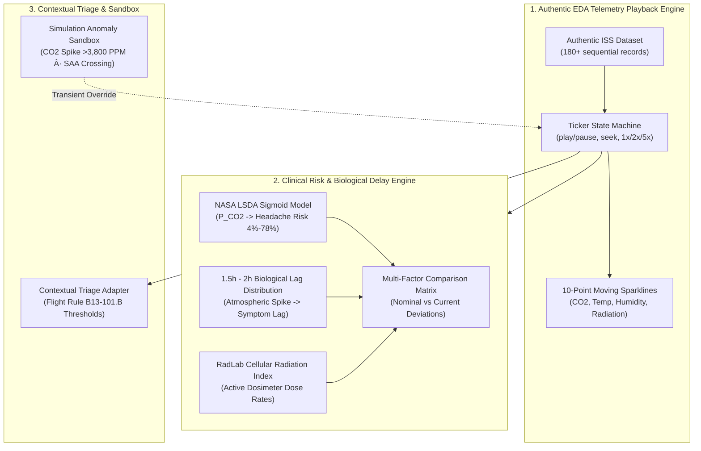

# HABITRACK Version 4: Predictive Clinical Risk & Authentic Flight Playback Architecture

* **Author:** MinnThikeTunn & Antigravity Team
* **Date:** 2026-11-14
* **Status:** Approved Technical Design Document
* **Predecessor Context:** [habitrack_v3.md](file:///D:/nasaResearch/docs/designs/habitrack_v3.md)
* **Parent Architecture:** [README.md](file:///D:/nasaResearch/README.md)
* **Requirements Baseline:** [PRD.md](file:///D:/nasaResearch/PRD.md) (Section 17: Version 4 Scope), [SPEC-001](file:///D:/nasaResearch/docs/specs/SPEC-001-iss-environmental-telemetry-and-clinical-risk.md)
* **Domain Model:** [GLOSSARY.md](file:///D:/nasaResearch/GLOSSARY.md)

---

## 1. Overview

HABITRACK Version 4 upgrades the platform from static historical data exploration to dynamic flight-grade telemetry playback, continuous short-term trend estimation, and empirical non-linear epidemiological risk forecasting. 

Version 4 incorporates:
1. **Authentic ISS EDA Telemetry Playback Engine**: Continuous streaming controller for authentic ISS Expedition 71/72 flight telemetry across Node 2 Harmony and US Lab Destiny with scrub, play/pause, 1x/2x/5x speed modifiers, and sliding 10-point moving sparklines.
2. **Clinical Risk & Biological Delay Engine**: Non-linear epidemiological models derived from NASA Life Sciences Data Archive (LSDA) and RadLab data calculating hypercapnia headache risk curves ($4\%\text{ to }78\%$), cellular radiation fatigue indexes, dry-eye mucosal irritation thresholds, and exercise thermal strain.
3. **Empirical Biological Lag-Time Modeling**: Explicit calculation and visualization of the $1.5\text{ to }2.0\text{-hour}$ biological latency between cabin environmental excursions (such as elevated carbon dioxide) and physiological symptom onset.
4. **5-Factor Contextual Clinical Triage**: Environmental snapshot adapter evaluating astronaut symptom entries against simultaneous multi-factor telemetry and station compartment topology under NASA Flight Rule B13-101.B.
5. **Onboard Anomaly Injector / Simulation Sandbox**: Controlled injection environment enabling flight surgeons to trigger localized $\text{CO}_2$ pocket spikes ($>3,800\text{ PPM}$) and South Atlantic Anomaly (SAA) dosimetric surges to validate alert pipelines without corrupting authoritative state.

---

## 2. The Problem

### 2.1 Lack of Continuous Dynamic Telemetry Playback
In previous releases, telemetry streams were static or required manual page reloads. Flight Surgeons and astronauts could not scrub backward to inspect atmospheric transitions before and after cabin air scrubbing cycles or evaluate rate-of-change dynamics in real time.

### 2.2 Linear Assumptions vs. Non-Linear Biological Delay
Standard environmental monitors display raw sensor values as simple thresholds. In reality, human spaceflight physiology operates on non-linear biological curves:
- **Biological Latency:** When carbon dioxide partial pressure spikes, astronauts do not immediately develop headaches; there is a documented $1.5\text{ to }2.0\text{-hour}$ delay before cerebrovascular vasodilation induces acute cephalea.
- **Cognitive Misattribution:** Crew members frequently misattribute symptoms to current nominal conditions because they have already transitioned to a ventilated module by the time symptoms manifest.

### 2.3 Untestable Alert Pipelines During Mission Readiness
Flight Surgeons lacked an onboard mechanism to inject simulated anomalies during flight readiness training to verify how triage rules, alert banners, and decision-support agents respond to critical environmental transients without corrupting persistent mission databases.

---

## 3. Goals and Non-Goals

### 3.1 In-Scope Goals
1. **Interactive EDA Playback (`web/src/features/eda`):**
   - Stream 180+ authentic ISS records with play/pause, scrub slider, and 1x/2x/5x speed modifiers.
   - 10-point moving-window sparklines showing short-term rate of change.
   - Dual unit reporting: $\text{CO}_2$ in both $\text{PPM}$ and partial pressure ($\text{mmHg}$).
2. **Epidemiological Clinical Risk Predictor (`web/src/features/risk`):**
   - Non-linear sigmoid risk calculation for hypercapnic headaches ($4\%\text{ at }<2\,\text{mmHg}$ to $78\%\text{ at }>6\,\text{mmHg}$).
   - 5-factor risk matrix: Carbon Dioxide, Ambient Temperature, Relative Humidity, Ionizing Radiation, and Exercise Heat Strain.
   - Empirical biological delay distribution chart indicating peak expected symptom onset window.
3. **Contextual Clinical Triage (`web/src/features/triage`):**
   - Pure adapter consuming environmental snapshots and crew symptom text.
   - Flight Rule B13-101.B threshold verification and automated compartment entity extraction.
4. **Simulation Anomaly Injector (`web/src/features/simulation`):**
   - Transient state overrides for localized $\text{CO}_2$ spikes ($>3,800\text{ PPM}$) and South Atlantic Anomaly (SAA) radiation belt passages.
   - Single-click reset restoring authentic baselines.

### 3.2 Non-Goals
- **Replacing Operational Flight Hardware:** This module provides decision support and training simulation, not direct control of ISS life-support valves or CDRA blowers.
- **Autonomous Diagnostic Prescription:** The system maintains strict adherence to non-causal language and does not prescribe medical pharmaceuticals.

---

## 4. Mathematical & Epidemiological Formulations

### 4.1 Hypercapnia Headache Probability Model
Derived from NASA LSDA bed-rest and spaceflight archival data, the acute cephalea probability $P(\text{headache})$ is modeled as a generalized logistic sigmoid function of carbon dioxide partial pressure $P_{\text{CO}_2}$:

$$P(\text{headache}) = L_{\min} + \frac{L_{\max} - L_{\min}}{1 + e^{-k (P_{\text{CO}_2} - P_0)}}$$

Where:
- $L_{\min} = 0.04$ (4% baseline ambient spaceflight headache rate)
- $L_{\max} = 0.78$ (78% peak acute hypercapnia risk ceiling)
- $k = 1.15\,\text{mmHg}^{-1}$ (steepness coefficient)
- $P_0 = 4.2\,\text{mmHg}$ (inflection threshold)

### 4.2 Biological Delay Distribution
The onset probability density over time $t$ (hours following initial exposure spike) is modeled as a log-normal distribution peaking at $1.75\text{ hours}$:

$$f(t; \mu, \sigma) = \frac{1}{t \sigma \sqrt{2\pi}} \exp\left( -\frac{(\ln t - \mu)^2}{2\sigma^2} \right)$$

With parameters $\mu = 0.56$ and $\sigma = 0.28$, yielding $90\%$ probability density concentrated in the $[1.2, 2.5]\text{ hour}$ window.

---

## 5. Module Implementation & Architecture

| Component | Path | Function |
| :--- | :--- | :--- |
| **EDA Stream Controller** | [EdaStreamController.tsx](file:///D:/nasaResearch/web/src/features/eda/EdaStreamController.tsx) | Ticker state machine, playback scrub bar, 10-point moving sparkline renderer |
| **Clinical Risk Matrix** | [ClinicalRiskMatrix.tsx](file:///D:/nasaResearch/web/src/features/risk/ClinicalRiskMatrix.tsx) | 5-factor multi-metric risk evaluator, sigmoid curve plotter, delay distribution visualizer |
| **Contextual Triage** | [ContextualTriageAdapter.ts](file:///D:/nasaResearch/web/src/features/triage/ContextualTriageAdapter.ts) | Pure evaluation function validating symptoms against environmental context and Flight Rule B13-101.B |
| **Triage Banner** | [ContextualTriageBanner.tsx](file:///D:/nasaResearch/web/src/features/triage/ContextualTriageBanner.tsx) | High-visibility warning alert displayed upon multi-factor threshold violation |
| **Simulation Sandbox** | [SimulationSandboxPanel.tsx](file:///D:/nasaResearch/web/src/features/simulation/SimulationSandboxPanel.tsx) | Anomaly injection panel for testing crew alarms and assistant triggers |

---

## 6. Verification and Test Gates

1. **Unit & Mathematical Verification:**
   - [test_clinical_risk.py](file:///D:/nasaResearch/tests/test_clinical_risk.py): Validates sigmoid probability bounds ($P \in [0.04, 0.78]$), biological delay integrals, and thermal workout curves.
   - [test_contextual_triage.py](file:///D:/nasaResearch/tests/test_contextual_triage.py): Verifies compartment extraction and Flight Rule B13-101.B advisory latching.
   - [test_eda_telemetry.py](file:///D:/nasaResearch/tests/test_eda_telemetry.py): Tests EDA record parsing, unit conversion ($\text{PPM} \leftrightarrow \text{mmHg}$), and timestamp continuity.
   - [test_simulation_sandbox.py](file:///D:/nasaResearch/tests/test_simulation_sandbox.py): Ensures transient anomaly injection does not mutate the persistent SQLite database.
2. **Frontend Test & Build Gate:**
   - `npm --prefix web run build` validates zero TypeScript compilation errors and bundle optimization.
