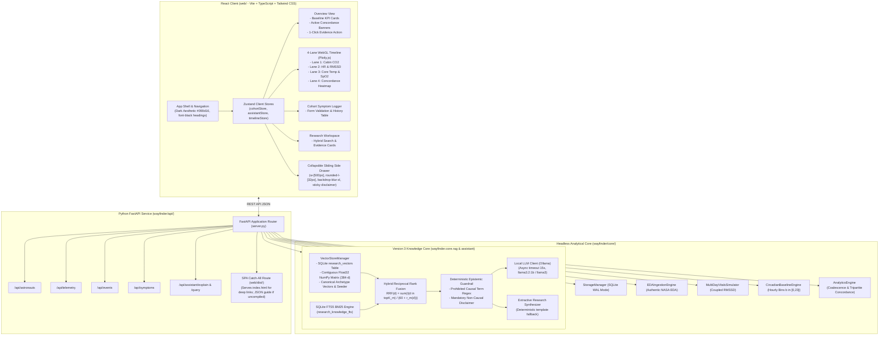
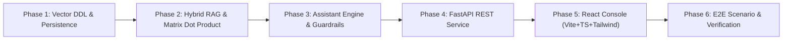

# WAYFINDER Version 3: Evidence-Grounded Local AI & React Console Architecture

* **Author:** MinnThikeTunn
* **Date:** 2026-11-14
* **Status:** Approved Technical Design Document (Remediated & Implementation Ready)
* **Predecessor Context:** [concepts_brief.md](file:///D:/nasaResearch/concepts_brief.md)
* **Parent System:** [WAYFINDER Version 2 Approved Technical Design](file:///D:/nasaResearch/docs/designs/wayfinder_v2.md)
* **Requirements Baseline:** [PRD.md](file:///D:/nasaResearch/PRD.md) (Section 17: Version 3 Scope, Section 9.1, Section 11, and FR-10)
* **Domain Model:** [GLOSSARY.md](file:///D:/nasaResearch/GLOSSARY.md)

---

## 1. Overview

WAYFINDER Version 3 transitions the platform from a prototype demonstration workstation into an **Evidence-Grounded Local AI Health Intelligence System** backed by a decoupled **React + TypeScript + Tailwind CSS** presentation console and a Python **FastAPI** service.

The system correlates authentic NASA ISS Environmental Data Application (EDA) telemetry, deterministic multi-day physiological vitals with non-linear inverse RMSSD dynamics, and crew-logged symptom reports against a curated NASA spaceflight biomedical research corpus. It introduces an in-process embedded vector store (SQLite-backed float32 embeddings with contiguous in-memory NumPy matrix dot-product similarity) fused with SQLite FTS5 BM25 via Reciprocal Rank Fusion (RRF), a contextual Knowledge Assistant providing 1-click citation-grounded explanations within a non-blocking sliding side drawer, a resilient local LLM integration with deterministic non-causal safety guardrails and instant extractive fallback, and a full React console adhering to a high-end minimalist 'Perplexity' aesthetic.

---

## 2. The Problem

During long-duration human spaceflight (such as International Space Station expeditions and lunar/Mars transit missions), crewmembers and flight surgeons face two major operational challenges:

### 2.1 Disconnected, Keyword-Only Evidence Retrieval
In WAYFINDER Version 2, scientific evidence retrieval is isolated within a separate "Research" tab and relies exclusively on lexical SQLite FTS5 BM25 search:
- **Lexical Mismatch:** Lexical search fails on spaceflight physiological synonyms (e.g. querying "autonomic suppression during hypercapnia" fails to retrieve papers describing "reduced vagal tone and sympathetic overactivation during elevated CO2 partial pressures").
- **Disconnected Decision Support:** Retrieval is disconnected from real-time operational events. When an `INVESTIGATE` Multi-Signal Concordance Event fires (such as Commander Vance's acute headache, elevated heart rate, and suppressed RMSSD during the Day 127 cabin $P_{\text{CO}_2}$ excursion), the flight surgeon or astronaut must manually pivot to another tab and formulate keyword queries rather than receiving an instantaneous, citation-grounded contextual explanation.
- **Absence of Explainable Synthesis:** Raw search returns disparate text excerpts without synthesizing observed operational dynamics, scientific context, and explicit research limitations.

### 2.2 Monolithic Prototype UI Bottlenecks
The Streamlit prototype console (`wayfinder/ui/`) established proof of concept, but presents core structural limitations:
- **Server Rerun Overhead:** Streamlit's reactive execution model re-executes the Python script on user interaction, causing noticeable UI re-rendering latency and fragile camera state preservation during time-series interaction.
- **Ergonomic Constraints:** Modal dialogs or expanders in Streamlit obscure or desynchronize the 4-lane WebGL time-series timeline, preventing simultaneous visual correlation between physiological traces and research citations.
- **Specification Alignment:** [PRD.md](file:///D:/nasaResearch/PRD.md) Section 9.1 explicitly specifies a decoupled architecture: React + TypeScript frontend with a Python FastAPI backend and responsive charting.

---

## 3. Goals and Non-Goals

### 3.1 In-Scope Goals
1. **In-Process Embedded Vector Store (`wayfinder.core.rag`):**
   - SQLite table `research_vectors` storing passage metadata, verified DOI citations, title, authors, report identifier, and 384-dimensional float32 vector embeddings pinned to `all-minilm` (`sentence-transformers/all-MiniLM-L6-v2`).
   - Contiguous in-memory 2D float32 NumPy matrix dot-product similarity executing in $< 0.2\text{ ms}$ on standard CPU hardware with startup empty-store protection.
   - Pre-computed canonical archetype query vectors for all known mission event signatures (enabling 1-click event vector lookups with zero runtime model dependencies).
   - Bundled static seed embeddings (`data/research_embeddings_seed.json`) ensuring cold-start offline readiness without requiring a running Ollama daemon.
   - Reciprocal Rank Fusion (RRF) combining dense vector search and SQLite FTS5 BM25 with normalized percentage scores ($[0\%, 100\%]$).
2. **Contextual Knowledge Assistant (`wayfinder.core.assistant` & `/api/assistant`):**
   - Dedicated Research Workspace for ad-hoc hybrid search and passage inspection.
   - Non-blocking collapsible sliding side drawer (`w-[500px]`, `rounded-l-[32px]`, `backdrop-blur-xl`) in Overview and Timeline views for 1-click evidence explanations of active Multi-Signal Concordance Events.
   - Dynamic chart resizing (`w-[calc(100%-500px)]`) on drawer toggle with `Plotly.Plots.resize` to preserve interactive WebGL crosshairs.
   - Strict cohort scoping in React state (`useAssistantStore`) unconditionally closing the drawer on cohort switch to prevent cross-crew context leakage.
   - Structured `AssistantResponse` contract defining headline, observed dynamics, scientific context, cited evidence (Scientific Evidence Cards), study caveats, and mandatory non-causal disclaimer.
3. **Resilient Local LLM Integration & Epistemic Guardrail:**
   - Optional local Ollama integration (`/api/generate` with instruction models such as `llama3.2:1b` or `llama3:latest`) with structured JSON enforcement (`format: "json"`) and bracketed citation enforcement (`[Doc ID: Section]`). Embedding generation uses `all-minilm` via `/api/embeddings`.
   - Deterministic post-generation regex assertion suppressing prohibited causal terms across all inflectional stems:
     `r"\b(cause|causes|caused|causing|proves|proven|proving|diagnose|diagnosed|diagnosing|diagnosis|prescribe|prescribes|prescribed|prescribing|prescription|treat|treated|treating|treatment|therapeutic|therapy|cure|remedy)\b"`.
   - Instantaneous, transparent fallback to the Extractive Research Synthesizer when Ollama is offline, unreachable, or times out (> 15s).
4. **React Console Migration (`web/`):**
   - High-end minimalist Perplexity design aesthetic: deep dark palette (`#090d16`), font-black typography (`font-black tracking-tight`), generous whitespace, rounded-[32px] containers, and subtle micro-animations.
   - Synchronized 4-lane Plotly.js WebGL timeline with dual secondary Y-axes on Lanes 2 & 3, continuous stepped circadian baseline ribbons $[\mu \pm 2\sigma]$, and colorblind-safe concordance heatmaps.
   - Explicit WebGL context cleanup (`Plotly.purge`) upon component unmount to prevent browser canvas context exhaustion.
   - Cohort switcher supporting `CDR Vance (ASTRO-01)`, `FE-1 Dr. Patel (ASTRO-02)`, and `MS Lindgren (ASTRO-03)`.
   - Cohort-bound structured symptom logging form with validation and history table.
   - High-performance Python FastAPI backend (`wayfinder/api/`) exposing REST endpoints and serving compiled static assets (`web/dist/`) with Single-Page Application (SPA) catch-all fallback.

### 3.2 Out-of-Scope Non-Goals
- **Cloud-Based AI APIs:** Zero cloud dependencies; strictly 100% offline edge execution.
- **Autonomous Medical Diagnosis:** The system must never independently calculate clinical risk, diagnose pathology, or prescribe medical countermeasures.
- **External Vector Database Daemons:** No ChromaDB, Milvus, Qdrant, or external vector service processes.
- **Modifying Headless Core Invariants:** All existing mathematical algorithms in `wayfinder.core` (circadian hourly binning, physiological variance floors $\sigma_{\min}$, pre-severity interval coalescence, tripartite concordance) and their 64 passing pytest tests must remain untouched and backward compatible.

---

## 4. Open Questions & Technical Resolutions

*   **Question 1: Ad-hoc query vectorization when Ollama is offline?**
    *   *Resolution:* Contextual 1-click event vector lookups utilize pre-computed canonical archetype vectors stored in SQLite. For free-text queries, the system calls Ollama's `/api/embeddings` using `all-minilm`; if offline, it gracefully falls back to pure SQLite FTS5 BM25 lexical search with zero operational disruption.
*   **Question 2: How to ensure single-command deployment without Node.js at runtime?**
    *   *Resolution:* The React frontend is compiled into static assets (`web/dist/`) during build. FastAPI mounts `web/dist/` at root `/` via an explicit SPA route handler that returns `web/dist/index.html` for deep routes. If `web/dist/` is uncompiled, FastAPI serves a clear diagnostic JSON guide rather than crashing.
*   **Question 3: How to prevent generative language models from hallucinating clinical causation?**
    *   *Resolution:* A deterministic post-generation regex filter checks for prohibited causal verbs and medical intervention terms. Any violation immediately triggers fallback to verbatim extractive passage rendering.
*   **Question 4: How are embeddings seeded on an air-gapped machine without Ollama?**
    *   *Resolution:* Bundled static seed embeddings (`data/research_embeddings_seed.json`) are checked and idempotently loaded into `research_vectors` during database initialization.

---

## 5. Critical User Journeys (CUJs)

### CUJ 1: 1-Click Contextual Evidence Explanation for Active Concordance Event
* **Given:** Commander Vance (`ASTRO-01`) is selected. On Day 127 at 02:15 UTC, an active `INVESTIGATE` Multi-Signal Concordance Event indicates elevated $P_{\text{CO}_2}$ ($5.8\text{ mmHg}$ in Node 2), acute frontal headache (severity 3/5), and autonomic vital shift (+18 bpm HR, -24 ms RMSSD).
* **When:** The flight surgeon or Chief Medical Officer (CMO) clicks "Explain with Evidence" on the event card in the Overview or Timeline view.
* **Then:** The non-blocking sliding side drawer expands smoothly from the right edge, resizing the timeline container (`w-[calc(100%-500px)]`). The system resolves the event's archetype (`ARCHETYPE_CO2_HYPERCAPNIA_VITAL_SHIFT`), executes a sub-millisecond hybrid search using the pre-computed event vector and BM25 keywords, retrieves matching NASA literature (HRR Elevated CO2, Cardiovascular Microgravity Adaptation), and presents a structured explanation with verbatim bracketed citations, study caveats, and the sticky bottom non-causal disclaimer—while the 4-lane WebGL timeline remains fully interactive.

### CUJ 2: Interactive Offline Free-Text Research Search
* **Given:** The flight surgeon navigates to the dedicated "Research" workspace in the React console.
* **When:** The flight surgeon enters the search query `"vagal withdrawal microgravity"`.
* **Then:** The system queries local embeddings (or BM25 fallback) and returns ranked literature passages displayed as Scientific Evidence Cards scored with normalized percentage badges ($[0\%, 100\%]$). Clicking a passage card expands the full section, authors, NASA report identifier, and verified DOI citation.

### CUJ 3: Resilient Fallback when Local LLM Daemon is Offline
* **Given:** The local Ollama daemon is uninstalled, stopped, or experiencing GPU memory exhaustion.
* **When:** The flight surgeon triggers an evidence explanation.
* **Then:** The health check times out within 1.5 seconds. The system immediately engages the Extractive Research Synthesizer, rendering top-ranked literature passages, key findings, and study caveats with an `[EXTRACTIVE RETRIEVAL]` status badge, maintaining zero UI delay or failure dialogs.

### CUJ 4: Full React Console Navigation, Cohort Switching & Timeline Inspection
* **Given:** The flight surgeon launches the system via `python -m wayfinder.server` and opens `http://localhost:8000`.
* **When:** The flight surgeon toggles between Commander Vance (`ASTRO-01`) and Dr. Patel (`ASTRO-02`), and interacts with the 4-lane WebGL timeline.
* **Then:** The React application updates the active cohort in $< 50\text{ ms}$ without a full page refresh. The 4-lane Plotly timeline renders at 60 FPS, maintaining synchronized crosshairs across all four lanes and displaying Dr. Patel's endurance-trained nominal baselines with zero cross-crew context leakage. Switching cohorts unconditionally closes the assistant drawer.

---

## 6. Technical Plan (Architecture)

### 6.1 Subsystem Block Diagram



### 6.2 Data Layer & SQLite DDL Migrations (`wayfinder/core/storage.py`)

To support dense vectors, audit logging, and canonical event archetype lookups without external services, `StorageManager.ensure_initialized()` applies the following DDL migrations:

```sql
-- 1. Embedded Research Vectors Table
CREATE TABLE IF NOT EXISTS research_vectors (
    chunk_id TEXT PRIMARY KEY,
    doc_id TEXT NOT NULL,
    title TEXT NOT NULL,
    authors TEXT,
    report_identifier TEXT,
    section_heading TEXT NOT NULL,
    content TEXT NOT NULL,
    doi_citation TEXT,
    source_repository TEXT,
    embedding BLOB NOT NULL,
    embedding_model TEXT NOT NULL
);
CREATE INDEX IF NOT EXISTS idx_vectors_doc ON research_vectors(doc_id);

-- 2. Pre-computed Canonical Event Archetype Vectors
CREATE TABLE IF NOT EXISTS event_archetype_vectors (
    archetype_id TEXT PRIMARY KEY,
    description TEXT NOT NULL,
    embedding BLOB NOT NULL
);

-- 3. Assistant Interaction Audit Trail Table
CREATE TABLE IF NOT EXISTS assistant_audit_logs (
    log_id TEXT PRIMARY KEY,
    event_id TEXT REFERENCES health_events(event_id),
    astronaut_id TEXT REFERENCES astronauts(astronaut_id),
    query_text TEXT NOT NULL,
    retrieval_mode TEXT NOT NULL CHECK(retrieval_mode IN ('HYBRID_RRF', 'LEXICAL_BM25', 'DENSE_COSINE')),
    generation_mode TEXT NOT NULL CHECK(generation_mode IN ('OLLAMA_GENERATIVE', 'EXTRACTIVE_FALLBACK')),
    response_text TEXT NOT NULL,
    cited_doc_ids TEXT NOT NULL,
    tripwire_triggered BOOLEAN NOT NULL DEFAULT 0,
    latency_ms REAL NOT NULL,
    created_at TIMESTAMP NOT NULL
);
CREATE INDEX IF NOT EXISTS idx_audit_astronaut ON assistant_audit_logs(astronaut_id);

-- 4. Schema Migration on Existing health_events Table
-- Automatically applied in StorageManager.ensure_initialized() if column is absent:
-- ALTER TABLE health_events ADD COLUMN peak_deviation_sigma REAL;
```

#### Static Seed Embeddings Contract (`data/research_embeddings_seed.json`)

To guarantee cold-start readiness on air-gapped mission systems without Ollama running, `StorageManager.seed_research_vectors_if_empty()` validates and idempotently loads `data/research_embeddings_seed.json` structured as follows:

```json
{
  "chunks": [
    {
      "chunk_id": "HRR-CO2-001_c1",
      "doc_id": "HRR-CO2-001",
      "title": "NASA Human Research Program: Risk of Impairment from Carbon Dioxide Exposure",
      "authors": "Law J., et al.",
      "report_identifier": "NASA/SP-2015-6105",
      "section_heading": "Physiological Responses to Elevated Carbon Dioxide",
      "content": "Elevated cabin carbon dioxide concentrations (exceeding 2.0-3.0 mmHg) are associated with mild hypercapnia, compensatory peripheral vasodilation, cerebral hyperperfusion, and reports of episodic tension headache in spaceflight crews...",
      "doi_citation": "https://doi.org/10.1016/j.amjmed.2014.05.012",
      "source_repository": "NASA Technical Reports Server",
      "embedding": [0.0125, -0.0452, "/* ... 384 float32 numbers ... */"],
      "embedding_model": "all-minilm"
    }
  ],
  "archetypes": [
    {
      "archetype_id": "ARCHETYPE_CO2_HYPERCAPNIA_VITAL_SHIFT",
      "description": "Cabin CO2 excursion coupled with compensatory tachycardia and autonomic vagal withdrawal",
      "embedding": [0.0331, -0.0122, "/* ... 384 float32 numbers ... */"]
    },
    {
      "archetype_id": "ARCHETYPE_AUTONOMIC_WORKOUT_FATIGUE",
      "description": "Elevated heart rate with suppressed HRV during strenuous physical countermeasure workout",
      "embedding": [-0.0152, 0.0421, "/* ... 384 float32 numbers ... */"]
    },
    {
      "archetype_id": "ARCHETYPE_THERMAL_ENVIRONMENTAL_STRESS",
      "description": "Cabin thermal excursion with cutaneous vasodilation and mild sympathetic elevation",
      "embedding": [0.0211, 0.0084, "/* ... 384 float32 numbers ... */"]
    },
    {
      "archetype_id": "ARCHETYPE_GENERIC_PHYSIOLOGICAL_EXCURSION",
      "description": "General physiological vital deviation exceeding circadian baseline threshold",
      "embedding": [0.0054, -0.0031, "/* ... 384 float32 numbers ... */"]
    }
  ]
}
```

Serialization from JSON float lists to SQLite BLOB storage is explicitly defined as:
```python
blob_bytes = np.array(item["embedding"], dtype=np.float32).tobytes()
```

### 6.3 Domain Models & Schemas (`wayfinder/core/models.py`)

```python
class HealthEvent(BaseModel):
    """Multi-Signal Concordance Event model with peak deviation tracking."""
    model_config = ConfigDict(frozen=True)

    event_id: str
    astronaut_id: str
    event_type: str
    severity_level: SeverityLevel
    start_time: str
    end_time: str
    contributing_stream_ids: str
    symptom_report_id: Optional[str] = None
    rationale: str
    peak_deviation_sigma: Optional[float] = None  # Peak observed sigma excursion
    review_status: ReviewStatus = ReviewStatus.PENDING
    review_notes: Optional[str] = None
    reviewed_at: Optional[str] = None


class CitedEvidence(BaseModel):
    """Scientific Evidence Card: specific literature passage supporting decision support."""
    model_config = ConfigDict(frozen=True)

    chunk_id: str
    doc_id: str
    title: str
    authors: Optional[str] = None
    report_identifier: Optional[str] = None
    section_heading: str
    doi_citation: Optional[str] = None
    source_repository: str
    excerpt: str
    rrf_score: float
    relevance_pct: float  # Normalized [0.0, 100.0]


class AssistantResponse(BaseModel):
    """Structured clinical decision support explanation payload."""
    model_config = ConfigDict(frozen=True)

    interaction_id: str
    astronaut_id: Optional[str] = None
    event_id: Optional[str] = None
    mode: Literal["OLLAMA_GENERATIVE", "EXTRACTIVE_FALLBACK"]
    headline: str
    observed_dynamics: str
    scientific_context: str
    cited_evidence: List[CitedEvidence]
    study_caveats: List[str]
    disclaimer: str
    tripwire_triggered: bool = False
    latency_ms: float


class VectorEmbeddingRecord(BaseModel):
    """Persisted vector embedding record for passage chunks."""
    model_config = ConfigDict(frozen=True)

    chunk_id: str
    doc_id: str
    title: str
    authors: Optional[str] = None
    report_identifier: Optional[str] = None
    section_heading: str
    content: str
    doi_citation: Optional[str] = None
    source_repository: str
    embedding: bytes
    embedding_model: str = "all-minilm"


class AssistantAuditLog(BaseModel):
    """Audit trail record for assistant interactions."""
    model_config = ConfigDict(frozen=True)

    log_id: str
    event_id: Optional[str] = None
    astronaut_id: Optional[str] = None
    query_text: str
    retrieval_mode: Literal["HYBRID_RRF", "LEXICAL_BM25", "DENSE_COSINE"]
    generation_mode: Literal["OLLAMA_GENERATIVE", "EXTRACTIVE_FALLBACK"]
    response_text: str
    cited_doc_ids: str
    tripwire_triggered: bool = False
    latency_ms: float
    created_at: str


class HealthStatus(BaseModel):
    """System health check payload including vector store and model status."""
    model_config = ConfigDict(frozen=True)

    status: str = "ok"
    version: str = "3.0.0"
    ollama_online: bool
    vector_store_chunks: int


# FastAPI Request Schemas
class ExplainEventRequest(BaseModel):
    event_id: str
    astronaut_id: str


class ResearchQueryRequest(BaseModel):
    query: str
    top_k: int = 5
    astronaut_id: Optional[str] = None


class ReviewEventRequest(BaseModel):
    review_status: ReviewStatus
    review_notes: Optional[str] = None


class SymptomReportRequest(BaseModel):
    astronaut_id: str
    symptom_code: str
    severity: int = Field(..., ge=1, le=5)
    cabin_module: Optional[str] = "Node 2"
    notes: Optional[str] = None
    occurred_at: Optional[str] = None  # defaults to current UTC timestamp if None
```

### 6.4 Hybrid Retrieval & In-Memory Vector Acceleration (`wayfinder/core/rag.py`)

1. **In-Memory Matrix Initialization & Empty-Store Guard:**
   On server initialization, `VectorStoreManager` queries all rows from `research_vectors`:
   ```python
   class VectorStoreManager:
       def __init__(self, storage_manager: StorageManager):
           self.storage_manager = storage_manager
           self.lock = threading.Lock()
           self.reload_corpus()

       def reload_corpus(self) -> None:
           with self.lock:
               rows = self.storage_manager.list_all_vector_chunks()
               if not rows:
                   self.corpus_matrix = np.empty((0, 384), dtype=np.float32)
                   self.chunk_ids = []
               else:
                   raw_mat = np.vstack([np.frombuffer(r["embedding"], dtype=np.float32) for r in rows])
                   norms = np.linalg.norm(raw_mat, axis=1, keepdims=True)
                   norms[norms == 0] = 1.0
                   self.corpus_matrix = (raw_mat / norms).astype(np.float32)
                   self.chunk_ids = [r["chunk_id"] for r in rows]
   ```
   For a query vector $\vec{q}_{\text{norm}} \in \mathbb{R}^{384}$:
   $$\vec{S} = \text{corpus\_matrix} \cdot \vec{q}_{\text{norm}}$$
   If `self.corpus_matrix.shape[0] == 0`, dense search gracefully returns an empty list, and hybrid search relies purely on SQLite FTS5 BM25.

2. **Reciprocal Rank Fusion (RRF) with Calibrated Modality Normalization:**
   $$RRF(d) = \sum_{m \in M} \frac{\mathbb{I}(d \in \text{topK}_m)}{60 + r_m(d)}$$
   The score is normalized against the theoretical maximum RRF score across active modalities $M$:
   $$\text{RRF}_{\max} = \sum_{m \in M} \frac{1}{60 + 1} = \frac{|M|}{61}$$
   - For dual-modality hybrid search ($M = \{\text{dense}, \text{bm25}\}$, $|M|=2$):
     $$\text{RRF}_{\max} = \frac{2}{61} \approx 0.032787$$
     $$\text{relevance\_pct}(d) = \min\left(100.0, \frac{RRF(d)}{0.032787} \times 100\%\right)$$
   - For single-modality fallback ($M = \{\text{bm25}\}$, $|M|=1$, when Ollama is offline and dense query vectorization is unavailable):
     $$\text{RRF}_{\max, \text{single}} = \frac{1}{61} \approx 0.016393$$
     $$\text{relevance\_pct}(d) = \min\left(100.0, \frac{RRF(d)}{0.016393} \times 100\%\right)$$
     In this case, the response sets `retrieval_mode = "LEXICAL_BM25"`.

   UI Scientific Evidence Cards display source attribution badges (e.g., `Hybrid RRF: 92%`, `Dense Semantic: 88%`, `Lexical FTS5: 75%`) with a minimum confidence display threshold so that flight surgeons can immediately interpret absolute confidence.

### 6.5 Deterministic Epistemic Guardrail & Archetype Mapping (`wayfinder/core/assistant.py`)

```python
DEFAULT_EMBEDDING_MODEL = "all-minilm"
DEFAULT_GENERATIVE_MODEL = "llama3.2:1b"

MANDATORY_DISCLAIMER = (
    "Non-Causal Decision Support Disclaimer: Temporal correlation indicates "
    "co-occurrence only and does not establish clinical causation. WAYFINDER "
    "is a clinical decision-support tool, not an autonomous diagnostic system. "
    "Operational countermeasure decisions must be verified by flight surgeons."
)

PROHIBITED_CAUSAL_TERMS = re.compile(
    r"\b(cause|causes|caused|causing|proves|proven|proving|diagnose|diagnosed|"
    r"diagnosing|diagnosis|prescribe|prescribes|prescribed|prescribing|prescription|"
    r"treat|treated|treating|treatment|therapeutic|therapy|cure|remedy)\b",
    re.IGNORECASE,
)

def resolve_archetype_id(event: HealthEvent) -> str:
    """Deterministically maps a HealthEvent to a canonical archetype key."""
    streams = {s.strip() for s in event.contributing_stream_ids.split(",") if s.strip()}
    if "stream_eda_co2" in streams and ("stream_sim_hr" in streams or "stream_sim_hrv" in streams):
        return "ARCHETYPE_CO2_HYPERCAPNIA_VITAL_SHIFT"
    elif "stream_sim_hr" in streams and "stream_sim_hrv" in streams:
        return "ARCHETYPE_AUTONOMIC_WORKOUT_FATIGUE"
    elif "stream_eda_temp" in streams:
        return "ARCHETYPE_THERMAL_ENVIRONMENTAL_STRESS"
    return "ARCHETYPE_GENERIC_PHYSIOLOGICAL_EXCURSION"


async def is_ollama_available(ollama_url: str = "http://localhost:11434") -> bool:
    """Asynchronous 1.5s probe verifying Ollama daemon availability."""
    try:
        async with httpx.AsyncClient(timeout=1.5) as client:
            resp = await client.get(f"{ollama_url}/api/tags")
            return resp.status_code == 200
    except Exception:
        return False


class ExtractiveResearchSynthesizer:
    """
    Deterministic zero-dependency fallback synthesizer.
    Generates structured AssistantResponse payloads using extracted event rationale,
    top-K scientific literature passages, and spaceflight analogue study caveats
    without calling any external LLM.
    """
    @staticmethod
    def synthesize_for_event(
        event: HealthEvent,
        evidence: List[CitedEvidence],
        astronaut_id: Optional[str] = None,
        tripwire_triggered: bool = False,
        latency_ms: float = 0.0,
    ) -> AssistantResponse:
        headline = f"Scientific Evidence Context: {event.event_type.replace('_', ' ').title()}"
        
        streams_list = [s.strip() for s in event.contributing_stream_ids.split(",") if s.strip()]
        peak_sigma = getattr(event, "peak_deviation_sigma", None)
        sigma_text = f" Max deviation reached {peak_sigma:.2f} sigma against circadian baseline." if peak_sigma is not None else ""
        observed_dynamics = (
            f"Observed concordance event across {len(streams_list)} telemetry streams "
            f"({', '.join(streams_list)}). Rationale: {event.rationale}{sigma_text}"
        )
        
        if evidence:
            context_bullets = []
            for ev in evidence[:3]:
                ref = f"[{ev.doc_id}: {ev.section_heading}]"
                context_bullets.append(f"{ref} {ev.excerpt.strip()}")
            scientific_context = " ".join(context_bullets)
        else:
            scientific_context = (
                "No direct NASA Life Sciences / GeneLab passages matched this query threshold. "
                "Review baseline trends and environmental telemetry manually."
            )
            
        caveats = [
            "Data primarily reflects terrestrial 6-degree head-down tilt bed-rest analogues or LEO station telemetry.",
            "Individual astronaut autonomic reactivity varies significantly during high workload and circadian shifts."
        ]
        for ev in evidence[:2]:
            if "bed-rest" in ev.excerpt.lower() or "bed rest" in ev.excerpt.lower():
                caveats.append(f"Caveat for {ev.doc_id}: Terrestrial bed-rest study; fluid redistribution kinetics differ from free microgravity.")
        
        return AssistantResponse(
            interaction_id=str(uuid.uuid4()),
            astronaut_id=astronaut_id,
            event_id=event.event_id,
            mode="EXTRACTIVE_FALLBACK",
            headline=headline,
            observed_dynamics=observed_dynamics,
            scientific_context=scientific_context,
            cited_evidence=evidence,
            study_caveats=caveats,
            disclaimer=MANDATORY_DISCLAIMER,
            tripwire_triggered=tripwire_triggered,
            latency_ms=latency_ms,
        )

    @staticmethod
    def synthesize_for_query(
        query: str,
        evidence: List[CitedEvidence],
        astronaut_id: Optional[str] = None,
        tripwire_triggered: bool = False,
        latency_ms: float = 0.0,
    ) -> AssistantResponse:
        headline = f"Literature Synthesis: {query.strip()[:60]}"
        observed_dynamics = "Ad-hoc biomedical literature exploration query across NASA GeneLab and Life Sciences corpus."
        if evidence:
            context_bullets = []
            for ev in evidence[:3]:
                ref = f"[{ev.doc_id}: {ev.section_heading}]"
                context_bullets.append(f"{ref} {ev.excerpt.strip()}")
            scientific_context = " ".join(context_bullets)
        else:
            scientific_context = "No literature passages matched the query terms in the embedded vector index."
            
        caveats = [
            "Extractive search synthesis compiled directly from indexed NASA biomedical archives.",
            "Always correlate literature findings with flight mission rules and onboard diagnostic protocols."
        ]
        return AssistantResponse(
            interaction_id=str(uuid.uuid4()),
            astronaut_id=astronaut_id,
            event_id=None,
            mode="EXTRACTIVE_FALLBACK",
            headline=headline,
            observed_dynamics=observed_dynamics,
            scientific_context=scientific_context,
            cited_evidence=evidence,
            study_caveats=caveats,
            disclaimer=MANDATORY_DISCLAIMER,
            tripwire_triggered=tripwire_triggered,
            latency_ms=latency_ms,
        )


def apply_epistemic_guardrail(
    headline: str,
    observed_dynamics: str,
    scientific_context: str,
    cited_evidence: List[CitedEvidence],
    study_caveats: List[str],
    astronaut_id: Optional[str],
    event_id: Optional[str],
    latency_ms: float,
    fallback_generator: Callable[[], AssistantResponse],
) -> AssistantResponse:
    # Only test the synthesized narrative fields, exempting verbatim quoted excerpts
    test_text = f"{headline} {observed_dynamics} {scientific_context}"
    if PROHIBITED_CAUSAL_TERMS.search(test_text):
        logging.warning("Epistemic guardrail triggered: prohibited causal terms detected in generative output. Falling back to extractive synthesis.")
        res = fallback_generator()
        return res.model_copy(update={"tripwire_triggered": True})
    return AssistantResponse(
        interaction_id=str(uuid.uuid4()),
        astronaut_id=astronaut_id,
        event_id=event_id,
        mode="OLLAMA_GENERATIVE",
        headline=headline,
        observed_dynamics=observed_dynamics,
        scientific_context=scientific_context,
        cited_evidence=cited_evidence,
        study_caveats=study_caveats,
        disclaimer=MANDATORY_DISCLAIMER,
        tripwire_triggered=False,
        latency_ms=latency_ms,
    )


async def query_generative_assistant(
    prompt: str,
    evidence: List[CitedEvidence],
    event: Optional[HealthEvent] = None,
    astronaut_id: Optional[str] = None,
    model: str = DEFAULT_GENERATIVE_MODEL,
    ollama_url: str = "http://localhost:11434",
) -> AssistantResponse:
    """Calls local Ollama with fast-fail health check, JSON validation, and extractive fallback."""
    start_time = time.monotonic()
    
    def _fallback(tripwire: bool = False) -> AssistantResponse:
        latency_ms = (time.monotonic() - start_time) * 1000.0
        if event:
            return ExtractiveResearchSynthesizer.synthesize_for_event(
                event=event, evidence=evidence, astronaut_id=astronaut_id, tripwire_triggered=tripwire, latency_ms=latency_ms
            )
        return ExtractiveResearchSynthesizer.synthesize_for_query(
            query=prompt, evidence=evidence, astronaut_id=astronaut_id, tripwire_triggered=tripwire, latency_ms=latency_ms
        )

    # 1. Fast-fail probe: if Ollama daemon is offline or unreacheable within 1.5s, fall back immediately
    if not await is_ollama_available(ollama_url):
        return _fallback(tripwire=False)

    # 2. Generative invocation with 15s hard timeout
    try:
        async with httpx.AsyncClient(timeout=15.0) as client:
            resp = await client.post(
                f"{ollama_url}/api/generate",
                json={"model": model, "prompt": prompt, "format": "json", "stream": False},
            )
            resp.raise_for_status()
            parsed = json.loads(resp.json().get("response", "{}"))
            latency_ms = (time.monotonic() - start_time) * 1000.0

            return apply_epistemic_guardrail(
                headline=str(parsed.get("headline", "")),
                observed_dynamics=str(parsed.get("observed_dynamics", "")),
                scientific_context=str(parsed.get("scientific_context", "")),
                cited_evidence=evidence,
                study_caveats=list(parsed.get("study_caveats", [])),
                astronaut_id=astronaut_id,
                event_id=event.event_id if event else None,
                latency_ms=latency_ms,
                fallback_generator=lambda: _fallback(tripwire=True),
            )
    except (json.JSONDecodeError, KeyError, httpx.RequestError, httpx.TimeoutException) as exc:
        logging.warning("Generative LLM unavailable or malformed response (%s: %s). Falling back to extractive synthesis.", type(exc).__name__, exc)
        return _fallback(tripwire=False)
```

### 6.6 REST API Interface (`wayfinder/api/server.py`)

| Method | Endpoint | Query / Body Schema | Response Model | Description |
| :--- | :--- | :--- | :--- | :--- |
| `GET` | `/api/health` | None | `HealthStatus` | Service health, version (`3.0.0`), and Ollama availability. |
| `GET` | `/api/astronauts` | None | `List[Astronaut]` | List registered cohort profiles (`ASTRO-01`, `02`, `03`) with calibration state. |
| `GET` | `/api/astronauts/{id}` | Path: `id` | `Astronaut` | Detailed astronaut profile and resting baseline stats. |
| `GET` | `/api/telemetry/measurements` | `astronaut_id: str, window_hours: int = 72, max_points: int = 1000` | `List[Measurement]` | Query LTTB decimated environmental and vitals streams filtered by cohort. |
| `GET` | `/api/telemetry/baselines` | `astronaut_id: str` | `Dict[str, List[CircadianBinStats]]` | Circadian hourly baseline envelope bounds $[\mu \pm 2\sigma]$ for active cohort. |
| `GET` | `/api/events` | `astronaut_id: Optional[str] = None, severity: Optional[str] = None` | `List[HealthEvent]` | List evaluated Multi-Signal Concordance Events filtered by astronaut. |
| `POST` | `/api/events/{id}/review` | Path: `id`, Body: `ReviewEventRequest` | `HealthEvent` | Update event CMO review status (`PENDING`, `ACKNOWLEDGED`, `RESOLVED`). |
| `GET` | `/api/symptoms` | `astronaut_id: Optional[str] = None` | `List[SymptomReport]` | List crew-logged symptom reports filtered by astronaut. |
| `POST` | `/api/symptoms` | Body: `SymptomReportRequest` | `SymptomReport` | Submit structured crew symptom report. |
| `POST` | `/api/assistant/explain` | Body: `ExplainEventRequest` | `AssistantResponse` | Contextual 1-click evidence explanation for an active health event. Looks up event via `storage.get_health_event(event_id)`, retrieves evidence, applies guardrails, logs interaction to `assistant_audit_logs`, and returns response. |
| `POST` | `/api/assistant/query` | Body: `ResearchQueryRequest` | `AssistantResponse` | Ad-hoc biomedical literature exploration. Runs hybrid RRF (or pure BM25 fallback), synthesizes explanation, logs interaction to `assistant_audit_logs`, and returns response. |

#### StorageManager Contracts for API and Assistant Layer (`wayfinder/core/storage.py`)

To satisfy the REST and Assistant contracts, `StorageManager` implements:
```python
def get_health_event(self, event_id: str) -> Optional[HealthEvent]:
    """Retrieves a single HealthEvent by event_id, returning None if not found."""
    query = "SELECT * FROM health_events WHERE event_id = ? LIMIT 1;"
    with self.get_connection() as conn:
        row = conn.execute(query, (event_id,)).fetchone()
        return HealthEvent(**dict(row)) if row else None

def insert_assistant_audit_log(self, log: AssistantAuditLog) -> None:
    """Persists assistant query interaction and safety audit record."""
    query = """
    INSERT INTO assistant_audit_logs (
        log_id, event_id, astronaut_id, query_text, retrieval_mode,
        generation_mode, response_text, cited_doc_ids, tripwire_triggered,
        latency_ms, created_at
    ) VALUES (?, ?, ?, ?, ?, ?, ?, ?, ?, ?, ?);
    """
    with self.get_connection() as conn:
        conn.execute(query, (
            log.log_id, log.event_id, log.astronaut_id, log.query_text,
            log.retrieval_mode, log.generation_mode, log.response_text,
            log.cited_doc_ids, int(log.tripwire_triggered), log.latency_ms, log.created_at
        ))
```

In `POST /api/events/{id}/review`, the handler executes `storage.update_health_event_review(event_id, req.review_status, req.review_notes)` and returns `storage.get_health_event(event_id)`, returning HTTP 404 if the event does not exist.
| `POST` | `/api/assistant/query` | Body: `ResearchQueryRequest` | `AssistantResponse` | Free-text hybrid literature search and research synthesis. |
| `GET` | `/{full_path:path}` | Catch-all | `FileResponse` | SPA static router: returns requested asset or falls back to `web/dist/index.html`. |

### 6.7 React Frontend Console Architecture (`web/`)

- **Tech Stack:** React 18, TypeScript 5, Vite, Tailwind CSS, Plotly.js (`react-plotly.js`), Lucide React, Zustand.
- **Visual Aesthetic:**
  - Background: `#090d16` (Primary app backdrop), `#0f172a` (Card surfaces).
  - Borders: `border border-slate-800/80 rounded-[32px]`.
  - Typography: `font-black tracking-tight` for headings.
  - Accent Colors: Cyan `#38bdf8` (EDA), Amber `#fbbf24` (Simulated Vitals), Violet `#c084fc` (Crew Reported).
- **Synchronized 4-Lane WebGL Timeline Specification:**
  - **Lane 1 (Cabin Atmosphere):** Authentic NASA ISS EDA $P_{\text{CO}_2}$ (`mmHg`), temperature, and pressure with comm gap hatched void rectangles.
  - **Lane 2 (Cardiovascular & Autonomic Tone):** Heart Rate (`bpm`, left Y-axis) and HRV/RMSSD (`ms`, right secondary Y-axis) with continuous stepped translucent baseline ribbons $[\mu_b \pm 2\sigma_b]$ (`line: { shape: 'hv' }`).
  - **Lane 3 (Thermoregulation & Oxygenation):** Core Body Temperature ($^\circ\text{C}$, left Y-axis) and $\text{SpO}_2$ (`%`, right secondary Y-axis).
  - **Lane 4 (Statistical Deviation & Concordance Heatmap):** Instantaneous $Z$-scores and Multi-Signal Concordance Event markers (`INFO`, `OBSERVE`, `INVESTIGATE`).
  - **Single Plotly Figure:** Single unified WebGL figure with 4 vertical domains (`grid: {rows: 4, columns: 1}`) sharing a unified x-axis (`xaxis: {matches: 'x'}`) for smooth 60 FPS synchronization.
  - **Context Purge:** Calls `Plotly.purge(el)` in React component unmount lifecycle.
- **Sliding Side Drawer Specification (`web/src/components/AssistantDrawer.tsx`):**
  - Sliding side drawer (`w-[500px]`, `rounded-l-[32px]`, `backdrop-blur-xl`, `bg-[#0b0f19]/95`, `border-l border-slate-800`).
  - Opening the drawer dynamically shrinks the timeline container (`w-[calc(100%-500px)]`) with a `Plotly.Plots.resize(plotDiv)` call inside `requestAnimationFrame`.
  - Non-causal disclaimer docked in a `sticky bottom-0 bg-[#0f172a]/95 backdrop-blur border-t border-slate-800 p-4` footer.
  - Cohort isolation: selecting a new cohort in `cohortStore` unconditionally closes the drawer and resets `active_event_id` to `null`.

---

## 7. Key Edge Cases & Operational Resilience

### 7.1 Ollama Offline, Hanging, or Memory Exhaustion
- **Scenario:** The host system has not launched Ollama, or an LLM query takes excessive time due to GPU/CPU starvation.
- **Handling:** The client wraps Ollama calls with a strict 15.0-second timeout, preceded by an asynchronous 1.5-second `/api/tags` health check. If unreachable, the system instantaneously engages the `ExtractiveResearchSynthesizer`. The flight surgeon receives valid, structured decision support with zero latency stall or error modals.

### 7.2 Missing Pre-Compiled `web/dist/` Static Assets
- **Scenario:** The backend is started via `python -m wayfinder.server` in a fresh checkout where `npm run build` has not yet been executed.
- **Handling:** In `wayfinder/api/server.py`, the SPA static file mount is guarded with an existence check for `web/dist/index.html`. If absent, root requests return a clean JSON diagnostic response (`status: "WAYFINDER V3 API Online"`, instruction to compile or use Vite dev server) rather than a fatal startup `RuntimeError`.

### 7.3 Multi-Astronaut Context Leakage
- **Scenario:** The flight surgeon is reviewing Commander Vance's CO2 excursion in the assistant drawer, then selects Flight Engineer Dr. Patel from the sidebar.
- **Handling:** React Zustand store `assistantStore` binds active drawer state strictly to `astronaut_id`. Changing cohorts dispatches an unconditional close action that resets `active_event_id` to `null`.

### 7.4 Telemetry Gaps & Measurement Quality Status
- **Scenario:** Real-world communications blackouts produce prolonged gaps in environmental or vitals telemetry.
- **Handling:** Points with `QualityStatus.GAP` are rendered as hatched void regions and never connected with continuous lines. The knowledge assistant explicitly notes data completeness levels and elevated uncertainty in the `study_caveats` field.

### 7.5 Prohibited Causal Language Safety Tripwire
- **Scenario:** A local generative model slips past prompt constraints and emits causal statements (e.g. "The high CO2 caused Vance's headache").
- **Handling:** The post-generation regex assertion intercepts the response before it reaches the API layer. Upon detecting prohibited causal verbs, the generative text is suppressed, `tripwire_triggered: true` is logged to `assistant_audit_logs`, and the deterministic extractive summary is returned.

---

## 8. Testing & Verification Strategy

### 8.1 Automated Test Suites (pytest)
- **Embedded Vector Store (`tests/test_vectors.py` & `test_rag.py`):**
  - Verify SQLite `research_vectors` table creation, static seed loading, and blob serialization/deserialization.
  - Verify contiguous NumPy matrix dot product cosine similarity achieves $< 0.2\text{ ms}$ search speed and handles empty stores safely.
  - Verify Reciprocal Rank Fusion combines sparse BM25 and dense cosine rankings accurately with normalized percentage scoring.
- **Knowledge Assistant & Epistemic Guardrail (`tests/test_assistant.py`):**
  - Verify 1-click contextual archetype resolution from `HealthEvent` instances.
  - Test regex guardrail: assert that simulated causal strings trigger immediate fallback to extractive mode.
  - Verify mock Ollama timeout falls back cleanly to extractive synthesis.
- **FastAPI Endpoints (`tests/test_api.py`):**
  - Use `fastapi.testclient.TestClient` to verify all REST endpoints: `/api/health`, `/api/astronauts`, `/api/telemetry/measurements`, `/api/events`, `/api/symptoms`, `/api/assistant/explain`.
  - Assert HTTP 200 responses, schema validation, cohort filtering, and SPA fallback behavior.
- **Expedition 71 Mission Scenario E2E (`tests/test_scenario_v3.py`):**
  - Execute end-to-end simulation across Day 120–134.
  - Trigger 1-click evidence explanation on Day 127 Commander Vance CO2 acute headache event.
  - Assert returned payload contains cited NASA HRR/OSDR literature, correct relevance scores, and mandatory disclaimer.
- **Regression Invariant:**
  - All 64 existing unit, component, simulation, baseline, and scenario tests in `tests/` must pass with 100% success.

### 8.2 Frontend Verification
- **TypeScript Static Analysis:** `npm run tsc --noEmit` with zero type errors.
- **Vite Production Build:** `npm run build` generates optimized bundle in `web/dist/`.
- **Browser Cross-Check:** Verify 60 FPS 4-lane WebGL rendering, synchronized crosshairs, cohort switching, and sliding side drawer animations.

---

## 9. Rollout & Phasing Strategy

The Version 3 migration executes across 6 sequential, fully tested phases:

| Phase | Milestone Name | Key Deliverables & Validation Gate |
| :--- | :--- | :--- |
| **Phase 1** | **Authoritative Vector Persistence** | SQLite DDL migrations (`research_vectors`, `assistant_audit_logs`, `event_archetype_vectors`) and static seed seeder in `StorageManager`. Unit tests in `test_storage.py`. |
| **Phase 2** | **Accelerated Hybrid RAG Engine** | `VectorStoreManager` with contiguous NumPy matrix dot-product similarity ($<0.2\text{ ms}$), canonical event archetype seeds, and hybrid RRF scoring. Unit tests in `test_vectors.py` and `test_rag.py`. |
| **Phase 3** | **Knowledge Assistant & Epistemic Guardrail** | `AssistantEngine` in `wayfinder/core/assistant.py` with post-generation regex tripwire, Ollama client, and deterministic Extractive Research Synthesizer. Unit tests in `test_assistant.py`. |
| **Phase 4** | **FastAPI Application Service** | Modular REST endpoints in `wayfinder/api/` covering astronauts, telemetry, events, symptoms, and assistant explanations. Guarded SPA static mount. API tests in `test_api.py`. |
| **Phase 5** | **React Console Presentation Tier** | React 18 + TypeScript + Tailwind CSS application in `web/` with Perplexity dark aesthetic (`#090d16`), 4-lane Plotly.js WebGL timeline, cohort switcher, and sliding side drawer. Build verified via `npm run build`. |
| **Phase 6** | **Mission E2E Verification & Documentation** | Full 14-day Expedition 71 scenario verification (`test_scenario_v3.py`). Verify 64 existing tests pass. Update `README.md` and subsystem blueprints. |

---

## 10. Observability & Operational Monitoring

1. **Audit Logging:** Every assistant interaction is logged to `assistant_audit_logs` with timestamp, active `astronaut_id`, associated `event_id`, query string, generation mode (`OLLAMA_GENERATIVE` vs `EXTRACTIVE_FALLBACK`), cited passage IDs, `tripwire_triggered`, and `latency_ms`.
2. **Performance Telemetry:** Each `AssistantResponse` payload records `latency_ms` measuring end-to-end retrieval and generation duration.
3. **Safety Tripwire Monitoring:** Whenever the post-generation regex guardrail intercepts prohibited causal verbs, a warning is recorded in the operational log and the fallback event is flagged with `tripwire_triggered: true`.

---

## 11. Alternatives Considered

### Alternative A: ChromaDB, Milvus, or Qdrant as External Vector Store
* **Pros:** Standard out-of-the-box vector database tooling with built-in HNSW index.
* **Cons:** Introduces over 50 third-party Python packages, ONNX runtime version conflicts, and separate background daemon processes that increase deployment failure risk on low-power spacecraft laptops.
* **Reason for Rejection:** Storing 384-d float32 embeddings directly in SQLite with contiguous in-memory NumPy matrix dot-product multiplication achieves $< 0.2\text{ ms}$ query latency on the curated NASA corpus with zero extra dependencies and zero daemon overhead.

### Alternative B: Pure Extractive Summarization Only (No Local LLM Support)
* **Pros:** Completely deterministic, zero memory footprint, no dependency on Ollama.
* **Cons:** Lacks the ability to synthesize technical biomedical literature into conversational, contextual decision support requested in PRD FR-10.
* **Reason for Rejection:** An optional local Ollama integration paired with an instantaneous, deterministic extractive fallback delivers the best of both worlds: natural language synthesis when a model is running, and uninterrupted operation when offline.

### Alternative C: Modal Dialog for Evidence Explanations
* **Pros:** Simpler CSS layout to implement.
* **Cons:** An opaque modal dialog completely covers the 4-lane WebGL time-series timeline, preventing flight surgeons from visually correlating vital sign excursions against cited research passages.
* **Reason for Rejection:** Replaced with a non-blocking sliding side drawer (`w-[500px]`, `rounded-l-[32px]`, `backdrop-blur-xl`) that slides out from the right margin while keeping the timeline crosshairs interactive.

### Alternative D: Immediate Removal of Streamlit Console
* **Pros:** Eliminates duplicate presentation code immediately.
* **Cons:** Deprives developers of a working visual baseline during early phases of the React migration.
* **Reason for Rejection:** Retaining the Streamlit console (`wayfinder/ui/app.py`) in maintenance mode (port 8501) ensures continuous visual inspection while the React application is developed.

---

## 12. Detailed Implementation Plan

The implementation is executed across 6 modular, sequentially verifiable phases:



### 12.1 Complete File Inventory & Technical Contracts

| File Path | Status | Change Rationale & Explicit Technical Contract |
| :--- | :--- | :--- |
| `wayfinder/core/models.py` | **Modified** | Add Pydantic V2 models: `CitedEvidence`, `AssistantResponse`, `VectorEmbeddingRecord`, `AssistantAuditLog`, `ExplainEventRequest`, `ResearchQueryRequest`, `ReviewEventRequest`, `SymptomReportRequest`. |
| `wayfinder/core/storage.py` | **Modified** | Add idempotent DDL migrations in `ensure_initialized()` for `research_vectors` (with `title`, `authors`, `report_identifier`), `event_archetype_vectors`, and `assistant_audit_logs` (with `tripwire_triggered`, `latency_ms`). Add static seed loading from `data/research_embeddings_seed.json`. |
| `wayfinder/core/embeddings.py` | **Created** | Deterministic offline text encoder: `embed_text(text: str) -> np.ndarray` (384-d float32 L2-normalized vector via SHA-256 token hashing pinned to `all-minilm`). |
| `wayfinder/core/rag.py` | **Modified** | Add `VectorStoreManager` with startup in-memory contiguous NumPy matrix caching (`corpus_matrix` shape $(N, 384)$), vector dot-product similarity, empty-matrix protection, thread-safe `reload_corpus()`, and `search_hybrid_rrf`. |
| `wayfinder/core/assistant.py` | **Created** | Headless `AssistantEngine`: implements `resolve_archetype_id(event: HealthEvent)`, local Ollama client (`/api/generate`) with 15s timeout and 1.5s health probe, deterministic post-generation regex assertion (`PROHIBITED_CAUSAL_TERMS`), and deterministic `ExtractiveResearchSynthesizer`. |
| `wayfinder/provision.py` | **Created** | Dataset bootstrap CLI (`python -m wayfinder.provision`) provisioning authentic EDA telemetry and 5-min cohort vitals across Days 120–134. |
| `wayfinder/api/__init__.py` | **Created** | Package initialization for the FastAPI backend. |
| `wayfinder/api/deps.py` | **Created** | Shared FastAPI dependency injection helpers (`get_storage`, `get_vector_store`). |
| `wayfinder/api/server.py` | **Created** | Main FastAPI application instance, CORS configuration, route inclusions, and guarded static file mounting for `web/dist/` with SPA catch-all fallback (returns diagnostic JSON guide if uncompiled). |
| `wayfinder/api/routes/health.py` | **Created** | REST endpoint: `GET /api/health` reporting service status, version, Ollama availability, and vector chunk count. |
| `wayfinder/api/routes/astronauts.py` | **Created** | REST endpoints: `GET /api/astronauts` (list cohort) and `GET /api/astronauts/{id}` (profile & calibration). |
| `wayfinder/api/routes/telemetry.py` | **Created** | REST endpoints: `GET /api/telemetry/measurements` (LTTB decimated streams filtered by `astronaut_id`) and `GET /api/telemetry/baselines` (hourly envelopes). |
| `wayfinder/api/routes/events.py` | **Created** | REST endpoints: `GET /api/events?astronaut_id={id}&severity={level}` and `POST /api/events/{id}/review`. |
| `wayfinder/api/routes/symptoms.py` | **Created** | REST endpoints: `GET /api/symptoms?astronaut_id={id}` and `POST /api/symptoms`. |
| `wayfinder/api/routes/assistant.py` | **Created** | REST endpoints: `POST /api/assistant/explain` (1-click event explanation) and `POST /api/assistant/query` (free-text research search). |
| `wayfinder/server.py` | **Created** | CLI entry point launching FastAPI server via `python -m wayfinder.server` with Uvicorn on port 8000. |
| `wayfinder/ui/app.py` | **Unchanged** | Retained in maintenance mode; launchable via `streamlit run wayfinder/ui/app.py` on port 8501 as reference console. |
| `web/package.json` | **Created** | Node.js manifest with React 18, TypeScript 5, Vite, Tailwind CSS, Plotly.js (`react-plotly.js`), Lucide React, Zustand, and devDependencies including `@types/plotly.js` and `@types/react-plotly.js`. |
| `web/vite.config.ts` | **Created** | Vite configuration with local proxy forwarding `/api` to `http://localhost:8000`. |
| `web/tailwind.config.js` | **Created** | Tailwind configuration with dark minimalist Perplexity palette (`#090d16`, `#0f172a`, rounded-[32px]). |
| `web/src/index.css` | **Created** | Global stylesheet with dark theme resets and scrollbar styling. |
| `web/src/main.tsx` | **Created** | Vite React DOM root entry point mounting `App.tsx`. |
| `web/src/plotly.d.ts` | **Created** | Ambient TypeScript type declarations for Plotly factory component. |
| `web/src/types/api.ts` | **Created** | TypeScript interfaces matching backend models: `Astronaut`, `HealthEvent`, `Measurement`, `AssistantResponse`, `CitedEvidence`, `SymptomReport`, `HealthStatus`. |
| `web/src/lib/format.ts` | **Created** | Shared formatting and badge styling utilities for dates, stream labels, and severity ranks. |
| `web/src/services/api.ts` | **Created** | Centralized API client module with typed Fetch/Axios wrappers for all `/api/*` endpoints. |
| `web/src/stores/cohortStore.ts` | **Created** | Zustand store managing active `astronaut_id`, cohort list, and calibration states. |
| `web/src/stores/assistantStore.ts` | **Created** | Zustand store managing sliding drawer open/closed state, active event explanation, and search results; resets on cohort switch. |
| `web/src/stores/timelineStore.ts` | **Created** | Zustand store caching time-series zoom ranges and decimation settings. |
| `web/src/App.tsx` | **Created** | Application shell, cohort selector, main navigation tabs (Overview, Timeline, Symptoms, Research), and side drawer portal. |
| `web/src/components/OverviewView.tsx` | **Created** | Active crew baseline KPIs, calibration status badge, concordance event banner, and 1-click "Explain with Evidence" triggers. |
| `web/src/components/TimelineView.tsx` | **Created** | 4-lane Plotly.js WebGL chart with dual Y-axes on Lanes 2 & 3, stepped ribbons, concordance heatmaps, decimation toggle, and `Plotly.purge` on unmount. |
| `web/src/components/SymptomsView.tsx` | **Created** | Structured symptom logging form with validation and historical reports table. |
| `web/src/components/ResearchView.tsx` | **Created** | Dedicated literature search workspace with Scientific Evidence Cards and confidence match badges. |
| `web/src/components/EvidenceCard.tsx` | **Created** | Reusable scientific evidence presentation card with DOI links and RRF match badges. |
| `web/src/components/AssistantDrawer.tsx` | **Created** | Non-blocking sliding side drawer (`w-[500px]`, `rounded-l-[32px]`, `backdrop-blur-xl`) with sticky disclaimer, observed dynamics, cited evidence, and study caveats. |
| `wayfinder/core/README.md` | **Created** | Subsystem architectural blueprint for headless analytical core. |
| `wayfinder/api/README.md` | **Created** | Subsystem architectural blueprint for FastAPI application service. |
| `wayfinder/ui/README.md` | **Created** | Subsystem architectural blueprint for Streamlit maintenance console. |
| `tests/test_vectors.py` | **Created** | Unit test suite for SQLite vector storage, contiguous matrix caching, empty-store protection, and $< 0.2\text{ ms}$ dot-product cosine similarity. |
| `tests/test_assistant.py` | **Created** | Unit test suite for `AssistantEngine`, `resolve_archetype_id`, post-generation regex guardrail, Ollama timeout, and extractive fallback. |
| `tests/test_api.py` | **Created** | Integration test suite for FastAPI REST endpoints, cohort filtering, and uncompiled static fallback using `TestClient`. |
| `tests/test_scenario_v3.py` | **Created** | Expedition 71 Day 120-134 mission scenario verification with 1-click evidence explanation on Day 127 Vance event. |
| `requirements.txt` | **Modified** | Add pinned dependencies: `fastapi>=0.110.0`, `uvicorn>=0.28.0`, `httpx>=0.27.0`. |
