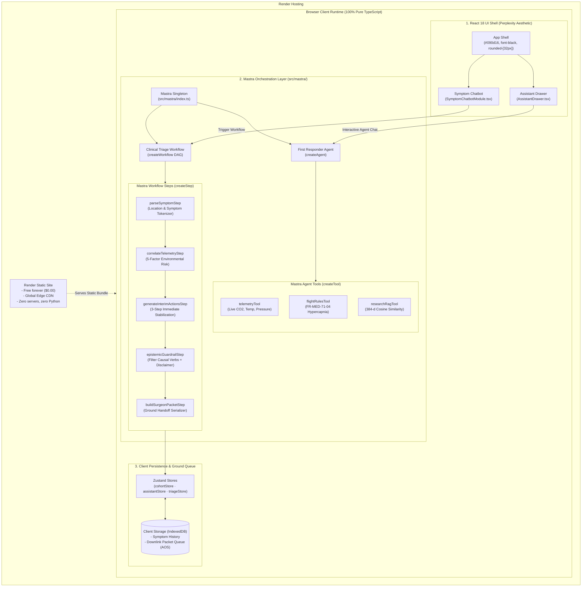

# SPEC-002: Zero-Backend Pure-TypeScript Architecture & Clinical Interim Triage

## Status: Approved Architecture Specification
## Target Platform: Client-Side Web (Vite + React 18 + Tailwind) / Render Static Site
## Core Framework: Mastra (`@mastra/core` + `zod`)
## Reference Implementation: `src/mastra/`, `src/features/triage/`, `src/features/symptoms/`

---

## 1. System Overview & Core Philosophy

HABITRACK operates as an offline-capable, **zero-backend, 100% Pure TypeScript clinical decision-support workstation** for long-duration human spaceflight (e.g. ISS Expedition 71, lunar/Mars transit). 

It eliminates all server-side dependencies (Python, FastAPI, Uvicorn, SQLite WAL server) and replaces them with:
1. **Mastra Agentic Orchestration Layer (`src/mastra/`)**: Type-safe Directed Acyclic Graph (DAG) workflows and onboard agent tools powered by `@mastra/core` and `zod`.
2. **First-Response Clinical Triage Advisor**: An onboard "quick-think" interim countermeasure advisor that assists astronauts immediately during Communication Loss (LOS) or while ground Flight Surgeons are unavailable.
3. **In-Browser Vector RAG Engine**: Pure TypeScript cosine similarity and BM25 token search over pre-computed 384-dimensional embeddings ([research_embeddings_seed.json](file:///D:/HabiTrack/data/research_embeddings_seed.json)) and NASA flight rules.
4. **Flexible Inference Execution**: Selectable between WebGPU in-browser LLMs (`@mlc-ai/web-llm`), direct client-to-Gemini 2.0 Flash Lite streaming, and deterministic extractive synthesis.
5. **Client Persistence**: `IndexedDB` / `localStorage` via Zustand `persist` for symptom reports, astronaut baseline calibrations, and ground handoff audit queues.
6. **Zero-Cost Edge Hosting**: Deploys as a 100% free Render Static Site with zero cold starts and instant CDN delivery.

---

## 2. System Architecture



---

## 3. The Clinical "First-Response Interim Advisor" Model

### 3.1 The Operational Problem in Deep Space
During spaceflight operations, ground communications experience periodic **Loss of Signal (LOS)** intervals or transmission propagation delays (up to 22 minutes one-way during Mars transit). When an astronaut experiences acute symptoms (e.g. headache, ocular irritation, dizziness), they cannot passively wait for Earth.

### 3.2 Operational Workflow: "Quick Think Before the Surgeon Arrives"

```
[Astronaut Input] "I have a throbbing headache and slight brain fog in Node 2."
                           │
                           ▼
[1. Instant Sensor Check] (ppCO2: 3,197 ppm [ELEVATED], Pressure: 758.2 mmHg, Humidity: 43.9%)
                           │
                           ▼
[2. Immediate Interim Plan] ("While awaiting Flight Surgeon review, execute these 3 steps immediately:")
       ├─ Step 1: Check your cabin ventilation diffuser fan (clears microgravity CO2 pockets).
       ├─ Step 2: Ingest 500 mL water with electrolytes (counteracts cephalic fluid shift).
       ├─ Step 3: Relocate from Node 2 to US Lab Destiny (higher air CFM turnover).
                           │
                           ▼
[3. NASA Flight Rule Latch] -> Latch FR-MED-71-04 (Cabin Hypercapnia Exposure Protocol).
                           │
                           ▼
[4. Ground Handoff Prep]    -> Serialize JSON clinical telemetry packet into IndexedDB queue for AOS downlink.
```

---

## 4. Mastra Codebase Integration Map

### 4.1 Directory Layout
```
D:\HabiTrack\src\mastra\
├── index.ts                         # Singleton Mastra container (export const mastra)
├── agents\
│   └── firstResponderAgent.ts       # Mastra Agent: Onboard First-Response Co-Pilot
├── workflows\
│   └── clinicalTriageWorkflow.ts   # Mastra Workflow: 5-step deterministic DAG
├── steps\
│   ├── parseSymptomStep.ts          # Step: Compartment detection & symptom parsing
│   ├── correlateTelemetryStep.ts    # Step: 5-factor environmental risk correlation
│   ├── generateInterimActionsStep.ts# Step: 3-step physical stabilization countermeasures
│   ├── epistemicGuardrailStep.ts    # Step: Non-causal phrasing & disclaimer filter
│   └── buildSurgeonPacketStep.ts    # Step: Flight surgeon ground handoff serializer
└── tools\
    ├── telemetryTool.ts             # Tool: Real-time environmental readings
    ├── flightRulesTool.ts           # Tool: NASA Flight Rules lookup (e.g. FR-MED-71-04)
    └── researchRagTool.ts           # Tool: 384-d vector embeddings retrieval
```

### 4.2 Primitive Responsibilities

| Mastra Primitive | Location | Specific Responsibility in HABITRACK |
| :--- | :--- | :--- |
| **`createTool`** | `src/mastra/tools/*.ts` | Exposes telemetry and NASA flight rule catalog entries to the conversational agent. |
| **`createStep`** | `src/mastra/steps/*.ts` | Type-safe Zod-validated pipeline steps for symptom classification, environmental correlation, interim physical countermeasure generation, and epistemic guardrails. |
| **`createWorkflow`** | `src/mastra/workflows/*.ts` | Chains the steps into a deterministic DAG (`.step().then().commit()`), guaranteeing immediate stabilization actions are calculated before ground contact. |
| **`createAgent`** | `src/mastra/agents/*.ts` | Conversational assistant configured with the "First-Response Interim Co-Pilot" persona. |
| **`Mastra`** | `src/mastra/index.ts` | The singleton application instance invoked by [SymptomChatbotModule.tsx](file:///D:/HabiTrack/src/features/symptoms/SymptomChatbotModule.tsx) and [AssistantDrawer.tsx](file:///D:/HabiTrack/src/components/AssistantDrawer.tsx). |

---

## 5. UI/UX Specifications (Perplexity Aesthetic)

In compliance with the project UI standards:
- **Containers**: Wrapped in `rounded-[32px]`, `border-white/10`, and deep `#090d16` background.
- **Typography**: Headings styled with `font-black uppercase tracking-wider text-xs`.
- **Interim Action Cards**: Interactive checkboxes allowing astronauts to mark off each stabilization action in real time.
- **Corroborated Telemetry HUD**: Displays real-time compartment $ppCO_2$, temp, and pressure indicators directly alongside recommendations.
- **Loss of Signal Badge**: Displays `QUEUED FOR AOS (Loss of Signal Active)` showing that clinical telemetry is packaged and awaiting ground downlink.

---

## 6. Deployment on Render

- **Service Type**: Render Static Site (Free Tier)
- **Build Command**: `npm run build`
- **Publish Directory**: `dist`
- **Routing**: Rewrites `/*` to `/index.html` (Vite SPA)
- **Cost**: **$0.00 / month**, zero server maintenance, zero cold starts, 100% client-side privacy.
