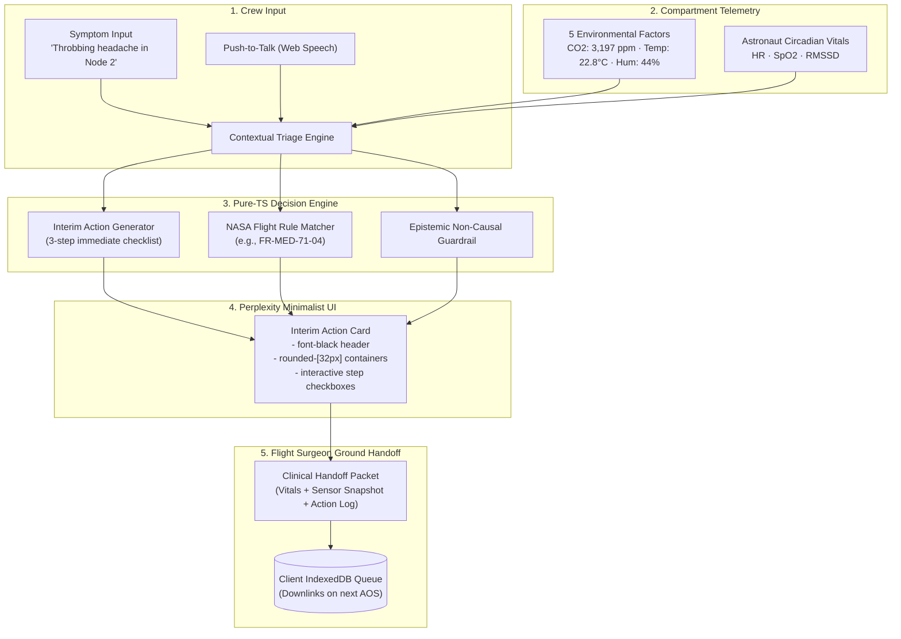

# SPEC-003: Clinical SI Diagnostic Chatbot ("First-Response Interim Advisor")

## Status: Approved Architecture Specification
## Target Platform: Client-Side TypeScript (Vite + React 18) / Render Static Site
## Reference Implementation: `src/features/triage/ContextualTriageAdapter.ts` & `src/features/symptoms/SymptomChatbotModule.tsx`

---

## 1. System Role & Operational Mission

During long-duration spaceflight (ISS expeditions, Lunar Gateway, and Mars transit), communication with Earth experiences **Loss of Signal (LOS)** intervals or transmission propagation delays (up to 22 minutes one-way).

The **Clinical SI Diagnostic Chatbot** acts as an **Onboard Interim First Responder**. It is explicitly designed **not** to diagnose autonomously or replace the flight surgeon, but to perform rapid **"quick-think" stabilization triage**:
> **"Correlate symptoms immediately with local compartment telemetry, prescribe physical interim countermeasures before the surgeon arrives, latch NASA flight rules, and prepare a structured handoff packet ready for ground downlink."**

---

## 2. Architecture & Dataflow

---

## 3. Clinical Triage Scenarios

### Scenario A: Cabin Hypercapnia & Cephalic Fluid Shift
- **Report**: *"Throbbing headache and brain fog in Node 2 (Harmony)."*
- **Telemetry Corroboration**: $ppCO_2 = 3,197\text{ ppm}$ (High), Cabin Pressure = $758.2\text{ mmHg}$.
- **Physiological Driver**: Microgravity cephalic fluid shift elevates intracranial pressure; $CO_2$ pockets form around astronaut's face due to lack of buoyancy.
- **Immediate Interim Actions**:
  1. Inspect sleep station / module ventilation diffuser exhaust fans for blockage.
  2. Drink 500 mL water with electrolytes to aid venous return.
  3. Relocate to US Lab Destiny (airflow turnover is 40% higher).
- **Latched Rule**: `FR-MED-71-04` *(Cabin Hypercapnia Exposure Protocol)*.

### Scenario B: Low-Humidity Ocular Irritation
- **Report**: *"Eyes are burning, dry, and stinging in Columbus."*
- **Telemetry Corroboration**: Relative Humidity = $38.2\%$ (Below nominal $40-60\%$), Air Velocity = $0.25\text{ m/s}$.
- **Immediate Interim Actions**:
  1. Instill preservative-free artificial tear drops.
  2. Reposition direct airflow duct away from facial line of sight.
  3. Verify no particulate debris in module air intake filter.
- **Latched Rule**: `FR-ECLSS-012` *(Cabin Humidity Excursion Protocol)*.

---

## 4. Implementation Phasing

1. **Phase 1**: Upgrade [ContextualTriageAdapter.ts](file:///D:/HabiTrack/src/features/triage/ContextualTriageAdapter.ts) with full typed contracts (`ClinicalTriageResponse`, `InterimCountermeasure`, `FlightSurgeonHandoffPacket`).
2. **Phase 2**: Redesign [SymptomChatbotModule.tsx](file:///D:/HabiTrack/src/features/symptoms/SymptomChatbotModule.tsx) following the Perplexity aesthetic: rounded-[32px] containers, font-black headings, interactive step checkboxes, and corroborated telemetry HUD badges.
3. **Phase 3**: Implement `triageStore.ts` using Zustand `persist` with `IndexedDB` to queue handoff packets for ground transmission when signal returns.
4. **Phase 4**: Integrate in-memory vector RAG search ([research_embeddings_seed.json](file:///D:/HabiTrack/data/research_embeddings_seed.json)) to cite NASA HRP flight medicine papers.
