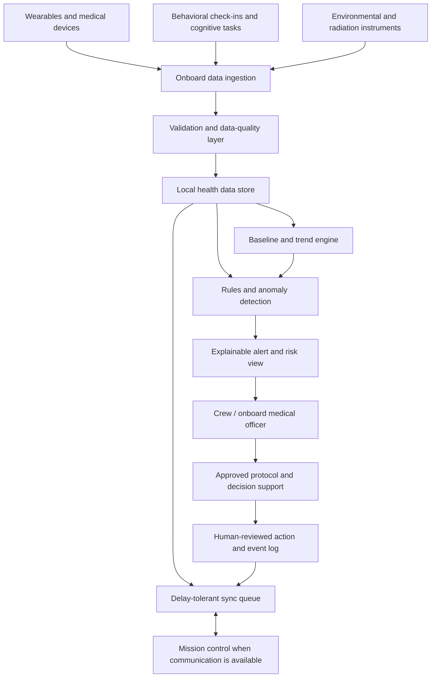

# NASA Human Health Monitoring for Space Missions
## Research Brief for NASA Space Apps Challenge

**Project theme:** Health Monitoring Software for Astronauts on Space Missions  
**Research date:** 8 November 2026  
**Primary source reviewed:** NASA Human Research Program (HRP) — https://www.nasa.gov/hrp/

---

## 1. Executive summary

NASA's Human Research Program (HRP) studies how spaceflight affects astronaut health and performance, then develops methods, technologies, and operational practices to reduce those risks. Its work spans ground laboratories, Earth-based analog missions, the International Space Station (ISS), and Artemis missions.

The central product opportunity is not simply a dashboard that displays heart rate, oxygen saturation, or temperature. A useful astronaut health system should help a crew and mission support team:

1. Collect reliable physiological, behavioral, environmental, and medical observations.
2. Detect meaningful changes from an astronaut's personal baseline.
3. Recognize combinations of signals that may indicate deteriorating health or mission performance.
4. Explain why an alert was raised and show the evidence behind it.
5. Recommend approved next steps and support onboard medical decision-making.
6. Continue to work when communication with Earth is delayed or unavailable.
7. Preserve data quality, privacy, traceability, and safe human oversight.

**Key design insight:** Deep-space health monitoring must be *Earth-independent by design*. It should support onboard awareness and decision-making rather than assume that a doctor on Earth is always available.

This brief synthesizes the NASA HRP homepage and its linked hazards, risks, research, data, and technical reference pages. It is a focused review of the HRP research ecosystem, not a crawl of every page on NASA.gov.

---

## 2. What NASA's Human Research Program does

NASA HRP develops methods to protect astronaut health and performance for missions to low Earth orbit, the Moon, Mars, and beyond. It studies both the human body and the human factors that influence mission performance.

The HRP homepage highlights these program areas:

- **Human Factors and Behavioral Performance (HFBP):** behavioral health, sleep, cognition, teamwork, and the ability to perform mission tasks.
- **Human Health Countermeasures (HHC):** understanding physiological effects and developing safeguards, including exercise, nutrition, pharmaceuticals, and rehabilitation.
- **Space Radiation:** understanding radiation exposure and reducing associated health risks.
- **Research Operations and Integration:** planning and integrating research across spaceflight, ground simulations, and other research platforms.
- **Exploration medical capability:** enabling crews to assess and respond to medical problems farther from Earth.

NASA's program is evidence-driven. It uses flight investigations, ground-based studies, analog environments, medical data, and research repositories. A student prototype should therefore distinguish between established NASA findings, proposed software features, and assumptions that still need validation.

Sources:
- https://www.nasa.gov/hrp/
- https://www.nasa.gov/hrp/about-hrp/
- https://www.nasa.gov/hrp/human-health-countermeasures/
- https://www.nasa.gov/hrp/human-factors-and-behavioral-performance/
- https://www.nasa.gov/hrp/radiation/

---

## 3. The five hazards of human spaceflight: RIDGE

NASA groups major spaceflight hazards under the acronym **RIDGE**. These hazards can interact and amplify one another; they should not be treated as five isolated dashboard widgets.

### 3.1 Radiation

**Why it matters**

Outside Earth's protective atmosphere and magnetic field, astronauts encounter ionizing radiation from sources including galactic cosmic rays and solar particle events. Radiation is not directly sensed by a person. Exposure can contribute to acute and long-term health risks, including cancer and degenerative effects.

**Monitoring and software implications**

- Ingest radiation measurements from suitable onboard instruments or dosimeters.
- Track cumulative exposure as well as changes in the radiation environment.
- Associate exposure records with time, location/mission phase, and instrument quality.
- Display exposure trends and operational alerts using mission-approved thresholds.
- Support protective procedures and shelter/mission guidance supplied by authorized sources.

**Important limitation:** A wearable vital-sign sensor cannot measure radiation dose. Radiation monitoring needs dedicated radiation instruments and validated dose models. A prototype should not invent radiation thresholds or claim to predict cancer.

NASA sources:
- https://www.nasa.gov/hrp/radiation/
- https://www.nasa.gov/hrp/hazard-space-radiation/
- https://www.nasa.gov/hrp/radiation/space-radiation-risks/
- https://www.nasa.gov/directorates/esdmd/hhp/space-radiation/

### 3.2 Isolation and confinement

**Why it matters**

Crews may spend months or years in small, isolated environments. Isolation, workload, interpersonal conflict, limited privacy, and distance from family can affect mood, stress, sleep, team cohesion, and performance.

**Monitoring and software implications**

- Provide brief, private self-reports for mood, stress, workload, and perceived fatigue.
- Track sleep and activity patterns where suitable sensors are available.
- Offer confidential journaling or structured check-ins.
- Identify sustained changes, not one-off emotional responses.
- Support team-level check-ins without turning the system into intrusive surveillance.
- Provide access to approved coping resources and crew support procedures.

**Important limitation:** Software should not diagnose depression or other psychiatric disorders from a mood score. Psychological data is sensitive and should have clear access controls.

NASA sources:
- https://www.nasa.gov/hrp/hazards/
- https://www.nasa.gov/hrp/human-factors-and-behavioral-performance/
- https://www.nasa.gov/reference/about-human-factors-and-behavioral-performance/

### 3.3 Distance from Earth

**Why it matters**

As missions travel farther from Earth, communication delays increase and resupply or emergency evacuation become harder. NASA notes that Mars communications can involve delays of up to roughly 20 minutes one-way. A crew cannot rely on immediate ground-based medical guidance.

**Monitoring and software implications**

- Make core monitoring, data storage, alerting, and medical reference functions available onboard.
- Prioritize alerts locally; do not wait for cloud connectivity.
- Store-and-forward data when communication becomes available.
- Provide concise medical summaries that can be transmitted efficiently.
- Support onboard medical officers and crew procedures with traceable decision support.
- Clearly distinguish local recommendations from remote expert guidance.

**This is one of the strongest differentiators for your project:** demonstrate an offline-first, delay-tolerant health system rather than a normal cloud dashboard.

NASA source:
- https://www.nasa.gov/humans-in-space/the-human-body-in-space/

### 3.4 Gravity fields

**Why it matters**

Microgravity and transitions between gravity environments affect multiple body systems. NASA describes concerns involving bone and muscle loss, cardiovascular adaptation, fluid shifts toward the head, vision changes, balance, sensorimotor function, and post-flight readaptation.

**Monitoring and software implications**

- Track heart rate and other available cardiovascular measurements over time.
- Record exercise sessions, adherence, and performance.
- Support periodic vision, balance, and functional assessments where included in the mission protocol.
- Track hydration-related observations and relevant medical measurements.
- Compare current values with personal baselines and mission-phase expectations.
- Present longitudinal trends rather than interpreting one reading in isolation.

**Important limitation:** Do not claim that a consumer wearable can directly measure bone density, intracranial pressure, or all causes of vision changes. These require appropriate clinical instruments and validated protocols.

NASA source:
- https://www.nasa.gov/humans-in-space/the-human-body-in-space/

### 3.5 Hostile and closed environments

**Why it matters**

A spacecraft is both a home and a complex machine. Air quality, temperature, humidity, noise, lighting, microbial contamination, and other environmental conditions can affect comfort, health, sleep, and performance. Spaceflight can also alter immune responses.

**Monitoring and software implications**

- Ingest spacecraft environmental telemetry from approved systems.
- Correlate environmental changes with symptoms or health observations.
- Track available temperature, humidity, air-quality, and microbial-monitoring records.
- Support symptom and exposure timelines.
- Flag possible shared environmental patterns for human review.

**Important limitation:** Environmental sensors and medical sensors measure different things. Do not infer a specific infection or toxic exposure from a correlation alone.

NASA source:
- https://www.nasa.gov/hrp/hazards/
- https://www.nasa.gov/humans-in-space/the-human-body-in-space/

---

## 4. Health and performance risks that matter to a monitoring system

NASA's risk material covers a broad range of physiological and behavioral risks. The following are especially relevant to software monitoring and decision support.

| Risk area | Why it matters | Potential software support |
|---|---|---|
| Cardiovascular adaptation | Spaceflight changes cardiovascular function and fluid distribution | Trend available vital signs; flag deviations from personal baseline |
| Bone and muscle loss | Reduced loading can affect bone and muscle | Exercise tracking, adherence, performance trends, scheduled assessments |
| Sensorimotor and vestibular changes | Balance, orientation, coordination, and movement can be affected | Guided functional tests and trend tracking |
| Vision / spaceflight-associated neuro-ocular concerns | Fluid shifts may be associated with ocular changes | Record vision symptoms and clinician-performed examination results |
| Immune changes | Spaceflight stressors may alter immune response and reactivate latent viruses | Track authorized laboratory results, symptoms, and longitudinal changes |
| Sleep loss and irregular schedules | Fatigue can affect health, cognition, and operational safety | Sleep/activity trends, fatigue check-ins, schedule context |
| Behavioral health | Isolation and stress can affect psychological well-being | Private check-ins, trends, support workflows |
| Teamwork and coordination | Team friction and communication problems can affect mission success | Carefully governed team check-ins and non-diagnostic trend summaries |
| In-mission medical events | A crew may need to assess and manage illness or injury without immediate Earth support | Medical event records, onboard protocols, decision-support workflow |
| Radiation exposure | Exposure is cumulative and not directly felt | Integrate dosimeter data and approved exposure models |

NASA risk overview:
- https://www.nasa.gov/hrp/risks/
- NASA Human Research Roadmap risk catalogue: https://humanresearchroadmap.nasa.gov/Risks/

The Human Research Roadmap is especially useful for going beyond a general overview. It lists specific risks and research areas, and should be explored when selecting a narrow problem for the challenge.

---

## 5. Existing NASA research and technologies to learn from

Do not present your project as if NASA has no health monitoring systems. NASA already conducts research and tests medical technologies. Your opportunity is to demonstrate a useful integration, workflow, or decision-support concept.

### 5.1 ARCHeR — Artemis Research for Crew Health & Readiness

NASA's ARCHeR study examines astronaut well-being, activity, sleep patterns, and interactions during Artemis missions. It uses actigraphy and behavioral performance surveys, with measurements before and after the mission and actigraphy during the mission.

**What to learn**
- Sleep and activity are relevant health/performance signals.
- Monitoring can include both sensor data and human-reported information.
- Pre-flight and post-flight measurements provide useful context for in-flight changes.
- Health and performance should be considered together.

Source: https://www.nasa.gov/reference/archer/

### 5.2 Tempus Pro

NASA describes Tempus Pro as a telemedicine device being evaluated for future space-based medical care. It can collect and integrate vital health data, provide medical imaging, and support telemedicine features that may help diagnose crew members in near real time.

**What to learn**
- Integrating different medical measurements is valuable.
- Medical imaging and device data can complement vital signs.
- A system should help structure a medical assessment, not merely show numbers.
- Compact, energy-efficient, versatile equipment matters for exploration missions.

Source: https://www.nasa.gov/reference/tempus-pro/

### 5.3 Standardized behavioral measurement

NASA research includes software-based measures of mood, cognitive function, mental and physical fatigue, sleep quality, and other behavioral indicators. Research plans include cognition tasks, self-report scales, actigraphy, audio journals, and operational performance measures.

**What to learn**
- Behavioral monitoring can be structured and repeatable.
- Multiple low-burden signals may provide more context than one questionnaire.
- A system should preserve the distinction between subjective self-report and objective sensor measurement.

Sources:
- https://humanresearchroadmap.nasa.gov/Tasks/task.aspx?i=1623
- https://humanresearchroadmap.nasa.gov/gaps/gap.aspx?i=747

### 5.4 NASA Life Sciences Portal

NASA's Life Sciences Portal provides access to human research data from spaceflight and ground-analog studies. It includes resources connected to the Life Sciences Data Archive and Lifetime Surveillance of Astronaut Health program.

**What to learn**
- NASA has a substantial research-data ecosystem.
- De-identified research data may be useful for understanding study variables and designing analysis.
- Dataset access, permissions, metadata, and study context matter.

Source: https://www.nasa.gov/hrp/nlsp/

### 5.5 NASA's ongoing HRP investigations

NASA's ongoing research page lists studies including:
- **Immune Biomarkers:** blood and saliva analysis to investigate immune changes.
- **Artemis II Standard Measures:** collecting standardized health information for research.
- **Venous Haemostasis:** studying blood flow and coagulation changes.
- **Zero T2:** investigating exercise and health/performance.
- **Altered Immunity:** examining immune-system changes using biological samples.
- **Omics Archive:** collecting biological samples to study long-duration spaceflight effects.
- **Spinal Health:** examining spinal changes and strategies to counter bone and muscle loss.
- **Tempus Pro:** evaluating integrated medical data and telemedicine capabilities.

Source: https://www.nasa.gov/hrp/ongoing-hrp-research/

---

## 6. What your software could actually build

### Recommended project direction

Build an **Astronaut Health and Mission Readiness System**: an onboard-first platform that combines health signals, behavioral check-ins, mission/environment context, and explainable risk alerts.

A compelling system should answer these questions:

- What is happening to this astronaut now?
- Is this different from their normal baseline?
- Is the change isolated or part of a developing pattern?
- Which other signals or mission conditions may be relevant?
- How urgent is the issue, and why?
- What approved next step should the crew consider?
- What information should be sent to mission control when communication is available?

### Suggested modules

#### A. Astronaut health profile and baseline
- Astronaut profile and mission phase.
- Personal baseline ranges derived from authorized pre-flight measurements.
- Medical history and medication information only when appropriate and permitted.
- Clear timestamps, units, source devices, and data-quality indicators.

#### B. Vital-sign and medical data ingestion
Potential inputs, depending on available hardware and datasets:
- Heart rate.
- Blood pressure.
- Oxygen saturation.
- Body temperature.
- Respiratory rate.
- ECG, if an appropriate device provides it.
- Medical imaging and laboratory results, when available.

Do not assume all these signals are continuously available in a real spacecraft. Label simulated inputs clearly in the prototype.

#### C. Behavioral health and sleep
- Sleep duration and regularity.
- Activity and rest patterns.
- Self-reported mood, stress, workload, and fatigue.
- Short cognitive-performance tasks.
- Private journal or check-in functionality.

#### D. Environmental and radiation context
- Spacecraft environmental telemetry, if available.
- Radiation readings from dedicated instruments or a clearly identified simulation.
- Mission phase and relevant event timeline.
- Correlation views that help a crew member investigate context without claiming causation.

#### E. Risk and anomaly detection
- Personal-baseline deviation detection.
- Configurable rules using approved or clearly labeled demonstration thresholds.
- Multi-signal trend detection.
- Data-quality and missing-sensor warnings.
- Explainable alert details: observed values, baseline, time window, contributing signals, and confidence/limitations.

#### F. Medical decision-support workflow
- Structured symptom and event intake.
- Approved procedure/reference library.
- Checklist-based support for the onboard medical officer.
- Recommendations linked to their source and version.
- Human confirmation before any medical action.
- Event notes and audit history.

#### G. Offline-first mission operations
- Local database and local inference/rules.
- Queue data for later transmission.
- Prioritize urgent summaries over bulk telemetry.
- Synchronize safely after connectivity returns.
- Detect duplicate, stale, missing, or out-of-order records.

#### H. Mission control view
- Crew health overview with role-based access.
- Alerts requiring review.
- Longitudinal trends.
- Data freshness and connectivity status.
- A concise medical summary that can be transmitted when a link is available.

---

## 7. Suggested architecture

### Architecture principles

1. **Edge-first:** essential monitoring must not depend on a cloud round trip.
2. **Graceful degradation:** the system should communicate when sensors, network links, or data sources are unavailable.
3. **Interoperability:** use documented data formats and preserve source metadata.
4. **Explainability:** every alert should show the measurements and logic that triggered it.
5. **Human-in-the-loop:** the software supports trained crew members; it does not autonomously diagnose or prescribe.
6. **Security and privacy:** protect sensitive health and psychological data with role-based access, encryption, and audit logs.
7. **Traceability:** retain timestamps, units, device/source identity, algorithm version, and alert history.

---

## 8. A realistic MVP for a Space Apps team

Avoid trying to solve all five hazards equally in the first version. A narrow, demonstrable workflow is more convincing than a large collection of unfinished modules.

### Recommended MVP: Early Detection of Astronaut Health and Readiness Changes

**Core user journey**

1. Select an astronaut and mission phase.
2. Load sample or simulated health, sleep, and activity data.
3. Establish a personal baseline.
4. Detect a meaningful deviation or multi-day trend.
5. Explain the alert in plain language.
6. Show a safe, predefined checklist or next-step reference.
7. Record the crew member's or medical officer's review.
8. Demonstrate that the system continues working offline and syncs later.

### MVP feature priority

| Priority | Feature | Why |
|---|---|---|
| P0 | Astronaut profile and personal baseline | Context makes readings meaningful |
| P0 | Time-series health dashboard | Shows current status and trends |
| P0 | Data validation and freshness indicators | Prevents misleading displays |
| P0 | Explainable alerts | Judges can understand why the system flagged a risk |
| P0 | Offline local operation | Directly addresses deep-space communication constraints |
| P1 | Sleep, activity, and fatigue check-ins | Connects physical and behavioral readiness |
| P1 | Medical event timeline | Helps reconstruct what happened |
| P1 | Mission-control sync simulation | Demonstrates delay-tolerant architecture |
| P2 | Radiation/environmental data integration | Valuable, but requires appropriate source data and instrumentation |
| P2 | Advanced AI prediction | Only after reliable data, validation, and explainable baselines exist |

### Suggested demo scenario

A crew member has several nights of reduced sleep, rising self-reported fatigue, and a decline in a short attention task.

The system:
- Detects a change relative to that astronaut's baseline.
- Shows the sleep, fatigue, and task-performance evidence.
- Explains that the combined pattern may warrant review; it does not diagnose a condition.
- Presents a predefined crew check-in or approved operational checklist.
- Logs the review locally.
- Queues a concise report for mission control when communication returns.

This scenario is realistic, demonstrable, and directly connected to NASA's behavioral health and performance research.

---

## 9. AI: where it helps and where it should not be trusted

AI can help with:
- Summarizing trends across time-series data.
- Prioritizing patterns for human review.
- Turning structured data into concise health-event summaries.
- Retrieving relevant, approved medical procedures.
- Explaining which observations contributed to an alert.
- Detecting unusual patterns after suitable validation.

AI should **not**:
- Invent medical thresholds.
- Diagnose a disease from incomplete data.
- prescribe medication or change dosage autonomously.
- Treat a correlation as proof of causation.
- Hide uncertainty or missing data.
- Generate an unverified emergency procedure.
- Replace the onboard medical officer or approved mission protocols.

**Best approach for a challenge prototype:** use deterministic, explainable rules for safety-critical alerts. Use AI for summarization and retrieval from a curated reference library, with citations and human review. Clearly label all demo data and simulated predictions.

---

## 10. Data strategy

### Potential data sources

1. **NASA Life Sciences Portal:** https://www.nasa.gov/hrp/nlsp/
   - Explore human research datasets and study metadata.
   - Check data-use conditions and access requirements.
2. **NASA Human Research Roadmap:** https://humanresearchroadmap.nasa.gov/
   - Explore risks, gaps, tasks, and evidence behind research priorities.
3. **NASA OSDR:** https://osdr.nasa.gov/
   - Explore biological and life-sciences datasets. Check each dataset's species, study design, variables, and relevance before using it.
4. **NASA HRP ongoing research:** https://www.nasa.gov/hrp/ongoing-hrp-research/
   - Identify investigations and measurements that inform feature design.
5. **Synthetic demonstration data**
   - Generate clearly labeled time-series data for heart rate, sleep, activity, fatigue, and mission events if real astronaut data is unavailable.

### Dataset checklist

Before using any dataset, record:
- Dataset title and source URL.
- Study purpose and population.
- Whether it contains astronaut, analog, animal, or cell data.
- Variables, units, sampling frequency, and missing values.
- Collection time and mission context.
- Data access and reuse restrictions.
- Whether it is suitable for training, testing, or only exploratory analysis.

**Critical:** An animal or cell dataset is not a direct substitute for human astronaut health data. Bed-rest analog data can inform microgravity-related research but is not identical to spaceflight. Do not train a medical prediction model on unrelated data and claim it is validated for astronauts.

---

## 11. Safety, validation, and ethics

A health-monitoring prototype should explicitly address the following:

- **No false certainty:** label uncertain, missing, simulated, or low-quality data.
- **Personal baselines:** avoid assuming one universal normal range fits every astronaut and mission phase.
- **Clinical validation:** any threshold or medical recommendation intended for real use requires appropriate expert validation.
- **Human authority:** alerts support decisions; trained personnel remain responsible for medical action.
- **Privacy:** mental health, medical, and performance data need carefully controlled access.
- **Cybersecurity:** protect device ingestion, local storage, synchronization, and audit logs.
- **Resilience:** test power loss, sensor failure, clock drift, communication delay, and conflicting records.
- **Explainability:** show why an alert occurred and what data was used.
- **Fairness and individual variation:** avoid interpreting differences between people as disease or poor performance.
- **Auditability:** preserve who reviewed an alert, what information was available, and which protocol version was used.

For a competition demo, state clearly that the software is a research prototype and not a certified medical device.

---

## 12. What could make your project stand out

Many teams may build a wearable dashboard. A stronger project demonstrates an operational capability that is especially relevant to deep-space missions.

### Differentiator 1: Personal-baseline intelligence
Instead of relying only on generic thresholds, learn each astronaut's baseline from approved pre-flight and in-flight observations. Show deviations with transparent evidence.

### Differentiator 2: Multi-signal risk context
Connect sleep, fatigue, activity, vital signs, mission phase, and environmental events. Show relationships as hypotheses for review, not as proven causes.

### Differentiator 3: Earth-independent operation
Demonstrate that alerts, local records, and approved reference material remain usable with no network. Show delayed synchronization after reconnection.

### Differentiator 4: Explainable medical event timeline
Combine measurements, symptoms, alerts, crew notes, and actions into one chronological record. This can help onboard review and later ground analysis.

### Differentiator 5: Crew-centered behavioral health
Include private, low-burden check-ins and fatigue awareness. Make privacy boundaries explicit and avoid turning the system into a crew-surveillance tool.

**Recommended positioning statement**

> An onboard-first astronaut health and readiness platform that detects meaningful changes from personal baselines, explains multi-signal risks, and supports crew decision-making even when communication with Earth is delayed.

---

## 13. Research gaps and questions worth investigating

These are promising areas to investigate, not claims that NASA has no existing work in them:

1. **Reliable health decisions with delayed ground support:** How can onboard systems present enough context for safe crew decisions when experts on Earth cannot respond immediately?
2. **Combining heterogeneous signals:** How should vital signs, sleep, self-reports, cognitive tests, radiation readings, and environmental telemetry be aligned and interpreted?
3. **Personalized baselines over changing mission phases:** How should a system adapt as an astronaut transitions between microgravity, lunar gravity, and Earth?
4. **Data quality under operational constraints:** How can software detect sensor dropout, motion artifacts, stale readings, clock drift, and inconsistent devices?
5. **Behavioral health with privacy:** How can systems identify when support may be needed without exposing sensitive personal reflections to the whole crew?
6. **Explainable alerts:** What evidence should accompany an alert so that an astronaut can judge its relevance quickly?
7. **Resource-constrained operation:** How can useful monitoring and decision support work with limited power, storage, bandwidth, and compute?
8. **Validation with limited astronaut data:** How can prototypes be evaluated responsibly when real astronaut datasets are small, restricted, or not representative of future missions?

Use the NASA Human Research Roadmap to identify specific documented gaps and tasks before describing any one of these as unresolved.

---

## 14. Suggested team research and development plan

### Phase 1 — Understand the problem
- Read the five hazards and risk pages.
- Select one primary risk and one supporting risk.
- Identify the astronaut, onboard medical officer, and mission-control user needs.
- Write a short problem statement and measurable success criteria.

### Phase 2 — Define evidence and data
- Find a relevant NASA study or dataset.
- Map each proposed input to its source, unit, frequency, and limitations.
- Decide which values are real, derived, or simulated.
- Define data-quality checks.

### Phase 3 — Design the system
- Draw the data-flow and offline-sync architecture.
- Define the alert explanation format.
- Design role-based access and audit history.
- Define what the software must never do.

### Phase 4 — Build and test
- Implement the smallest end-to-end scenario.
- Test normal, abnormal, missing, stale, and conflicting data.
- Simulate a communication blackout and reconnection.
- Ask a domain-informed reviewer to assess the medical language and workflow.

### Phase 5 — Present the value
- Start with the deep-space communication problem.
- Show a realistic astronaut scenario.
- Demonstrate detection, explanation, human review, and offline behavior.
- Explain what is based on NASA research and what is your team's proposed innovation.
- End with the mission benefit and limitations.

---

## 15. Official NASA source directory

### Core HRP pages
- HRP home: https://www.nasa.gov/hrp/
- About HRP: https://www.nasa.gov/hrp/about-hrp/
- Five hazards: https://www.nasa.gov/hrp/hazards/
- Risks of human spaceflight: https://www.nasa.gov/hrp/risks/
- Ongoing HRP research: https://www.nasa.gov/hrp/ongoing-hrp-research/
- Human Health Countermeasures: https://www.nasa.gov/hrp/human-health-countermeasures/
- Human Factors and Behavioral Performance: https://www.nasa.gov/hrp/human-factors-and-behavioral-performance/
- Space Radiation: https://www.nasa.gov/hrp/radiation/

### Specific research and technology
- The Human Body in Space: https://www.nasa.gov/humans-in-space/the-human-body-in-space/
- ARCHeR: https://www.nasa.gov/reference/archer/
- Tempus Pro: https://www.nasa.gov/reference/tempus-pro/
- HFBP risks: https://www.nasa.gov/hrp/human-factors-and-behavioral-performance/hfbp-risks/
- Space radiation risks: https://www.nasa.gov/hrp/radiation/space-radiation-risks/
- NASA Life Sciences Portal: https://www.nasa.gov/hrp/nlsp/
- Human Research Roadmap: https://humanresearchroadmap.nasa.gov/
- NASA Open Science Data Repository: https://osdr.nasa.gov/

---

## 16. Final recommendation

For a Space Apps project, prioritize **personal-baseline monitoring + explainable multi-signal alerts + offline-first operation + human-reviewed medical support**.

Do not attempt to build a complete autonomous astronaut doctor. That would be too broad and would create safety and validation problems.

Build one scenario exceptionally well. A sleep/fatigue/cognitive-readiness scenario is a strong starting point because NASA's ARCHeR and behavioral-measurement research provide a clear evidence base. If your team has access to appropriate physiological datasets and expertise, you can extend the prototype with vital-sign trends.

The strongest demo is one where the network disappears, the astronaut's health pattern changes, the system explains what it has detected, and the crew can still review the evidence and follow an approved workflow.

---

## Research scope and disclaimer

This document synthesizes publicly accessible NASA HRP pages and selected linked NASA research references available on 8 November 2026. It is not a complete review of every NASA publication, dataset, technical standard, or medical protocol. NASA research and operational requirements may change. Verify source pages, dataset licenses, current study status, and any medical thresholds before implementation. This is project research, not clinical guidance.
